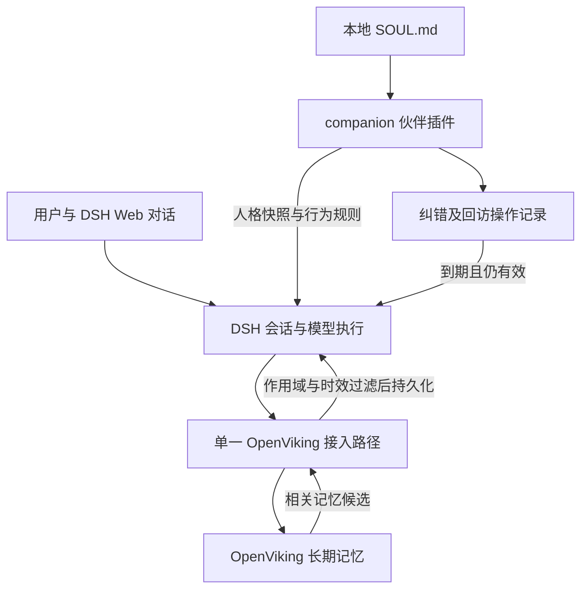

# 基于 OpenViking 的 DSH 拟人化伙伴方案与迭代记录（v0.1）

> 本文使命与轮次范围：设计并交付以 Soul 定义人格、OpenViking 管理长期记忆的轻量 DSH 伙伴插件，补齐状态时效、纠错控制和约定回访。
> 完成：否。
> 状态：已废弃。
> 废弃记录：2026-11-11，用户明确不接受 OpenViking 本体的 AGPL-3.0 许可证；原轮次未实施、未验收，无实现 commit。
> 更新日期：2026-11-12（Asia/Shanghai；本次仅整理归档）。
> 完成日期：—。
> 实现 commit：不适用：未实施，只有方案文档。
> 归档：已归档，2026-11-12；见[归档索引](README.md)。
> 当前结论：不再实施 OpenViking 路线。2026-11-12 用户选定 Hindsight，见 [新接入方案](../companion/hindsight-companion-plan.md)。下文技术设计保留作历史参考，不授权继续安装或实施。
> 验收基线：尚未验收。
> 关联文档：[插件调研](../companion/virtual-companion-plugin-research.md)、[Agent 研究](../companion/virtual-companion-agent-research.md)、[方案模板](../plan-template.md)、[测试方案](../testing-plan.md)、[环境输入](../configuration-v2.md)。

## 1. 结论摘要

**当前结论：本轮已废弃，完成为否。以下范围和技术选择为原草案记录；仅通用伙伴设计可供后续重新评估。**

- **要解决的问题**：伙伴换会话后仍记得用户和共同经历，保持稳定人格，能更正错误认知，并在约定时间延续话题。
- **采用的方案**：本地 `SOUL.md` 是人格与表达的权威来源；OpenViking 是唯一长期记忆后端；拟新增 `@mbda9091/companion` 管理伙伴会话、上下文规则、记忆控制和回访执行。
- **本轮边界**：单用户、单伙伴、Linux Web、文本对话。关系连续性和阶段状态通过记忆策略实现，不建立独立关系引擎或情绪引擎。主动性只做用户明确约定的回访。
- **依赖取舍**：伙伴插件使用 TypeScript、Node 内置能力及 DSH 宿主服务；接受 OpenViking 独立服务及其模型、索引依赖，不再要求整个系统纯 JS 或纯本地 MD。
- **当前进展**：用户已认可职责方向；本文具体接口、默认值和交付范围为首版提案。尚无实现、安装或运行验收。
- **下一步**：不再执行本轮 M1–M5；按用户后续选择进入 [Hindsight 接入方案](../companion/hindsight-companion-plan.md)。

## 2. 范围

### 2.1 目标

- G1：新建、恢复和压缩后的伙伴会话保持同一人格；修改人格不会无记录地改变进行中的会话。
- G2：跨会话召回明确偏好、共同经历和有效约定，区分即时状态、阶段状态与长期事实。
- G3：用户可查看、更正、更新、遗忘或禁止记忆某项内容，并获得准确的执行结果。
- G4：对用户明确同意的回访，在指定时间窗内触发一次伙伴回复；取消、过期、重启和重复事件不造成重复发送。
- G5：OpenViking 暂时不可用时仍能进行有固定人格的普通对话，记忆写入与回访的失败可见、可恢复。
- G6：模型实际看到的人格与记忆能从已提交的 DSH session event 重建；开发、测试与日常数据隔离。

### 2.2 非目标与延期项

| 事项 | 本轮处理 | 原因或后续触发条件 |
|---|---|---|
| QQ、微信、B 站等平台适配 | 延期 | 先验证 DSH Web 内的伙伴体验；以后独立接渠道 |
| 自发找话题、刷平台、日记驱动联系 | 延期 | 需要独立评估动机、打扰和成本；不扩大约定回访范围 |
| 语音、形象、表情动画 | 不做 | 不影响本轮人格和记忆闭环 |
| 人格自动演化、亲密度分数、模拟生理需求 | 不做 | 优先使用具体经历、偏好与约定解释行为 |
| 多用户、多伙伴、群聊身份映射 | 延期 | 第一版用固定伙伴身份和专用记忆作用域 |
| 自建向量库、记忆抽取模型、知识图谱界面 | 不做 | 复用 OpenViking；不重复建设后端 |
| 历史会话全量导入 | 不做 | 第一版只捕获启用后的伙伴会话 |
| Windows/macOS、Desktop、DSH 进程退出后的唤醒 | 延期 | 本轮仅承诺 Linux Web 在线运行；不引入外部调度服务 |
| 从历史日志和备份彻底擦除全部个人数据 | 不做 | “从伙伴记忆遗忘”有明确范围；彻底擦除需独立数据生命周期方案 |

### 2.3 适用场景与协作边界

- 拟新增插件目录 `companion/`，包名 `@mbda9091/companion`，loader 行 `companion`，均为待实现名称。
- 首轮 `dsh.targets` 拟声明 `surfaces: [web]`、`platforms: [linux]`。DSH 精确匹配仓库 `0.2.2-rc.1`，Cordis `4.1.0`，使用普通 Node 24；具体 Node 小版本在 M1 固定。
- OpenViking 服务单独部署；插件不静默安装、升级或管理其进程。服务端与官方 DSH 插件版本在 M1 固定，记录 commit/镜像摘要与配置摘要，不使用浮动 `latest` 作为验收基线。
- 使用专用伙伴 profile 和独立 OpenViking 用户空间。不能按当前 Git 仓库动态改变伙伴身份，也不能与编码助手共享默认记忆空间。
- 完成定义：M1–M5 出口满足、A1–A12 全部通过，Linux Web 真实验收及人工对话结果分别有记录，实现 commit 与验收基线完成对账。其他平台不作为本轮完成条件。

## 3. 现状与问题

以下为 2026-11-11 读取的上游文档事实，不代表本仓库已经集成或验证。

| 对象 | 已有能力 | 对本方案的影响 | 依据 |
|---|---|---|---|
| OpenViking 记忆 | 用户画像、偏好、人物、事件、identity、soul、自定义记忆类型 | 足以承载关系事实与阶段状态；须控制 identity/soul 与本地人格的冲突 | [Context Types](https://docs.openviking.ai/en/concepts/02-context-types) |
| OpenViking 会话 | 提交后异步抽取、合并与更新，生成 `memory_diff.json` | 接受任务不等于更新完成；必须跟踪结果及处理更正顺序 | [Session Management](https://docs.openviking.ai/en/concepts/08-session) |
| 官方 DSH 插件 | 自动召回、会话捕获、MCP 工具与技能接入，要求可访问服务端 | 优先复用，但控制扩展点、过滤顺序和重放一致性尚未验证 | [插件 README](https://github.com/volcengine/OpenViking/tree/main/examples/dsh-memory-plugin) |
| 服务端与适配器 | 本体包含 Python 与原生组件，DSH 插件为 JS | 伙伴插件轻量不等于整个系统无服务依赖 | [服务端清单](https://github.com/volcengine/OpenViking/blob/main/pyproject.toml)、[插件清单](https://github.com/volcengine/OpenViking/blob/main/examples/dsh-memory-plugin/package.json) |
| 本仓库 | 已有构建、隔离 profile、L1–L5 和 tarball 验收框架 | 复用现有入口；新增 Host-only 能力契约，不能以加载成功代替能力验收 | [仓库约定](../../AGENTS.md)、[测试方案](../testing-plan.md) |

待验证假设：官方插件能否只对伙伴会话生效；能否禁用人格抽取和未受控写入；是否允许在模型可见前过滤被遗忘内容；是否把召回结果持久化到合法 session event；DSH 是否提供可恢复的回访入队接口。这些均是 M1 检查项，不视为现有接口承诺。

## 4. 具体方案

### 4.1 总体设计与职责



| 部分 | 职责与契约 | 本轮处理 |
|---|---|---|
| DSH | 模型执行、会话事实日志、工具结果、用户审批和 Web 展示 | 复用，不修改核心 |
| `SOUL.md` | 身份、价值观、偏好、表达方式、分歧处理及具体对话示例 | 拟新增模板；实际个人文件放运行目录，不入库 |
| OpenViking | 长期记忆、关系事件、阶段状态、检索和整理 | 复用独立服务，不建立第二份记忆正文库 |
| OpenViking 接入路径 | 捕获、召回、提交与任务跟踪；接受伙伴作用域和控制规则 | 首选官方插件；M1 决定是否需要最小适配 |
| `companion` | 人格加载、有效性规则、纠错流程、约定回访和状态呈现 | 拟新增 Host 插件；本轮先用会话工具结果展示 |
| 本地操作记录 | 纠错版本、禁止记忆标记、待办回访、投递状态和失败重试 | 拟新增可恢复操作日志；不存完整长期记忆副本 |

**只有一条捕获和召回路径。** 若官方插件满足契约，伙伴插件只做协调；若不能在召回、写入或捕获前施加必要控制，则关闭对应官方路径，由包内适配层通过公开 HTTP API 实现该部分，不能两边同时工作。不得依赖监听器偶然的注册顺序实现过滤。M1 记录唯一选定的组合与版本；必要时向上游提交扩展点需求，但不以等待上游作为隐含完成条件。

本地操作记录允许 JSON/JSONL，属于执行控制元数据；长期事实仍由 OpenViking 保存。模型看到的操作结论必须另有已提交的合法 session event，不能只来自本地日志。

### 4.2 人格和上下文规则

`SOUL.md` 是人格内容的唯一权威来源，第一版只允许用户编辑，模型不自动写回。内容包括身份与自我介绍、稳定偏好、表达规则、如何回应情绪、如何提出异议，以及正反对话示例；不把用户临时情绪或共同经历塞进 Soul。

新伙伴会话读取 Soul，保存版本哈希及实际正文快照。默认会话内冻结；文件修改在新会话生效。恢复会话读取原快照；压缩后仍须能重建。缺失、超预算或不可读时明确报错，不静默使用默认人格。持久化方式必须使用 DSH 已支持的事件及提示扩展机制；具体 API 在 M1 核对，不自造 session event 类型。

上下文按下述语义处理，不整体替换宿主系统提示：

1. 宿主规则与用户明确的控制操作不能被 Soul 或召回内容覆盖。
2. Soul 管人格和表达；用户当前明确表达优先于关于用户的旧记忆。
3. 当前会话保留即时状态，阶段记忆只在有效期和适用范围内生效。
4. 检索内容是有来源、可能过时的资料，不具有新增系统指令的权限。

OpenViking 的 identity/soul 自动抽取与注入在本方案中关闭或排除；相关配置是否可用由 M1 验证。禁用失败时不启用自动捕获，不能让两套人格并行演化。

### 4.3 关系、阶段状态与记忆契约

不另建关系引擎。共同经历、称呼、约定、未完话题和状态变化存入 OpenViking。下面是拟新增的应用层逻辑字段，具体映射为自定义类型或 Markdown 元数据由 M1 验证，不能假设均是上游原生字段。

| 字段 | 用途 |
|---|---|
| `id / revision / scope` | 稳定标识、版本、所属伙伴空间 |
| `kind` | 偏好、事件、阶段状态、约定等分类 |
| `sourceSession / sourceEvent` | 指向已提交的对话证据；外部证据另标来源 |
| `assertion` | 区分用户明确陈述与模型推断；推断不作为确定事实回复 |
| `observedAt / validFrom / validUntil` | 观察时间和有效期；未知结束时间不伪造 |
| `status / supersedes` | 有效、被替代、取消或过期及其关联 |

处理原则：

- “现在很烦”默认留在当前会话，不自动提炼成永久性格。
- “这周准备面试”属于阶段状态；记录时间范围，超过范围不作为当前事实。
- “不喜欢连续追问”可作为长期偏好；后续明确更正取代旧值。
- “周五晚上问我结果”同时产生事件记忆和可执行回访记录。记忆描述事实，回访记录承担调度状态，两者以 ID 关联。
- 阶段状态缺少可判断的期限时只作为“当时如此”的历史信息，不按当前状态直接注入。
- 不自动推断亲密度等级，不把助手自行编造的经历提炼为共同事实。

召回须在模型可见前完成空间、禁止记忆标记、版本和时效过滤，再按预算持久化实际选中的正文及来源。过期内容可以用于历史回顾，但明确其时间语义。不要求简单关键词过滤解决所有语义冲突；无法可靠判断时降低为待确认资料。

### 4.4 纠错、遗忘与写入顺序

| 用户意图 | 操作语义 | 成功条件 |
|---|---|---|
| “你记错了” | 更正错误命题，替代旧版本 | 后端变更完成、回读正确、旧版本召回失效 |
| “以前如此，现在变了” | 保留历史，记录新状态和生效时间 | 当前检索采用新值，历史查询仍可解释变化 |
| “忘记这件事” | 删除作用域内可定位的派生记忆，撤销相关回访，阻止从已知旧来源再次提取 | 范围内删除和过滤生效；保留范围明确可见 |
| “这件事不要记” | 对明确内容/来源设置禁止提取规则 | 当前捕获受控，后续提取及召回均受控 |

每次控制操作带操作 ID、目标版本和来源。先提交用户指令及本地控制状态，再执行后端任务并等待完成、回读验证，最后记录结果；期间旧内容立即隔离，不等待后端完成才停止使用。并发更新采用版本检查和按作用域排序，冲突时重新读取，不盲目覆盖。

“已接受”“处理中”“已完成”“失败/待重试”分别展示。后端超时或返回 accepted 不得回答“已经忘掉了”。旧的异步抽取可能晚于更正完成，必须取消、隔离或在完成后核对并修复，不能让它重新覆盖新值。

遗忘范围包括伙伴长期记忆、相关召回缓存、待回访记录和受控提取来源；不声称删除 DSH 原始会话、OpenViking 归档或备份。已进入当前上下文的内容无法仅靠删库消除，需要追加纠正/禁止使用指令；若用户要求后续上下文不再包含原文，则切换到不携带该内容的新会话。禁止记忆标记只保存最少定位信息，不另存被遗忘正文；无法可靠定位的语义范围需要一次澄清。

### 4.5 主动性：只交付约定回访

用户明确提出或接受回访后，插件保存回访 ID、来源事件、主题记忆 ID、目标伙伴会话、时区、到期时间、最晚时间和状态。模糊时间先澄清；不自动把普通事件都变成通知。

拟定状态流：`scheduled → due → queued → delivered`，另有 `cancelled / expired / failed / uncertain`。生成回复前再次检查取消状态、事件是否仍有效、用户是否已经回答、会话是否忙碌和免打扰窗口。无有效话题则取消，不能为完成指标强行发消息。

- 默认关闭主动回访；启用后仅处理明确授权的约定。默认每天最多 1 次，发送间隔至少 6 小时；具体默认值为本方案提案。
- DSH 运行期间使用可清理计时器，重启时恢复未完成记录，不轮询 agent 状态。已过最晚时间直接过期，不集中补发。
- 用户正在发言或模型正在回复时排队，结束后重查；新的用户消息可使旧回访失效。
- 只在绑定的 Web 会话内形成持久的伙伴回复，浏览器关闭不等于已读；不承诺桌面通知或离线推送。
- 使用回访 ID 作为幂等键。若宿主缺少幂等入队，重启后先核对目标会话记录；无法判断是否发送时标 `uncertain`，不盲目重发。不能仅凭本地标记宣称严格 exactly-once。
- `delivered` 表示最终回复已经持久化，不等于用户已读。调度唤醒是带来源的系统上下文，不伪造用户发言，也不作为用户新事实重新抽取。

DSH 入队、取消及关联结果的真实接口在 M1 核查。若不具备可接受的恢复语义，M4 保持未完成，不能把“生成了一条待发送文本”算成主动性已交付。

### 4.6 接口、配置与目录

以下全部为拟新增，名称不是现有可调用工具。

| 接口 | 输入与结果 |
|---|---|
| `companion_memory` | `inspect / correct / update / forget / exclude / status`；返回来源、范围、任务状态与验证结果 |
| `companion_followup` | `schedule / list / cancel`；返回已解析的时间、目标及回访状态 |
| `companion_status` | 当前 Soul 版本、记忆可用性、处理队列和回访开关 |

伙伴会话内不同时暴露能绕过控制层的原始记忆写入工具；使用宿主 restrict/guard 限制，不能只靠 Prompt 劝阻。只读检索也必须满足作用域和禁止记忆过滤。

拟新增 `Config`：

| 配置 | 默认/要求 |
|---|---|
| `soulPath`、`dataDir` | 显式配置，使用 profile 外可备份的专用运行目录 |
| `companionId` | 显式稳定标识，不从 cwd 推断 |
| `memoryScope` | 显式绑定服务端身份/空间，映射经 M1 核实 |
| `soulMaxBytes` | 16 KiB；超限报错，不截断人格 |
| `recallMaxTokens` | 约 2000 tokens 的初始预算，计量方式在 M1 固定 |
| `memoryTimeoutMs` | 3000；只限制前台召回等待，不等同取消后台任务 |
| `followupEnabled` | `false` |
| `timezone`、`activeWindow` | 启用回访时必填，避免猜测本地时间和作息 |
| `followupDailyLimit`、`followupMinIntervalMinutes` | `1`、`360` |

服务地址和凭据使用选定接入路径的既有配置机制；不在伙伴插件再维护一套重复密钥。上游路径不足时才在 M1 定义显式环境变量引用，凭据不写入仓库或模型上下文。

拟新增源码结构：

```text
companion/
├── src/index.ts           # Host 注册及释放
├── src/targets.ts         # 仓库标准场景守卫
├── src/soul.ts            # 人格快照
├── src/memory.ts          # 应用层策略及选定的后端适配
├── src/control.ts         # 纠错与禁止记忆操作
├── src/followup.ts        # 可恢复回访
├── templates/SOUL.md      # 无个人信息的模板
├── package.json / tsconfig.json / cordis.patch.yml
├── locale/en.json / locale/zh.json / icon.svg
└── README.md
```

实际人格、队列、操作日志与凭据不放进插件安装目录或源码仓库。运行目录访问应限制在配置根内，写入原子化；操作日志保留最少必要信息。第一版不增加独立管理面板，通过对话工具查看状态，后续 UI 独立评估。

### 4.7 异常、兼容与回退

- OpenViking 不可用：用会话中已持久化的 Soul 和上下文继续对话，明确当前无法检索/保存；不把未落盘事实报告为已记住，不建立永久本地备用记忆库。
- 需要补交的会话只保存事件引用和处理游标；恢复后从已提交事件读取，先应用控制规则再捕获。记录幂等范围，避免重复提交。
- 纠错未完成：维持旧内容隔离，暂停依赖相关记忆的回访；重试预算耗尽后展示失败原因，不无限循环。
- 模型看到的内容必须持久化；投影只保存可由会话事件重建的派生状态，忽略事件时返回原引用。缓存失效或重启不得改变同一历史回合的输入。
- Host apply 首先执行场景守卫；注册、计时器和外部订阅使用 effect/disposer。不覆盖全局 `AGENTS.md` 或已有 profile 的完整配置。
- 首次启用在新的专用 profile 和空记忆空间验证；既有会话不自动导入。外部安装通过仓库现有入口显式指定 profile，服务准备与官方包安装另行记录，不静默捆绑下载。
- 回退先停回访与捕获，再停伙伴插件及选定接入路径；保留数据供用户检查。人格可恢复旧文件，新会话采用旧版本；已经写入的后端记忆不会因卸载自动撤销，按变更记录单独恢复。

### 4.8 验证设计

| 验收项 | 目标 | 场景与预期 | 验证方式与边界 |
|---|---|---|---|
| A1 人格连续 | G1/G6 | 新会话、恢复、压缩后同版本人格可重建；编辑只影响新会话 | L1–L3 + 真实 DSH 会话 |
| A2 记忆闭环 | G2 | 说出明确偏好，后台完成后新会话准确召回且有来源 | 真实 OpenViking 与模型；模拟仅测协议 |
| A3 状态时效 | G2 | 即时情绪不变成长期性格；到期状态只作历史 | 固定时钟用例 + 真实抽取样本 |
| A4 更正竞态 | G3 | 更正完成后旧任务迟到、重启或重试不恢复旧值 | 故障注入 + 真实后端回读 |
| A5 遗忘边界 | G3 | 已知来源不再被提取/召回，相关回访撤销；界面准确说明保留范围 | 真实后端、历史回放和当前上下文检查 |
| A6 作用域 | G2/G6 | 编码会话不被捕获，其他空间不能召回；绕过写入被拒绝 | 双空间隔离测试 |
| A7 回访生命周期 | G4 | 到期一次回复；取消、用户已回答、过期、静默期不误发 | 固定时钟 + Linux Web 真实会话 |
| A8 恢复与并发 | G4/G6 | 在入队/生成/提交边界中断，恢复不盲目重发、不插入忙碌回合 | 故障注入，检查会话事件与操作记录 |
| A9 故障降级 | G5 | 断网、超时、任务失败时正常聊天，写入状态不谎报；恢复按顺序补交 | 模拟与真实服务重启 |
| A10 输入可重建 | G6 | 人格、召回正文、纠错和调度输入均可从日志重建；无未知事件 | 真实日志复开、重放与压缩验证 |
| A11 打包交付 | G5/G6 | tarball 含运行资源；干净 profile 实际执行能力 | build/check、L1–L4、固定 tarball 能力适配器 |
| A12 拟人体验 | G1/G2/G4 | 同一人格在日常聊天、分歧、情绪、回忆和回访中保持一致 | 至少 20 组跨会话脚本 + 用户人工评价，不以关键词命中替代 |

已有入口：`node scripts/dev.mjs build --check`、`build`、`test`、`l4`、`l5`、`pack`、`verify-artifacts`。为本 Host-only 插件新增能力契约及适配器是 M2/M5 的必需工作；未知包被拒绝不能绕过。L5 验证 Web 中真实消息、状态及交互，不因没有自定义 UI 而跳过本轮关键 Web 行为。

真实验证使用隔离 profile、合成用户资料和专用 OpenViking 数据空间。报告拟保存在 `.tmp/companion/`，记录宿主、Node、插件、服务端、模型与配置摘要；临时报告可能被清理，提交稳定的脱敏摘要。API 密钥、完整个人记忆不进入报告。性能记录召回时延、后台整理耗时及模型用量；3 秒前台等待预算不等于端到端回复承诺。

## 5. 里程碑

2026-11-11：M1–M5 全部取消、不再实施；下表保留原出口条件，完成均为否，验收未执行。

| 阶段 | 交付内容 | 前置依赖 | 出口条件 | 完成 | 当前状态 | 实现 commit | 验收证据 |
|---|---|---|---|---|---|---|---|
| M1 | 固定版本、官方适配器契约实验、唯一集成路径 | 隔离服务与模型配置 | 作用域、人格排除、过滤、重放、入队和模型成本边界有真实结论；更新 Q1–Q5 | 否 | 已取消 | 不适用：未实施 | 未执行 |
| M2 | 插件骨架、Soul、单一记忆链路、Host-only 能力适配器 | M1 | A1/A2/A6/A10 基础通过 | 否 | 已取消 | 不适用：未实施 | 未执行 |
| M3 | 时效策略、纠错、遗忘、故障恢复 | M2 | A3–A6/A9 通过，真实迟到抽取验证完成 | 否 | 已取消 | 不适用：未实施 | 未执行 |
| M4 | 约定回访、取消、频率与重启恢复 | M3 | A7/A8 通过，真实 Web 会话收到持久回复 | 否 | 已取消 | 不适用：未实施 | 未执行 |
| M5 | 文档、固定产物及人工体验验收 | M2–M4 | A1–A12 全部对账；commit、版本和报告齐全 | 否 | 已取消 | 不适用：未实施 | 未执行 |

M1 发现上游能力不足时，先修订集成路径和工作量，再进入 M2；不得把能力缺口隐藏为“以后优化”。

## 6. 决策记录

D8（2026-11-11，已定）：因用户不接受 AGPL-3.0，废弃 OpenViking 实施路线。D1 中的后端选择失效，D2–D7 不再构成本轮实施任务；可复用设计须在后续方案重新确认。

| ID | 决策与理由 | 替代方案 | 日期 | 状态与关联 |
|---|---|---|---|---|
| D1 | Soul 管人格和表达，OpenViking 管长期记忆 | 独立人格引擎或自建记忆库，首版收益不足 | 2026-11-11 | 已定方向，来自用户讨论 |
| D2 | 关系和阶段状态使用记忆类型与有效性规则 | 另建关系/情绪系统，会增加双份状态 | 2026-11-11 | 已定方向；字段提议中，§4.3 |
| D3 | 本地 Soul 唯一权威、会话内冻结、禁止自动人格改写 | 两套 soul 同步，冲突与漂移更难解释 | 2026-11-11 | 提议中，§4.2 |
| D4 | 官方适配优先，必要时最小适配，每条数据流只有一个所有者 | 两个插件重复捕获/召回，无法保证顺序和控制 | 2026-11-11 | 提议中，M1 决定具体路径 |
| D5 | 首版主动性仅约定回访，默认关闭 | 无目的周期唤醒，难以评估打扰和价值 | 2026-11-11 | 提议中，§4.5 |
| D6 | 专用 Linux Web profile、单伙伴空间 | 多渠道多身份同时建设，增加身份与权限复杂度 | 2026-11-11 | 提议中，§2 |
| D7 | 纠错与回访保留执行日志，长期记忆正文不双写 | 所有执行状态交给语义记忆，不利于幂等和崩溃恢复 | 2026-11-11 | 提议中，§4.1/4.4 |

## 7. 风险与开放问题

本轮废弃后，下列风险与问题均停止跟进；保留未验证事实，不能据此记为已解决。通用问题移交替代选型重新评估。

### 7.1 风险

| ID | 风险与触发条件 | 影响 | 应对与验证 | 状态 |
|---|---|---|---|---|
| R1 | 官方插件缺乏必要控制扩展点 | 纠错和作用域只能依赖提示，不能兑现 | M1 检查源码及真实数据流，必要时替换对应接入路径 | 待验证 |
| R2 | 旧异步任务在更正后完成 | 错误记忆复活 | 版本、来源屏蔽与完成后核对；A4/A5 | 待验证 |
| R3 | 自动抽取把推断、临时情绪或助手虚构当事实 | 人格漂移、错误关系认知 | 来源与断言类型、抽取模板及固定样本；A3/A12 | 待验证 |
| R4 | 回访发送与本地状态非原子 | 重复或漏发 | 持久幂等标识、结果核对、不确定状态；A8 | 待验证 |
| R5 | 记忆整理成本、延迟高于预期 | 聊天变慢、使用费用不透明 | 限制前台预算、记录后台用量，不把长文工具输出全量捕获 | 待测量 |
| R6 | 外部内容混入人格或跨空间召回 | 行为被污染、资料串用 | 固定作用域，召回作为数据，受控工具；A6/A10 | 待验证 |

### 7.2 开放问题

| ID | 问题 | 影响阶段 | 解决方式与时点 | 当前结论 |
|---|---|---|---|---|
| Q1 | 哪组 OpenViking 服务端/官方插件版本兼容 DSH 0.2.2-rc.1？ | M1/M2 | 固定版本、读源码并真实安装验证 | 未决；宽版本声明不等于已验收 |
| Q2 | 捕获/召回能否按伙伴空间隔离并禁用 identity/soul？ | M1/M2 | 验证配置、工具绕过与过滤先后，选择唯一适配路径 | 未决 |
| Q3 | 自定义时效、来源字段以及禁止旧来源重抽取如何实现？ | M1/M3 | 自定义模板和异步竞态实验；不足则控制捕获和写入 | 未决 |
| Q4 | DSH 的合法人格快照、召回持久化与回访入队接口是什么？ | M1/M2/M4 | 核对 workspace 精确版本类型与实现，验证重放及恢复 | 未决；不预造 API |
| Q5 | 删除派生记忆后，哪些归档/缓存仍存在，如何阻止回流？ | M1/M3 | 枚举真实数据路径与检索接口，制定范围内验证 | 未决；不承诺全量数据擦除 |
| Q6 | 伙伴具体身份、风格、作息和回访时区？ | M5 人工体验 | 实现阶段提供可编辑模板；实际使用时由用户填写 | 不阻塞技术验证，测试使用合成角色 |

## 8. 验收状态

> 截至：2026-11-11。验收对象：尚无插件实现与服务部署基线。
> 环境：仅文档编写；目标为 Linux Web，DSH 0.2.2-rc.1。未执行模型或插件功能测试。

| 验收项 | 实现状态 | 验收结果 | 证据与日期 | 尚未覆盖原因 |
|---|---|---|---|---|
| A1–A3 人格、记忆与时效 | 未实现 | 未执行 | — | 方案阶段 |
| A4–A6 更正、遗忘与隔离 | 未实现 | 未执行 | — | 接入控制契约待验证 |
| A7–A8 回访与恢复 | 未实现 | 未执行 | — | 宿主入队接口待核对 |
| A9–A10 降级与重建 | 未实现 | 未执行 | — | 真实日志链路尚未建立 |
| A11 打包交付 | 未实现 | 未执行 | — | 尚无插件包和能力适配器 |
| A12 拟人体验 | 未实现 | 未执行 | — | 尚无可体验对象 |

验收结论：不满足插件完成定义。文档交付与功能验收分别记录；引用上游文档不作为本仓库功能通过证据。

## 9. 实施结果与修正

### 9.1 首版方案（2026-11-11）

- 本轮目标：按模板形成可评审方案；实现尚未开始。
- 实现 commit：不适用，本次只有文档变更。
- 实际完成：明确 Soul/OpenViking/伙伴插件职责，规划纠错、状态有效性、回访以及 M1–M5 出口。
- 方案修正：OpenViking 已有 identity/soul 类型，不再描述为完全没有人格存储；本方案主动选择本地 Soul 作为权威来源。阶段状态可以存入后端，但必须补有效性语义。回访记录是执行控制数据，不是第二套长期记忆。
- 证据边界：上游材料支持现有功能描述；接口组合、性能、模型效果和宿主兼容尚未实测。
- 遗留：按第 10 节执行，实施后追加真实版本、命令、报告及修正，不预填成功记录。

### 9.2 许可证约束导致废弃（2026-11-11）

用户确认不接受 OpenViking 本体 AGPL-3.0。原方案未实施，M1–M5 取消，A1–A12 仍为未执行，不记通过。无代码或用户环境变更。新增 [替代选型记录](../companion/companion-memory-alternatives.md)，优先评估 ReMe，其次 Hindsight，Mem0 为 Node 路线候选；尚未选定后端。

## 10. 当前未完成事项与下一步

本轮以下事项全部关闭为“不再实施”；表中前置条件仅保留原计划，不是当前执行指令。

| 事项 | 分类与状态 | 下一步或启动条件 | 依据 |
|---|---|---|---|
| 固定版本与集成契约 | 不再实施 | 隔离环境跑通捕获→提取完成→跨会话召回，随后测控制和重放 | M1，Q1–Q5 |
| 人格和记忆最小链路 | 不再实施 | M1 选定唯一接入路径后实现 | M2 |
| 纠错、遗忘与时效 | 不再实施 | 先完成来源/版本契约，再做异步竞态 | M3 |
| 约定回访 | 不再实施 | 纠错可取消相关任务，宿主可持久化入队与结果 | M4 |
| 固定产物、体验和交付 | 不再实施 | 各阶段完成后运行 A1–A12，对账版本与报告 | M5 |
| 其他平台、渠道与自发主动性 | 明确延期 | 新需求形成独立轮次，不计入本轮欠项 | §2.2 |

当前不再执行 M1–M5。下一轮从 [替代选型记录 §7](../companion/companion-memory-alternatives.md#7-下次继续的具体入口) 继续；不因保留此文档而恢复 OpenViking 路线。本文于 2026-11-12 移入归档，原路径保留跳转说明；未实施、未验收的结论不变。
