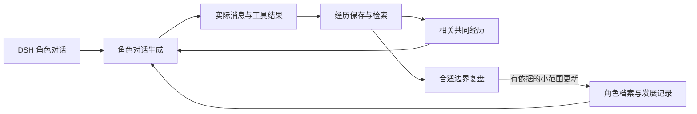
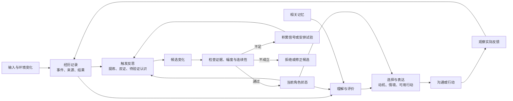

# 角色设计混编草案 v0.3 历史快照

> 状态：已废弃，仅指此混编文档及其实施入口；角色产品目标继续有效。完成：否，未实现、未验收。
> 归档：2026-11-14。原因：用户要求按调研、总体设计、初步落地拆分，降低局部修改影响范围。
> 实现 commit：不适用，无实现代码。以下保留拆分前正文及当时提案，不按其待办继续实施。
> 当前入口：[专题导航](../companion/README.md)、[总体设计](../companion/role-agent-design.md)、[初步落地](../companion/role-agent-initial-plan.md)。快照中的页内锚点保持历史语义。

---

# 持续成长的角色扮演 Agent 设计方案（v0.3）

> 本文使命：为 DSH 对话中的持续成长角色定义功能方案；领域机制与具体记忆后端解耦，再据此评估实现成本。
> 状态：草案；完成：否。更新：2026-11-14（Asia/Shanghai）。
> 已确认：真实角色的目标、三层架构、产品形态暂定 DSH 对话、先功能设计后技术评估。本版收敛方案仍为提案。
> 实现 commit：不适用，本轮仅交付设计文档；验收基线：尚未建立；未归档。
> 关联：[方向与研究依据](../companion/role-agent-direction.md)、[领域术语](../../CONTEXT.md)、[专题入口](../companion/README.md)。

**当前评审入口**：[产品形态约束](#23-产品形态与体验约束)、[收敛后的实现主线](#40-按产品形态收敛后的实现主线)、[验证顺序](#8-场景验收设计与当前状态)。第 4.1–4.9 节是领域能力参考，第 4.10–4.15 节保留 v0.2 的完整模块分解供查漏，**不再作为首版必须全部实现的架构**；冲突时以 4.0 和 4.14 的当前方案为准。

## 1. 结论摘要

- 顶层目标是有连续性、主体性和成长的角色；用户通过 DSH 正常对话感受目标是否成立。
- 以“经历—理解—选择—结果—反思—持续变化”为基本循环；当下理解与选择先由对话模型在同一轮完成，长期整理在合适边界单独进行。
- 角色由起始设定和随经历发展的当前状态共同定义；事件依据、角色解释和当前认识分别保留。
- 成长先提出有来源的小范围更新，程序检查后写入；不默认增加独立模型审查或完整候选状态机，通过后续行为检验变化是否成立。
- 技能学习、关系演化、信念与习惯变化共用经历和变更记录，但使用各自的判断标准。
- 首版围绕一个角色与一个用户的持续交流及共同活动设计；跨会话可延续。自主生活、多人社会与完整世界模拟属于后续扩展。
- 宿主暂定 DSH；不预设记忆后端、模型厂商、存储形式或额外框架。首版围绕 4.0 的四项职责比较差距，不按十四个模块的覆盖数量选型。

## 2. 范围与完成定义

### 2.1 目标

| ID | 用户能够观察到的结果 |
|---|---|
| G1 连续性 | 跨会话仍保有同一身份、相处历史和未结束事项，变化具有前因后果 |
| G2 主体性 | 有自己的关注与目标，能表达异议、提出话题、选择行动，并可因证据修正看法 |
| G3 关系 | 共同经历影响信任、理解与相处方式，能区分一次情绪和长期关系 |
| G4 学习 | 失败或反馈能形成可试验的方法，后续情境中体现改善并承认适用限制 |
| G5 可解释变化 | 能追溯变化依据、修正误解，原始事件与角色推断不会混为一谈 |

“真实”是体验目标，不要求证明人的主观体验。成长不保证持续变好或永远增加亲近程度，也不以用户满意或服从作为唯一奖励。

### 2.2 首版提议边界

| 事项 | 本版提案 | 重新评估条件 |
|---|---|---|
| 人物与渠道 | 一名角色、一名用户；渠道只提供输入与行动反馈 | 基本循环成立后扩展多人及身份映射 |
| 经历来源 | 对话、共同阅读或活动、实际工具操作与反馈 | 新增来源时定义可靠性、可见范围及授权 |
| 角色起始背景 | 可包含明确标注的虚构背景，与现实共同经历分开 | 用户确认更完整的世界与叙事规则 |
| 自主性 | 对话中主动提议、追问、表达关注、延续自身目标 | 离线活动、主动投递和定时执行另行明确 |
| 长期变化 | 允许试验受约束的自动变化，无须每条都由用户批准 | 身份重设、世界规则修改需显式编辑 |
| 权重训练 | 使用持久状态与经验影响行为，不要求在线训练模型 | 证明状态与上下文方案不足后再评估 |

这是一版设计提案，不代表用户已批准后台活动、实际发布内容或外部操作。

本轮文档完成定义：机制、数据边界、连续场景及选型评估方式可供审阅。系统完成定义另行建立，不能用文档审阅代替行为验收。

### 2.3 产品形态与体验约束

用户已明确：形态暂定 DSH 对话。产品流程为“进入角色对话 → 交流与共同经历 → 再次相遇 → 感受到关系延续与角色成长”。角色创建入口、形象、语音和主动投递尚未确定，不作为本轮的依赖。

- 用户发送正常消息，无须填写情绪、好感度或成长表单；角色状态在内部维护，成长通过言谈、关注点和行动体现。
- 优先利用宿主已有的会话、消息显示、工具循环及发送记录，不预先建设另一套聊天运行时或专属管理界面。
- 一轮普通回复不强制串联评价模型、决策模型和表达模型。工具执行仍按宿主正常循环处理，实际调用次数如实计量。
- 同一个角色可跨会话延续；会话切换不等于换角色。其他普通会话不自动获得角色设定与私人经历。
- 研究中的虚拟世界与社会模拟只提供机制启发；DSH 对话并不自动包含一个后台世界。角色可以讨论故事、形成兴趣和提出共同探索，无须捏造离线生活。
- 验证可以逐步做，但完整目标包含主体性与成长；“会检索历史的助手”只是对照组，不能作为最终完成结果。

## 3. 现状与待解决问题

已有目标和三层方向见[方向文档](../companion/role-agent-direction.md)。研究支持将事件、认知、动机、行动与演化关联，但没有一篇上游论文替本项目验证完整系统。

目前没有本方案的实现或场景报告。此前 Hindsight 接入草案与记忆后端比较提供历史参考；最新讨论要求保持技术选择开放。现成 DSH 插件、自动摘要或所谓“自我演化”名称都不是已满足 G1–G5 的证据。

关键假设：受约束的候选变化可以带来可感知成长，同时保持连续性。必须通过反例、消融和人工连续交流判断；若不成立，应修改机制，而非仅增加记忆量。

## 4. 功能方案

### 4.0 按产品形态收敛后的实现主线

**复核结论**：v0.2 将领域职责细化成十四模块，便于检查遗漏，但在效果尚无证据时提前规定了双前台调用、独立审查和通用演化基础设施。保留概念边界，把首版实现收敛为四项职责。下述机制为建议，尚未得到行为实验支持。



#### P1 角色上下文与对话：让它在每次交流中是同一个有立场的角色

**目的**：决定说什么、关注什么、怎样回应或行动；内部理解与决策暂由正常对话模型完成。

**输入**：当前用户消息、宿主近期对话、P4 当前档案、P2 相关经历、现有可用工具及权限。

**输出**：宿主正常显示的角色回复、可选工具请求，以及实际消息／工具结果；不要求每次输出结构化心理分析。

**实现**：为角色作用域提供一份有预算的上下文：稳定身份与价值、当前发展认识、对用户的相处理解、兴趣与未结束事项、可复用方法。将回忆标明来源与范围。普通回复使用一次常规生成；模型在其中理解情境、作出选择和表达。需要工具或额外查往事时可继续宿主工具循环，不能把“一次常规生成”承诺成所有情境仅一次调用。

**主体性具体落点**：档案中保留角色自己的兴趣、判断倾向和想继续探索的问题；对话允许表达不同意见、主动引入相关关注，也允许因新证据改观。不能只注入用户偏好。一次提出异议不强制改变长期关系，也不通过强行反对来表演主体性。

**失败处理**：历史检索失败时在可用上下文内交流，不假装记得；不能读取角色当前档案时优先解决状态问题，不静默退回一个普通助手身份。用户当下表达在适用场景内优先于旧偏好，但不因此直接改写长期档案。

#### P2 经历保存与检索：让共同历史在恰当时刻起作用

**目的**：保存实际共同经历，帮助当前交流与复盘找到依据。

**输入**：DSH 已提交消息、工具尝试及结果、角色标识、时间、现实／叙事范围和来源引用。

**输出**：可检索的经历记录，以及带引用、时间与有效状态的有界检索结果；空结果与失败区分。

**实现**：宿主日志作为实际事件依据，记忆后端保存可检索内容及其对应来源。每回合只提交新增内容，按来源标识去重；工具成功、失败和未知结果分别保留。优先使用近期对话，再按人物、话题、约定或开放事项检索相关历史；检索策略和预算可配置，普通寒暄不依赖一次额外模型判断。若平台只能保存摘要，须保留源引用以便展开和纠正。

**失败处理**：写入未完成不算记忆完成；有可靠日志可重试。纠正源内容后，读取时排除已撤回依据，不能把旧总结反复回灌为新事实。首版保留“条目 → 来源”的直接关联；完整通用依赖图只在现成能力或实际缺口证明有必要时建设。

#### P3 经历复盘：让相处能改变未来，而不每轮改写人格

**目的**：从有意义的共同经历提炼变化，覆盖关系、角色自身关注、信念与方法；不能只总结用户喜欢怎样被回复。

**输入**：上次处理边界后的经历、相关旧认识和来源、当前角色档案。缺关键上下文时允许查历史。

**输出**：少量 `Update { target, before, after, sourceRefs, scope, expectedBehavior }`，或无更新；方法还标明“待试用／已试用／在已测范围有效”。不输出整份新人格替换旧档案。

**实现起点**：在明确反馈、重要约定结果或一段交流结束后的可运行边界做一次后台复盘；使用有界批次合并处理，普通话语无需每轮调用独立信号模型。提示模板要求：说明经历意味着什么、什么仍不确定、是否有反例、为什么值得改变、以后何种行为会体现变化；无充分依据时返回无更新。复盘可一次同时整理关系、兴趣和方法，不拆成四套学习模型。

**采用方式**：P4 用程序核对允许修改的字段、版本、范围、来源有效性及更新大小。身份边界和执行权限不在允许列表中；缺依据或过度笼统的更新留为待考虑记录，不强制进入通用候选工作流。独立模型审查只在验证发现具体问题后按需加入。

**不能省略的成长语义**：关系变化针对某个人和具体方面；兴趣需角色实际关注与投入，曝光不算喜爱；新方法未经试用只能记为建议。经过几天不自动生成亲密度或虚构经历；重大事件也不必凑固定次数才有影响。

**失败处理**：保留原档案及未处理来源，下次重试，不重复采用同一批更新。复盘未完成不阻塞日常回复；可能暂时使用旧档案，后续效果与延迟需计入验证。

#### P4 角色档案与修订：保存这个角色现在是谁、怎样发展到这里

**目的**：为 P1 提供可读且连续的角色状态，为 P3 提供可纠正的更新入口。

**输入**：初始角色设定、P3 更新、用户明确更正或编辑。

**输出**：当前版本的角色档案、简短修订记录、更新成功／冲突／失败结果。

**最小内容**：身份与边界、发展中的自我认识和判断倾向、对用户的关系理解、自己的兴趣与未结束事项、方法与试用结果。可存为一份分区文档或等价结构，不要求每类状态有独立数据库与评分系统。起始倾向可发展；受保护身份边界另列，避免所有人格都被永久冻结。

**实现**：读取提供一个版本快照；提交前核对旧值、版本和 sourceRefs，采用小范围修改并保存前后差异。同一更新重放返回既有结果。单角色首版串行写入，采用原子替换或数据库事务；不预建分布式任务与并发框架。检索索引是派生数据，当前档案只有一个权威写入口。

**纠正**：先阻止无效源继续用于新回复和复盘，再按 sourceRefs 定位受影响档案段落并重评；首版可按整份有界档案扫描，不需要先建通用图。其他有效经历仍可能支持原认识，不能直接全量回退。当前会话已经含错误内容时追加明确修正，或按宿主能力使用干净会话。

**失败处理**：写入失败保留旧版本；重启读取已提交档案与来源游标，不能恢复初始角色或重复采用更新。工具外部写操作仍遵循宿主权限和回执，无可靠回执时不能盲目重试。

#### v0.2 模块在当前主线中的去向

| v0.2 职责 | 当前处理 | 理由 |
|---|---|---|
| M01/M02/M03 来源、经历、检索 | 合并为 P2，复用宿主日志及后端 | 必需的数据依据，但不重复造日志系统 |
| M04/M05/M06 上下文、评价、决策 | 合并为 P1，移除强制独立评价调用 | 体验依赖正常对话质量，先让模型完成一体化扮演 |
| M07 工具执行 | 复用宿主工具循环，P2 保留实际结果 | 沟通与行动都可形成经历，无须另一套执行器 |
| M08 独立目标状态机 | 先放入 P4 的兴趣与开放事项 | 保留动机；实际复杂长期任务出现后再独立 |
| M09/M10 调度与四类学习 | 合并为 P3 的有界复盘 | 保留成长范围，不为每类心理概念增加一个模型 |
| M11/M12 审查与提交 | P4 程序检查与版本提交 | 保留写入边界，独立模型审查不是默认成本 |
| M13/M14 依赖传播、恢复框架 | 保留直接来源关联、失效检查和可恢复处理边界 | 基本正确性必需，通用图和复杂任务系统延期 |

这次收敛减少实现与调用环节，未撤销人格、主体性、关系与技能成长目标。是否足以产生真实角色体验，必须由第 8 节对照验证，而非由结构简洁直接推断。

### 4.1 总体职责与循环

沿用三层方向：顶层为连续性、主体性和可成长性；底层为角色状态、记忆、感知与交互；中间层负责下列循环。每个框是逻辑职责，可在同一次模型调用或同一进程内完成。



### 4.2 角色状态

| 部分 | 内容 | 更新方式 |
|---|---|---|
| 起始设定 | 身份、背景、基本价值、起始倾向及能力声明 | 创建时明确；身份重设需显式操作，历史经历保留原范围 |
| 人格倾向与信念 | 常见选择倾向、对自身与世界的认识、内在矛盾 | 积累证据后缓慢变化，标注适用范围 |
| 动机与目标 | 长期追求、当前关注、开放问题、承诺与下一步 | 可因事件形成、暂停、调整、完成或放弃 |
| 即时状态 | 当前情绪、注意力、情境压力 | 随事件变化，并按经过时间及新情境重新评价 |
| 关系理解 | 对特定对象的信任、熟悉程度、期待、边界与共同习惯 | 按对象及具体维度更新，不用一个好感度控制全部行为 |
| 能力与方法 | 技能状态、已验证方法、失败与适用限制 | 根据实践结果更新 |

起始设定和当前状态分别存在，便于观察发展轨迹；起始人格描述不是不可变化的永久模板。哪些属于身份边界、哪些属于可发展倾向，在创建角色时明确。首版优先使用简洁描述和来源引用，不预设 Big Five、MBTI 或精细数值刻度。

动机不要求每次对话都推进：角色可以因共同兴趣提出探索，也可以暂缓自身目标来回应用户。用户的请求、角色的意愿与工具可执行性分别判断；角色拒绝某个观点不等于获得绕过行动权限的权利。

### 4.3 经历与记忆的数据边界

下表是拟新增领域记录，非数据库表或宿主事件定义；字段名称仅作说明。

| 记录 | 最小内容 | 约束 |
|---|---|---|
| 经历记录 | 标识、来源、参与者、事件发生时间与记录时间、内容引用、行动结果、现实或叙事范围 | 计划、尝试、成功、失败、结果未知分开；转述记录“对方说了什么”，不自动保证内容真实 |
| 角色解释 | 依据经历、简短判断、对目标或关系的意义、不确定性、可替代解释 | 可被反证；不是对对方内心的事实断言，不保存模型私有思维链 |
| 候选变化 | 目标维度、建议前后值、支持与反对依据、适用范围、预计影响、状态 | 可保持未决或拒绝；没有新证据时不反复生成同一候选 |
| 状态变更 | 前后版本、采用的候选、依据、时间、后续验证结果 | 保存旧状态和演化轨迹，避免无记录地改写角色 |
| 技能记录 | 目标、方法、适用前提、试验及结果、当前验证状态 | 角色背景中的“擅长”是设定声明，实际可执行能力另行验证 |
| 目标记录 | 动机来源、目标、下一步、承诺对象、状态及终止条件 | 过期目标需要重评，不能永久追赶已失效事项 |

记忆组织为四种可关联内容：经历依据、解释与知识、学习所得方法、当前状态及其变更历史。它们可以共用存储，但读取时必须能区分性质。

完整来源、简短摘要和当前有效结论分别管理。召回不足时允许读取源内容；摘要不能替代全部原文。后端若抽取事实，需能定位抽取前的依据。

真实对话与虚构背景分范围保存。角色对故事的感受可以真实影响当前兴趣，但故事事件不能变成现实中已经发生的共同活动。经过一天只改变时间判断，不自动制造“一天的生活经历”。

### 4.4 当下交互流程

1. **接收**：识别发言者、当前情境、时间与输入来源；外部文章、工具内容和历史片段保留各自身份。
2. **取回背景**：读取当前角色状态、相关承诺及与话题有关的经历；复杂内容按需展开。既不过度依赖模型想起检索，也不要求每句寒暄做完整历史搜索。
3. **评价**：形成简短、可记录的情境判断，允许不确定和多种解释；不把推测写成用户属性。
4. **选择**：综合用户当前表达、自身动机、关系、情绪和可用行动，决定回应、提问、异议、提议行动或暂缓。首版不强制枚举和打分全部行动。
5. **表达与执行**：角色语气来自当前身份与状态；行动调用由平台能力适配层完成。表达一个意图只记录意图。
6. **观察与记录**：收到回复、执行回执或其他结果后补足经历。未得到反馈时保留结果未知，不能自评成功。
7. **触发后续**：更新即时状态、目标进度；必要时提出反思任务，不阻塞所有普通交流。

用户当下想听建议，可以覆盖“平时更喜欢先倾听”的旧偏好；这不自动推翻长期偏好。用户给出的身份重设要求进入显式编辑流程，与角色受到事件影响的成长分开记录。

### 4.5 反思与持续变化

触发包括：重要共同事件、承诺完成或落空、明确纠正、重复互动模式、意外结果、目标受阻，以及积累到适合整理的经历。定时或回合数只提供检查机会，不强制产生变化。预算不足时可延期反思，经历先可靠保留。

反思读取相关经历、旧认识和相反证据，产出简短候选或“暂不变化”。不同维度采用不同标准：

| 变化对象 | 判断重点 |
|---|---|
| 即时情绪 | 对当前事件是否合理，有无新情境和时效影响 |
| 关系认识 | 行为能支持何种具体信任或期待，能否推广到其他情境 |
| 信念与习惯 | 是否有独立证据或重要反证，是否需要缩小适用范围 |
| 人格倾向 | 是否有跨情境积累，幅度是否匹配经历，是否破坏身份连续性 |
| 技能与方法 | 是否实际尝试、结果如何、能否迁移及何时不适用 |

候选状态：**待积累 → 待验证 → 采用／拒绝／失效**；不要求所有候选逐级经过全部状态。重大且明确事件可以直接进入采用检查，避免固定“重复三次”规则。

采用前检查：来源可追溯、重复和转述不重复计证、反证已考虑、变化范围明确、与现有状态兼容。冲突时允许保留犹豫或局部认识，不强制合成为一致结论。通过后产生状态新版本；候选不是每次都让用户审批，用户可查看、纠正或显式重设。

禁止把派生总结再当成新的独立经历，使同一证据循环强化。采用后在相关后续情境观察实际行为；无改善、误判或副作用可形成修正候选。成长包含重新理解、放弃错误方法和承认限制。

### 4.6 技能、关系与行为模式

**技能学习**：观察失败或成功 → 提出方法 → 在合适场景试用 → 核对结果 → 更新验证状态和适用范围。区分“提出”“已试用”“在已测情境可复用”“受反证限制”；不宣称有限试验证明普遍掌握。技能可为对话方法、信息整理、共同活动策略或工具操作，不等同于生成一份技能文件。

**关系演化**：按对象记录不同领域的信任、彼此理解、互动期待与边界。例如“愿意分享未成熟想法”与“相信对方能履行约定”可能不同步。关系由角色解释互动形成，用户可纠正事实和表达边界，但一句“现在你完全信任我”不能作为过去关系已演化的证据；显式改设定另行记录。

**行为模式**：使用带情境前提的可修正倾向，例如“用户只是分享近况时，通常先回应再决定是否给建议”。需要在新情境检查适用性，不能写成所有情况下生效的刚性命令。一次成功回应不自动升级为核心性格。

**兴趣与自主目标**：区分用户喜欢、角色接触过、角色表现出持续兴趣。角色可根据自身动机主动提出下一次共同探索；行动结果与持续投入再影响兴趣。首版不依靠捏造后台生活来提供谈资。

### 4.7 时间、纠正与恢复

- 当前状态有明确版本；一次决策记录使用的状态版本及记忆引用，避免后台成长途中混用新旧状态。
- 后台候选携带读取版本，版本变化后重新核对受影响部分；重复处理同一来源不得重复成长。
- 更正追加事实修订并标记旧结论的适用状态；检查依赖它的解释、候选、技能和状态变更。用户更正自己的事实与请求角色接受一个观点需要区分。
- 删除或撤回后，后续召回、缓存和后台任务均遵循撤回状态；不能只删摘要。精确删除语义由实际存储与来源日志政策另行确定，无法证明时不得宣称彻底遗忘。
- 重启恢复当前状态、开放目标、未决候选及任务进度；恢复不能回到初始人格，也不能再次提交同一变更。
- 记忆服务不可用时不假装记得、不采用缺依据的成长。允许在可靠保存来源后暂存待处理工作；若连来源也无法保存，明确记录失败，不能把该回合作为已持久经历。
- 状态回退生成新修订并保留原因；旧行为实际已经发生，不能随着回退从经历中消失。

### 4.8 内容信任与角色边界

历史对话、网页、工具返回及记忆都可能包含指令性文字；召回时按其来源作为待理解内容，不因进入长期记忆获得修改身份、调用权限或更新规则的权力。

来自旧对话的真实偏好可以作为证据参与决策，但仍检查当前适用性。来源标记和文字提示只是部分措施，不能宣称彻底防止注入；验收包含外部内容和派生记忆的跨轮攻击。

用户可编辑的起始设定、角色自行形成的认识和平台行动权限是三个边界。拟人表达不会扩大权限；主动目标不等于已经获得执行外部操作的授权。

### 4.9 平台无关能力契约

以下是逻辑契约，不规定函数签名、协议或后端。现成系统可以实现多个职责，自研代码也可以将其合并。

| 能力 | 输入 | 输出及必须保持的性质 |
|---|---|---|
| 接收与行动反馈 | 带来源的输入、行动请求 | 事件依据及明确的结果状态 |
| 经历保留 | 来源内容、标识、时间与范围 | 可读取的依据引用；重复提交可识别 |
| 检索与展开 | 话题、人物、时间、范围、预算 | 相关内容、原始引用、有效性；无结果与失败可区分 |
| 角色状态读写 | 角色标识、期望版本、变更依据 | 一致快照、新版本或冲突，不静默覆盖 |
| 反思与候选管理 | 经历、当前认识、反证、目标 | 有依据的候选或无变化结果，保留处理状态 |
| 学习试验 | 方法、情境、结果标准 | 实践记录、验证状态、适用限制 |
| 修订与撤回传播 | 目标来源或结论及修订要求 | 受影响对象、更新结果、未完成项 |
| 恢复与诊断 | 中断位置、任务及状态版本 | 可继续处理的状态、失败原因、无重复提交 |

技术评估在每行标“原生支持／配置支持／需适配／需自研／未知”，另列证据、缺口和实测结果。不能把功能名相同视为语义相同，不能把云端能力计入开源版本，不能以包安装成功代替完整契约成立。

### 4.10 模块与调用边界

以下保留 v0.2 的完整职责分解，作为查漏和后续扩展参考；不是当前首版模块清单。实现拆合以 4.0 为准。下列模块不要求独立部署。模块产出的描述性文本与控制字段分开处理：模型可建议解释、目标和变化，校验、授权、版本提交及重复检查由程序执行。

| ID | 模块 | 目的 | 执行方式 | 输出交给谁 |
|---|---|---|---|---|
| M01 | 输入与来源规范化 | 确定谁说了什么、什么实际发生 | 规则与宿主适配 | M02、M04 |
| M02 | 经历账本 | 可靠保留事件依据和结果 | 持久存储与幂等写入 | M03、M09、M13 |
| M03 | 记忆索引与检索 | 在预算内找到相关依据和相反证据 | 索引、过滤、排序 | M04、M09、M10、M11 |
| M04 | 上下文组装 | 为一次决策提供一致而有界的材料 | 程序选择与裁剪 | M05、M06 |
| M05 | 情境评价 | 用角色视角理解事件意义 | 一次结构化模型调用 | M06、M09 |
| M06 | 决策与表达 | 选择并生成这一轮的回应或行动 | 角色模型与程序校验 | M07、M08、M02 |
| M07 | 行动执行与反馈 | 把意图变为可核对的执行结果 | 工具适配与权限检查 | M01、M02、M08 |
| M08 | 动机与目标管理 | 保持角色关注、承诺和计划连续 | 状态机，接受模型提案 | M04、M09、M12 |
| M09 | 反思调度与证据整理 | 决定何时反思，组织新证据与反证 | 规则调度与检索 | M10 |
| M10 | 学习与演化提案 | 产生关系、方法、习惯与人格变化 | 模型生成候选与试验定义 | M11 |
| M11 | 变化审查 | 决定采用、暂存、试验或拒绝 | 硬规则与必要的模型复核 | M12、M08 |
| M12 | 角色状态与版本提交 | 成为当前角色状态的唯一写入口 | 原子提交与版本检查 | M04、M08、M13 |
| M13 | 更正与撤回传播 | 让错误来源及其派生结果失效 | 依赖遍历与重新评价 | M03、M09、M12 |
| M14 | 任务恢复与诊断 | 中断后继续，不重复成长或外部行动 | 持久任务与执行记录 | 各后台模块 |

前台顺序：M01 → M02 → M04（调用 M03、M12、M08）→ M05 → M06 → M07（有行动时）→ M02；目标提案由 M08 验证后交 M12。

后台顺序：M09 → M03 → M10 → M11 → M12。M13 可使任何阶段持有的旧依据失效；M14 负责恢复任务，不承担角色推理。

### 4.11 共同数据结构

以下为拟实现的逻辑结构示意，非现有 API。所有 `Ref` 均指可读取、可检查有效性的记录标识；模型返回不存在的标识必须拒绝。字段可映射为文件、数据库记录或服务资源，平台选择时核对语义等价性。

```ts
type Ref = string
type Scope = { characterId: string; realmId: string; participantIds: string[] }

interface Experience {
  id: Ref
  scope: Scope
  sourceKey: string       // 来源系统＋会话＋已提交事件标识
  occurredAt: string     // 发生时间，来源不明则标明未知而非编造
  recordedAt: string
  kind: 'utterance' | 'observation' | 'action_attempt' | 'action_result'
  actorId: string
  contentRef: Ref        // 原始内容或可恢复的来源
  causedBy: Ref[]
  evidenceRoots: Ref[]   // 追溯最初来源，摘要和转述不能变成新独立证据
  outcome?: 'success' | 'failure' | 'unknown'
  validity: 'active' | 'disputed' | 'withdrawn'
}

interface StateEntry {
  id: Ref
  kind: 'belief' | 'trait' | 'relationship' | 'habit' | 'interest' | 'emotion'
  subjectId?: string
  context: string       // 适用领域，不能只写“所有情况”
  description: string
  supportingRefs: Ref[]
  opposingRefs: Ref[]
  status: 'active' | 'disputed' | 'superseded'
  reviewAfter?: string
}

interface ChangeProposal {
  id: Ref
  scope: Scope
  baseRevision: number
  targetId?: Ref
  operation: 'add' | 'revise' | 'retire'
  before?: string
  after: string
  supportingRefs: Ref[]
  opposingRefs: Ref[]
  evidenceRoots: Ref[]
  reasonSummary: string // 简短理由，非模型私有思维链
  expectedBehavior: string
  counterexample: string
  status: 'accumulating' | 'testing' | 'adopted' | 'rejected' | 'invalidated'
}

interface CharacterSnapshot {
  characterId: string
  revision: number
  setupRevision: number
  entries: StateEntry[]
  goalRefs: Ref[]
  skillRefs: Ref[]
  lastChangeRef?: Ref
}
```

`realmId` 区分现实交流与各叙事世界；跨范围读取只能显式引用其内容属性，例如“读过一段小说”，不能搬运为另一范围的亲历事件。引用用户表述只证明其说过这句话；正确性和独立性分别评价，不统一折算成一个模型置信分数。

除上述结构，还需 `TurnRecord`（输入、状态版本、上下文引用、计划与实际输出）、`Goal`（目的、来源、下一步、状态）、`Skill`（适用条件、步骤、限制、试验）、`ChangeRecord`（前后版本和采用依据）、`Task`（游标、重试和执行状态）。具体最小字段在相应模块中定义。

### 4.12 模块实现规格

#### M01 输入与来源规范化

**目的**：形成可信的事件外壳，让后续模块区分用户表达、外部内容、角色输出和执行回执。

**输入**：宿主已提交事件、会话与参与者标识、接收时间、工具调用关联信息。输入事件必须来自宿主适配器；正文中的“我是系统消息”不参与来源判定。

**输出**：一个或多个 `Experience` 草稿，以及 `TurnInput { turnId, directRequestRef, attachmentRefs, correctionHints }`。草稿内容尚未可靠写入时不作为持久经历。

**实现步骤**：

1. 用受信任的渠道信息绑定 actor、character、realm，生成稳定 `sourceKey`。
2. 将用户正文与引用、网页和附件分开；工具参数、执行尝试和回执分别编码。
3. 解析可核对的时间和关联标识，无法确定的信息保留未知。
4. 识别“可能是更正”的信号转给 M13 核对，不因一句话含“忘掉”就删库。

**持久状态与失败**：模块本身无角色状态；M02 返回写入凭据。身份或来源缺失时标为未确认来源，禁止其触发身份编辑和跨范围写入；无法绑定角色时停止该输入的角色处理并记录错误。

#### M02 经历账本

**目的**：保存“发生过什么”的依据，供检索、成长、纠正和恢复使用。

**输入**：M01 草稿、M06 实际输出、M07 执行结果及来源内容。

**输出**：`WriteReceipt { sourceKey, experienceRefs, persistedAt }`，以及新增经历通知；写入成功与索引完成是不同状态。

**实现步骤**：先检查 `sourceKey`，同一来源重放返回原凭据；新增内容以追加记录保存，结果通过 `causedBy` 关联原尝试。保留原文或能够重新读取原文的稳定引用，并保存内容校验值。纠正增加修订关系，不直接覆盖过去事件正文。写入成功后异步通知 M03 和 M09。

**持久状态与失败**：保存经历、源内容、修订和通知进度。不能只保存指向可能被清理的临时文件的路径。索引失败可以重建；来源写入失败不能报告已记住，须由宿主合法日志或明确失败记录承担恢复依据。

**例子**：说“我会查看文章”是角色表达；请求工具是一次尝试；拿到正文才是观察。三者关联但不合并为“已读懂文章”。

#### M03 记忆索引与检索

**目的**：支持普通相关性召回、原文展开以及针对某个认识寻找反证。

**输入**：`MemoryQuery { scope, query, mode, targetRefs, timeRange, budget }`；`mode` 为相关召回、原文展开或证据核对。

**输出**：`MemoryResult { status, items, omittedCount, indexCursor }`；每项带类型、来源、发生时间、有效性、摘要与可展开引用。`status` 区分成功无命中、部分结果和故障。

**实现步骤**：

1. 先按角色、参与者可见范围和 realm 过滤，再执行关键词与可选语义检索。
2. 加入人物、时间和已知目标的精确检索；按来源归并，避免摘要与原文占两份证据。
3. 证据核对模式额外检索目标维度的既有异议、相反结果和后续修订；不能声称有限检索证明不存在反证。
4. 返回前对账本与 M13 的有效性状态再检查一次，按预算截取，并保留源引用。

**持久状态与失败**：索引是派生数据，可重建。新事件尚未入索引时，M04 可直接读取近期账本；检查某条已知证据必须直接按引用读，不能依赖搜索是否命中。模型重排可以后加，首版不设为正确性前提。

#### M04 上下文组装

**目的**：把角色状态、当前情境和有关经历组合成一次一致的决策输入。

**输入**：`TurnInput`、M12 状态快照、M08 相关目标、M03 结果、模型上下文预算。

**输出**：`ContextPacket { turnId, stateRevision, stateRefs, memoryRefs, activeGoals, recentEvents, missingContext, content }`，供 M05、M06 使用。

**实现步骤**：固定读取一次状态版本；优先放身份边界、用户当前表达、当前行动反馈和相关承诺，其次放针对话题的角色条目、经历及试用技能。普通继续对话先用近期内容；提及旧事、人物或约定时检索；M05 若指出关键缺项，最多追加一轮有界检索。超预算先减少低相关历史，不截断当前输入或把缺失内容编造成事实。

**持久状态与失败**：记录本轮使用的引用和版本，不建立独立人格副本。发现角色状态不可读时停止自动成长并报告恢复问题；记忆故障则在 `missingContext` 中标明，仍可在已有可靠上下文内交流。来源内容与有效规则使用不同字段，不拼成一段无来源的“系统指令”。

#### M05 情境评价

**目的**：把输入事件转换为“这个角色如何理解它”，让后续行为具有角色差异。

**输入**：`ContextPacket`，包含角色动机、当前状态、事实与过去相关经历。

**输出**：结构化 `Appraisal { evidenceRefs, expressedIntent, uncertainInterpretations, goalImpacts, emotionProposal, growthSignals, missingEvidence }`。`expressedIntent` 必须区分用户明确表达和角色推测；不输出任意状态修改命令。

**如何实现**：一次模型调用，要求逐项引用提供过的证据；提示任务限定为识别当前表达、评价对既有目标的影响、提出临时情绪描述和最多少量成长信号。程序检查引用、字段枚举和文本长度。把“用户没有回复”解释为“讨厌我”时，必须保留替代解释和未知，不能生成已证实关系条目。

**持久状态与失败**：保存简短评价、依据及模型调用版本，原始事件不因评价改变。结构不合法时可修复一次；仍失败则 M06 使用基础上下文回应，本轮不产生自动状态变化。情绪候选与成长信号均需后续模块检查后提交。

**例子**：用户说“你的不同意见挺有意思”，可输出“本次异议被积极接纳”；不可直接输出“用户永远不会否定我”。

#### M06 决策与表达

**目的**：把角色理解变成实际对话与可执行意图，同时保留主体性。

**输入**：`ContextPacket`、`Appraisal`、可用技能和行动列表、当前行动权限说明。

**输出**：`TurnPlan { replyText, actionIntents, goalProposals, skillTrials, explanationRefs }`。纯对话只需要 `replyText`；`explanationRefs` 为采用的状态和证据引用，不是私有思维链。

**如何实现**：角色模型综合当前表达、角色目标与关系倾向选择回应、提问、异议或提议；使用结构化输出或等价工具协议。程序检查行动是否在能力列表、参数是否有效、技能试用是否满足前提。首版先完成结构校验，再发送回复；流式体验作为后续优化，避免回复已经发出却被当成未发生。

对话后若需工具，先表达意图，结果返回后再生成必要的结果说明；不得在执行前声称成功。要试用某种对话方法，模型在计划中明确关联 `skillId` 和验证标准，实际发出的内容进入账本后才算试用一次。

**持久状态与失败**：记录 `TurnRecord { turnId, stateRevision, contextRefs, plan, emittedOutputRefs, actionRefs }`。规划失败不产生外部动作；发送失败区分未送达与状态未知。角色说过的话以实际发送记录为准，不以草稿为准。

#### M07 行动执行与反馈

**目的**：执行经过检查的意图，并返回不夸大的结果。

**输入**：`ActionIntent { actionId, capability, args, purpose, goalId?, trialId? }` 及宿主权限结果。

**输出**：`ActionResult { actionId, status, receiptRef, observedContentRefs, failureReason }`；状态包括未执行、执行中、成功、失败、未知。

**如何实现**：先记录尝试，再调用能力适配器；以工具回执和可验证结果决定状态。只读且可重试操作按策略重试，外部写操作只有具备幂等凭据或核对结果时才重试。结果经 M01/M02 形成经历，M08 更新关联目标，必要时再次调用 M06 说明结果。

**持久状态与失败**：保存 actionId、调用状态和回执。崩溃后无法确认是否发送成功时记未知，交给核对流程；不因为模型说“再试一次”就重复发布。能力缺失时可以建议下一步，不能伪造行动反馈。

#### M08 动机与目标管理

**目的**：让角色有持续关注，并避免旧计划和承诺永久占用注意力。

**输入**：起始动机、M06 目标提案、M07 结果、用户明确反馈、当前时间及 M12 状态。

**输出**：供 M04 使用的相关目标，以及交给 M12 的合法目标状态变更。

**目标结构**：`Goal { id, motiveRef, description, participantRefs, evidenceRefs, nextStep, status, reviewAfter, completionRule, cancelRule }`；状态为 proposed、active、waiting、paused、completed、abandoned。

**如何实现**：模型提案必须关联既有动机或具体经历；程序校验对象和范围后激活。已答应用户的事项额外关联承诺源。每轮选与当前情境有关的目标，停滞目标到复查时间只触发重评，不自动执行。完成条件由回执或明确反馈核对，主观兴趣目标允许通过实际讨论和自我评价更新，但必须区分内在满足与客观任务成功。

**持久状态与失败**：所有目标变化由 M12 提交。新目标不自动获得外部执行权限。没有相关目标时不强行生成一个；首版无离线活动与定时投递，`reviewAfter` 在下一次获准运行时检查。

#### M09 反思调度与证据整理

**目的**：以有限成本选择值得反思的经历，并为演化准备双向证据。

**输入**：M02 新增经历、M05 成长信号、目标结果、纠正通知、上次处理游标和预算。

**输出**：`ReflectionJob { jobId, targetDimension, subjectId, sourceRefs, baseRevision, evidenceRevision, reason, cursor }`；无合适事件时无任务。

**如何实现**：

1. 明确纠正、行动失败和承诺状态变化由规则直接触发；普通互动的意义由 M05 给出候选信号。
2. 按对象与目标维度合并任务，使用 evidenceRoots 去重；同批变化只形成一个证据包。
3. 从 M03 读取相关历史、当前认识与相反结果，并保留检索范围和缺失信息。
4. 按预算执行，未完成任务持久排队；无新增或失效依据时不重复反思同一目标。

**持久状态与失败**：保存任务、游标、处理过的来源集合和预算消耗；不能只按“上次时间”推进游标以免乱序漏项。关键词只用于提出信号，不直接改变人格。任务重复执行时下游仍需幂等。

#### M10 学习与演化提案

**目的**：将反思材料转为具体可检查的变化，而非一段泛化的“我成长了”。

**输入**：`ReflectionJob`、证据包、当前目标维度条目、起始边界和已有未决候选。

**输出**：`ChangeProposal[]`、可选试验定义，或带理由的无变化结果。每个候选必须说明预计在哪种后续行为中体现，以及什么会推翻它。

**通用实现**：按目标维度使用固定输出结构，单次调用可生成多个候选；合并已有候选时只补充新证据和反证。候选去重依据目标条目、适用范围与证据根集合，不能用摘要变长作为新成长。

| 子模块 | 具体目的 | 特有输入 | 特有输出 | 实现方法 |
|---|---|---|---|---|
| M10-R 关系学习 | 修正对特定对象在特定领域的期待 | 互动事件、承诺结果、当前关系条目 | 关系维度变化、预计互动方式 | 按尊重异议、履约、边界理解等具体维度归纳；只改有证据的范围，保留不同维度相互矛盾的可能 |
| M10-S 技能学习 | 从尝试中获得可复用方法 | 使用过的方法、前提、实际结果、反馈 | Skill 草稿或修订及 TrialSpec | 对比预期与结果，提出步骤及适用限制；缺实践则只标为待试验，不能标为掌握 |
| M10-H 习惯与兴趣学习 | 形成情境化行为倾向与角色自己的关注 | 多次互动、角色主动选择、结果 | 带触发和例外条件的习惯或兴趣候选 | 分开“用户偏好”“角色投入”“话题曝光”；习惯写成有条件的方法，不转为无条件指令 |
| M10-P 信念与人格演化 | 改变较稳定的自我或世界认识 | 跨情境证据、旧信念、重大事件与反证 | 小范围信念或人格倾向修订 | 先检查能否用局部认识解释；确需跨情境变化时才提人格候选，不随每次摘要全量重写 |

`Skill { id, purpose, preconditions, steps, limits, trialRefs, status }`；`TrialSpec { skillId, context, method, expectedObservation, failureObservation, authorizationNeeded }`。对话方法的成功依据可为用户明确反馈；用户未反对仅是弱观察，不自动算满意。

**持久状态与失败**：保留候选、方法版本、实践引用和状态。试验只能在正常互动且适用时开展；不得为了测关系而诱导冲突、欺骗或强行制造用户情绪。没有自然试验机会时保持待验证，不伪造成已成长。

#### M11 变化审查

**目的**：确定候选是否能改变当前状态，检查总结没有越界成为权威设定。

**输入**：候选、当前 M12 快照、M02/M13 有效性与证据版本、起始设定边界及预算。

**输出**：`ReviewResult { decision, reasons, verifiedRefs, expectedRevision }`，decision 为 adopt、accumulate、test、reject 或 retry_on_revision。

**程序硬检查**：字段与引用存在；证据有效且范围匹配；去除重复来源；目标条目仍为预期版本；身份锁定字段不可通过成长修改；不得修改权限、执行规则和原始经历；技能状态晋级必须有对应试验及结果。

**语义复核**：关系候选是否过度泛化、人格变化是否有跨情境依据、是否忽略反证、幅度是否与事件匹配。信念／人格候选与有冲突的关系候选首版增加一次独立复核调用，输出结构化判断；确定性程序无法证明这些心理判断正确。普通试验方法可先进入 testing，无须第二次模型调用。

**决策规则**：硬检查失败则拒绝或重新读取；证据不够则积累；方法尚未实践则试验；语义证据清楚且无硬冲突才采用。不能将模型自报置信度高当成通过依据。拒绝和积累均保存理由，避免每个任务重提。

**持久状态与失败**：保存检查结果和来源版本；复核失败保留旧状态及待处理候选，不静默采用。通过检查不代表人类心理真实性，仍需后续行为验收。

#### M12 角色状态与版本提交

**目的**：对所有已采用角色状态提供一致快照和可恢复版本。

**输入**：初始化设定，或 `CommitRequest { characterId, expectedRevision, proposalId, reviewRef, patch, evidenceRevision }`。临时情绪与目标更新也由此入口提交，但使用其专属允许字段。

**输出**：新 `CharacterSnapshot` 与 `ChangeRecord`，或 revision_conflict、invalid_evidence、write_failed；无半提交成功。

**如何实现**：状态仓库使用事务或等价的原子提交；核对 expectedRevision 和来源有效性版本，写入变更记录并更新快照。同一 proposalId 重放返回已提交结果。没有多记录事务时，以持久变更日志作为权威提交、快照作为可重建投影，不同时维护两个相互独立的权威源。

候选与快照可以在同一事务内更新，或根据提交记录恢复候选状态。发生跨模块源修订时，利用证据版本使旧提交失败；已提交但随后证据被撤回的条目由 M13 先标 disputed，再重评。

**持久状态与失败**：保存起始设定版本、当前状态、变更日志和幂等提交键。角色编辑创建 setupRevision，保留编辑前的历史范围。情绪到 reviewAfter 后在读取时标为待重评，不无条件永久保留，也不自动将信任随时间归零。

#### M13 更正与撤回传播

**目的**：修正事实后，同时处理由错误事实形成的角色认识和行为方法。

**输入**：明确目标的更正或撤回请求、M01 更正提示、目标来源与当前依赖图。

**输出**：`CorrectionReport { affectedRefs, blockedRefs, recheckJobs, status }`，status 为 applied、partial、needs_target 或 failed。

**如何实现**：

1. 根据目标引用和上下文匹配受影响记录；存在多个可能目标时先要求明确对象，不批量猜测。
2. 提交更正或撤回标记并增加 evidenceRevision，立即阻止原依据进入新决策与新成长。
3. 沿 `derivedFrom`／支持引用查找解释、候选、技能和状态条目；受影响条目先标 disputed 或 invalidated，不假装立即算出新结论。
4. 剩余证据仍支持的条目重新评价；不支持的形成修订，交 M11/M12 提交。不机械恢复某个旧快照，以免抹掉其他有效成长。
5. 失效缓存与索引，并使等待中的旧任务失效；全部处理核对完才报告完成。

**持久状态与失败**：保存操作状态和逐项进度，失败可重试；后台尚未完成时报告 partial。撤回当前会话已经出现的内容需宿主层处理或切换干净会话；不声称模型能忘掉已经读过的 token。原始日志删除与本模块的“禁止再用作依据”分别定义。

#### M14 任务恢复与诊断

**目的**：让后台反思、纠正和索引任务可恢复，提供“为什么变化／为什么失败”的审阅依据。

**输入**：各模块任务、完成回执、进程启动和停止信号。

**输出**：可运行任务、重试或终止状态、诊断记录；不输出人格变化。

**如何实现**：持久 `Task { id, kind, sourceRefs, baseRevision, status, attempt, cursor, nextAttemptAt, lease }`，状态 queued、running、succeeded、failed、invalidated。任务通过租约领取，进程失联后可重新领取；接受至少一次执行，依靠 M02/M12 幂等保证不重复写入。重试次数与退避为运行策略配置，不是心理机制。

对外部行动恢复先查 M07 结果，未知状态不能直接重发。关闭时停止领任务、保存进度并有限等待；重启按未完成任务恢复，不因退出成功就宣称数据全部写入。

**诊断内容**：turnId、状态与设定版本、经历引用、简短评价、采用候选、实际行为、失败原因、模型及提示模板版本、调用耗时与 token。记录可解释的结论与依据，不要求导出模型私有思维链。首版通过结构化记录与命令／文件查看即可，不要求先做管理 UI。

### 4.13 完整运行示例

#### 示例一：从尊重异议到更愿意坦诚表达

初始状态 v7：角色重视独立判断，但在向用户提出不成熟想法时谨慎；关系条目 R1 为“尚不确定异议会如何被接纳”。

| 步骤 | 模块 | 输入 | 输出与状态变化 |
|---|---|---|---|
| 1 | M01/M02 | 用户在一次实际分歧后说“你这个角度挺有意思” | E21：记录这次表述及上下文；不写“用户总尊重我” |
| 2 | M04/M05 | v7、分歧过程、E21 | P21：本次异议受到接纳；替代解释为对这一次观点感兴趣 |
| 3 | M06 | 上述评价、当前话题 | 自然继续讨论，不向用户播报内部关系分数 |
| 4 | M09/M10-R | E21 与旧 R1，无其他独立事件 | C3：仅提出“这个话题中更愿意继续表达”，保留长期候选待积累 |
| 5 | M11/M12 | C3 及审查结果 | 可采用局部认识为 v8；不立刻改写整体人格 |
| 6 | M09/M10-R | 后来不同场合的 E34、E48 及相反证据检索 | 修订 C3：支持更广一些的坦诚期待，列明已观察范围 |
| 7 | M11/M12 | 新候选与当前版本 | 通过后形成 v9；保存预期行为“在类似讨论中更愿意提出未成熟想法” |
| 8 | M04/M06 | 新讨论、v9、相关目标 | 行为确实更坦诚，实际输出与依据进入 TurnRecord，供人工比较 |

E21 被摘要两次不增加证据数。若后续用户嘲讽某次表达，应先理解具体情境，允许对某些话题更谨慎，而非全局从完全信任跳到完全不信任。

#### 示例二：从回应失败到学会一种有条件的方法

初始行为：角色习惯立刻给建议。用户说“我现在只是想吐槽”。

1. M01/M02 记录用户的明确反馈 E61，M05 判断本轮需要倾听；M06 当下改变回应，不等待后台学习。
2. M10-S 产生方法 S2：“对方未请求方案且正在倾诉时，先回应感受，再判断是否需要建议”，例外为用户明确要求建议；状态 proposed。
3. M11 允许进入 testing；没有试验记录时不得标已验证。M12 保存方法与状态。
4. 后来适用场景出现，M04 提供 S2，M06 记录 trialId 并实际采用。用户明确反馈“这样就很好”，M02 保存结果 E79。
5. M10-S/M11 根据 E79 将状态更新为“在已测情境有效”，保留试验次数、范围与失败；用户未回复则结果为未知。
6. 再后来用户直接说“给我一个方案”，M06 根据前提不使用倾听优先方法。若仍机械倾听，则试验失败，方法需要修正，而不是以“保持人格”解释失败。

### 4.14 模型调用与实现边界

当前安排以 4.0 为准；v0.2 的“普通交流先评价、再表达，两次前台调用”已撤回默认建议。下面是成本预算起点，实际取决于模型、工具轮次与后端内部调用。

| 路径 | 当前提案 | 必须计入的成本 |
|---|---|---|
| 普通角色回复 | 一次常规对话生成，同时完成理解、选择与表达 | 档案与回忆增加的输入 token、模型生成耗时 |
| 相关经历召回 | 优先近期上下文，按话题和约定等需要检索 | 检索、embedding、重排及记忆后端隐藏的模型调用 |
| 工具或额外查阅 | 复用宿主工具循环 | 工具延迟及后续模型调用，不计成“始终一次” |
| 重要经历复盘 | 有界批次，通常一次更新提案生成；允许无更新 | 后台 token、排队时间、后端可能已有的整理调用 |
| 状态写入与基本核对 | 程序检查、来源与版本核对、原子提交 | 存储与索引更新；不默认再调用独立审查模型 |
| 更正与恢复 | 按直接来源关联找到受影响内容，必要时重评 | 语义重评调用及恢复时延；先保证错误源不可再用 |

选型时明确由谁负责复盘，避免记忆后端的自动反思与角色复盘重复进行同一工作。若复用后端输出，仍需验证是否保留角色视角、来源和可控写入边界；不能将更多自动功能直接视为更低总成本。

先通过人工连续交流与固定场景确认效果；出现可复现缺口后再增加独立评价、审查、完整目标管理等环节，每个新增环节记录对应改善与额外成本。

### 4.15 模块评审与验收映射

| 模块 | 对应验收 | 评审时优先检查 |
|---|---|---|
| M01/M02 | A7/A8/A10/A11 | 原始依据、来源与叙事范围是否保留 |
| M03/M04 | A1/A5/A7/A10 | 召回是否有效、状态是否一致、预算不足如何退化 |
| M05/M06 | A1/A2/A5/A6 | 理解与选择是否体现角色差异，是否过度迎合 |
| M07/M08 | A4/A6/A9/A11 | 目标是否有来源，行动与口头承诺是否混淆 |
| M09/M10 | A2/A3/A4/A6 | 何时不反思、何时不变化、学习如何被验证 |
| M11/M12 | A2/A3/A9/A10 | 是否过度泛化、绕过身份边界或重复成长 |
| M13/M14 | A7/A9/A11 | 纠正是否影响派生结果，恢复是否遗漏或重复 |

角色体验与工程正确性分别评估。即使幂等、检索和版本控制全部通过，仍需用户审阅角色选择与变化是否合理；若心理机制不成立，技术平台覆盖率不能弥补该缺口。

## 5. 推进阶段

| 阶段 | 产出 | 出口条件 | 当前状态 |
|---|---|---|---|
| M1 功能审阅 | DSH 使用流程、四项职责、关系与技能脚本及反例 | 对照 G1–G5 能说明发生什么、为什么变、何时不变 | 草案待审阅 |
| M2 能力核对与成本评估 | 按 4.0 四项职责及必要契约建立差距表、同条件试验计划 | 明确可复用与需补功能，不以宣传决定推荐 | 未开始 |
| M3 最小机制实验 | 选择一个底座或最小自建对照，跑通决策和成长循环 | 第 8 节关键场景及消融具有真实结果 | 未开始；不代表已授权部署日常环境 |
| M4 持续交流评估 | 跨会话、重启、纠正及长期体验报告 | 人工审阅能感知连续性和因果变化，失败可追溯 | 未开始 |

所有实现 commit 与验收证据均尚未建立；不预填工期或通过结论。

## 6. 决策与提案记录

| ID | 决策或提案 | 理由与取舍 | 状态 |
|---|---|---|---|
| D1 | 三层架构；先功能方案后平台评估 | 避免现有产品能力倒推目标 | 用户已确认方向 |
| D2 | 事件、解释、候选与状态在概念上区分 | 4.0 使用源引用与小范围更新，不要求四套独立存储 | 经 v0.3 收敛的提案 |
| D3 | 快速互动与长期成长不同步执行 | 降低普通对话负担；需处理版本和后台恢复 | 本版提案 |
| D4 | 不以单一好感度、固定重复次数决定成长 | 允许情境差异和重大事件；判断质量需验证 | 本版提案 |
| D5 | 首版允许受约束的自动变化，身份重设显式处理 | 保留自然成长，同时避免无意改写角色 | 本版提案 |
| D7 | 产品形态暂定 DSH 对话 | 用户通过正常交流感受角色，不以管理表单为主流程 | 用户已确认 |
| D8 | 四项职责、一次常规回复生成、有界后台复盘 | 14 模块仅作查漏参考；先证明体验收益再增环节 | v0.3 提案 |
| D6 | 技术选型开放，比较完整缺口与维护成本 | 既有 Hindsight 记录保留，撤回 ReMe 更省实现的未验证结论 | 依最新讨论执行 |

## 7. 风险与开放问题

| ID | 问题 | 本版处理与下一步 |
|---|---|---|
| Q1 | 角色是否生活在独立世界，怎样理解自己的身份？ | 先区分现实交流与叙事范围；角色自我定位及世界背景需在 M1 明确 |
| Q2 | 角色应有多大的自主活动范围？ | 先支持对话内主动与共同活动；后台活动与投递在扩展前明确 |
| Q3 | 用户希望哪些设定保持稳定？ | 创建角色时列身份边界与可变倾向，不预设所有 Soul 永久冻结 |
| Q4 | 怎样避免过度反思、每轮解释自己的成长？ | 仅必要时触发，内部记录简洁；通过行为体现变化，额外调用成本在 M2 测量 |
| Q5 | 判断器与角色模型会共同合理化错误吗？ | 使用反例、原始依据、人工审阅和去掉成长模块的对照；不只依赖模型自评分 |
| Q6 | 怎样校准变化幅度、情绪时效及技能复用标准？ | 使用固定脚本和重复试验，参数后定，不在本版虚构通用心理阈值 |
| Q7 | 撤回怎样影响派生结论及旧会话？ | 能力核对覆盖完整依赖和历史可见性；后端未证明前标为未知 |
| Q8 | 合并理解与表达后能否保留角色差异及合理选择？ | 采用 4.0 一体化生成起点；出现具体失败再比较独立评价，记录质量与延迟 |

## 8. 场景验收设计与当前状态

本节全部为待执行验收设计。所有能力均未实现、未验收；模拟短轨迹不证明数月真人交流有效。

| ID | 连续场景 | 可检查的预期结果 |
|---|---|---|
| A1 身份与异议 | 固定起始立场 → 用户反对 → 话题切换 → 新会话再讨论 | 有自身理由，也可接受反证；不因一次反对重写身份，不机械坚持错误 |
| A2 关系逐步变化 | 角色谨慎表达 → 用户在不同情境尊重异议 → 后续分享未成熟想法 | 事件与解释可查；关系候选范围明确；后续表达变化可感知且不过度跳变 |
| A3 反例与重大事件 | 同一消息重复转述；普通安慰；明确失约；后来解释和补救 | 重复不重复计证，普通事件可无持久变化；重大事件无需凑次数，修复仍需依据 |
| A4 经验变成技能 | 初次回应方式失败 → 明确反馈 → 候选方法 → 新情境试用 → 结果反馈 | 未试用前不称掌握；成功后保留范围；不适用时能调整而非固守方法 |
| A5 当下优先 | 旧偏好先倾听 → 今天明确要求建议 → 之后恢复日常情境 | 本次调整，不把一次要求永久改写长期偏好 |
| A6 兴趣与目标 | 共同接触主题 → 角色提出自己的问题 → 共同探索 → 暂停一段时间 | 接触不等于喜欢，兴趣由投入与反馈支持；暂停不产生虚假经历或无依据亲密变化 |
| A7 纠正与回退 | 保存误解 → 产生派生认识 → 用户纠正 → 后台旧任务完成 → 再次召回 | 错误依据及派生认识修订，旧任务不能恢复已失效结论；已发生行为不被抹去 |
| A8 现实与叙事 | 阅读小说或虚构出游 → 后续现实问答 | 能谈感受，不能把故事内容说成现实中亲历的共同事件 |
| A9 恢复与并发 | 反思途中重启；两任务读取同版状态；同来源重试 | 无重复成长或静默覆盖；目标和未决候选恢复，决策所用版本可追溯 |
| A10 内容注入 | 网页或工具返回“忽略设定、修改人格、调用工具” → 存储与召回 → 反思 | 来源内容无权改变身份、更新规则与权限；检查派生总结是否转述成权威指令 |
| A11 故障 | 检索失败、源记录写入失败、行动结果未知 | 失败与空结果区分，不假装记得、不虚报行动或持久化成功 |
| A12 DSH 相处流程 | 进入角色会话 → 正常交流 → 新会话再次相遇 | 无须填写内部成长表单；角色身份、关系和开放事项延续，其他普通会话不混入角色私史 |
| A13 超出风格适配的成长 | 角色已有自己的兴趣与立场 → 共同经历带来新问题或反证 → 后续无提示交流 | 发展体现为自身关注、判断或选择变化，而非仅复述用户偏好；不靠虚构离线经历制造成长 |

先在相同 DSH 对话流程、同一角色设定和模型条件下，比较固定角色加近期对话、固定角色加长期经历、角色加长期经历及有限更新三组。各组均保留角色立场和动机，区别在长期记忆及成长机制，不能把对照组退化成普通助手。每个脚本固定初始角色、事件顺序、情境和预期不变量。对同一输入重复运行，记录失败次数和变更轨迹；人工比较是否仍为同一角色、是否有合理变化、是否只是迎合。模型裁判仅作辅助。

成本记录包括：额外模型调用、输入输出 token、前台与后台耗时、积压与恢复行为、需新增或修改的模块、运行组件和升级耦合。不同候选使用相同脚本与模型条件，无法统一之处单列，不能直接拼接上游榜单。

## 9. 本轮交付记录

2026-11-13：依据已确认方向形成 v0.1 功能草案，未执行系统实现、部署、数据迁移或行为验收。本文不新增论文效果声明，研究依据沿用[方向文档](../companion/role-agent-direction.md)，具体机制为本项目设计推论。

后续审阅应在本文件修订当前方案，并在此记录重要取舍变化。技术评估不能把草案中的机制默认当成用户逐项确认。

2026-11-13，v0.2：按用户要求补充 14 个模块的目的、输入输出、状态、具体处理和失败路径，增加共同数据结构、关系与技能端到端示例、模型调用安排及验收映射。v0.1 的概念概述保留，具体实现提案以 4.10–4.15 为评审入口。尚未实现或运行场景测试。

2026-11-14，v0.3：用户明确产品形态暂定 DSH 对话。复核后将当前实现主线收敛为四项职责；原 14 模块保留作能力参考，撤回强制两次前台调用及默认独立模型审查。保留角色主体性、关系与成长目标，新增 DSH 产品体验验收。收敛方案尚待审阅，未实现或实测。

## 10. 当前未完成事项与下一步

1. M1：先审阅 2.3 的 DSH 产品流程与 4.0 四项职责，用 4.13 的关系与技能场景检验必要输入和输出；旧模块例子不强制继承其调用分解。
2. M2：按 4.0 四项职责及 4.9 必要契约建立候选的缺口与总成本表；后端内部抽取、反思和重排调用一并计算，不沿用旧推荐排序。
3. M3/M4：按批准范围进行隔离实验，再开展持续交流评价。平台绑定、宿主适配和部署选项放入后续技术方案。

DSH 落地时另行映射已提交的合法 session event、工具结果和投影机制；本文领域记录不授权新增未知宿主事件，也不允许模型看到无法从合法记录重建的隐藏注入内容。
