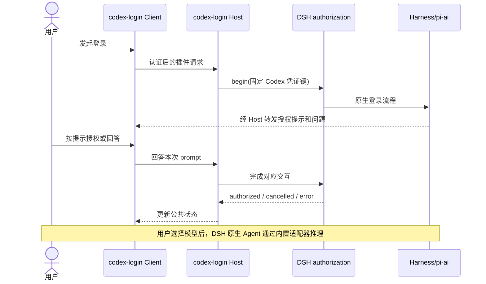

# Codex 订阅登录插件方案与迭代记录（v0.1）

> 本文使命与轮次范围：为 DSH 已有的 `openai-codex` 订阅模型通道补齐独立登录界面，保留 DSH 原生主／子 Agent、工具、审批及会话管理。
> 完成：否。
> 状态：待实施。
> 更新日期：2026-11-26（Asia/Shanghai）。
> 完成日期：—。
> 实现 commit：不适用：本次仅编写方案，尚无插件实现。
> 归档：未归档。
> 当前结论：采用现有 Codex 订阅通道及宿主授权能力；拟新增 `codex-login` 插件，不修改 DSH 内部代码。按用户要求采用简单方案，取消和本地退出沿用宿主能力；取消时的迟到保存、跨进程登录／退出竞争暂不专项处理，不阻塞首版。功能尚未实现或验收。
> 调研代码基线：`63206f698c646e7f0672f896a06253acce3ed864`；编写前工作区干净。宿主声明为 DSH `0.2.2-rc.5`，本机解析出的 pi-ai 为 `1.4.0`。
> 验收基线：尚未验收；调研基线不是插件验收提交，已有 CI 结果不代表本插件通过。
> 关联文档：[项目约定](../AGENTS.md)、[方案模板](plan-template.md)、[插件概念](dsh-concepts.md)、[指定 profile 安装](profile-install.md)、[测试方案](testing-plan.md)、[已有 OpenAI API 接入记录](archive/openai-api-plan.md)。

## 1. 结论摘要

- **问题**：当前 OpenAI API Key 入口不能发起 Codex 订阅登录；宿主已有对应授权流程和模型适配能力，缺少适合本仓库的用户入口。
- **方案**：新增 `@mbda9091/codex-login`，调用宿主已有 `llm-pi-ai/openai-codex` 授权流程。OAuth、凭证保存与刷新、模型请求均由 Harness/pi-ai 持有。
- **执行归属**：订阅仅用于模型推理；主／子 Agent 的编排、工具执行、审批、上下文与持久会话全部继续走 DSH。
- **硬边界**：通过公开插件接口接入，不修改 DSH 源码、安装目录或 `node_modules`，不替换或复制默认模型适配器，不启动 Codex CLI/app-server。
- **当前进展**：用户已确定采用现有 Codex 订阅通道。本次只交付方案；插件、测试及真实账号验证均未开始。
- **下一步**：获得实施指令后，先验证受管 Web profile 中的原生 flow、keyless 路由及公开通信接口，再实现登录面板。

## 2. 范围

### 2.1 目标及完成条件

1. 用户能从 DSH 模型设置中的插件面板发起 ChatGPT 账号授权，看到宿主返回的进度、链接、设备码或问题，并能取消及重试。
2. 授权提交后，界面准确显示“已保存授权”；通过 DSH 原生模型选择与会话完成实际推理，不将存储状态误报成模型可用或套餐有效。
3. 主 Agent 能创建至少两个 DSH 子 Agent 并回收结果；至少一个子 Agent 使用 `openai-codex`，混合模型选择仍按 DSH 原有配置执行。
4. 支持本地退出、宿主重启后的授权状态读取，以及原生凭证刷新链路的验证。
5. 必要验收项全部通过，实现 commit、固定包及验收证据可核对后，才将本文完成标为“是”。文档写完不等于功能完成。

### 2.2 场景与非目标

首版范围为**本机 macOS + Web**，使用普通 Node 24、仓库指定 pnpm、精确匹配的 workspace DSH。首版 `dsh.targets` 拟声明 `surfaces: [web]`、`platforms: [mac]`；Windows、Linux、Desktop 在单独验证后再扩展声明，不用 Node 通用性代替平台证据。

| 事项 | 本轮处理 | 边界 |
|---|---|---|
| 新 SIWC 独立 provider | 不纳入本轮 | 用户已选择现有 `openai-codex` 通道，不实现另一套授权或模型协议 |
| Codex Agent 内核、混合 Agent 后端 | 不纳入本轮 | 所有 Agent 仍由 DSH 执行 |
| 多账号切换、账号轮换、套餐／到期信息解析 | 不纳入本轮 | 原生凭证记录不透明，首版仅使用公共状态，不解析 token |
| 自定义代理、端点、模型目录 | 不新增 | 沿用宿主支持的配置；不对未知覆盖保证订阅语义 |
| 日常 profile 安装与修改 | 不是编写方案的动作 | 后续按用户指定 profile 使用正常安装与设置入口；开发、测试只使用隔离 home |
| 凭证迁移、复制 Codex 登录态 | 不纳入本轮 | 不读取 `~/.codex/auth.json`，不直接读取 DSH 凭证文件 |
| 服务端撤销、清空会话、删除模型配置 | 不纳入本轮 | 首版“退出”仅删除对应本地授权记录，准确告知作用范围 |
| 取消瞬间迟到保存、跨进程登录／退出竞争 | 首版暂不专项处理 | 沿用宿主结果，不增加写入屏障、回滚或跨进程协调，不作为首版验收门槛 |

## 3. 现状与依据

### 3.1 本轮代码事实

以下路径相对于仓库根目录，均为只读查阅；实施时需重新核对冻结安装后的实际版本。

| 已有能力 | 源码／文档入口 | 对本方案的意义 |
|---|---|---|
| pi-ai 注册原生登录 flow，仅排除 `openai` 的 OAuth | `node_modules/@deepseek-ai/dsh-llm-pi-ai/src/login.ts` | `openai-codex` 可复用；不为 API Key 的 `openai` 路由补造 OAuth |
| flow 的 `describe`、`begin`、`cancel` 与交互类型 | `node_modules/@deepseek-ai/dsh-authorization/src/index.ts` | 插件只驱动已经注册的流程，依方法及 prompt 动态呈现 |
| `describeRecord`、`deleteRecord`、串行更新与变更事件 | `node_modules/@deepseek-ai/dsh-credentials/src/index.ts` | 状态与本地退出有公开入口；刷新由宿主负责 |
| 凭证键为 `llm-pi-ai/<provider id>` | `node_modules/@deepseek-ai/dsh-llm-pi-ai/src/auth.ts`、`README.zh.md` | 固定操作 `llm-pi-ai/openai-codex`，不访问其他记录 |
| 模型目录和已激活 provider 可查询 | `node_modules/@deepseek-ai/dsh-llm/src/index.ts` | 区分目录存在、路由已启用与真实推理成功 |
| 模型目录给出 `settingsNs` 和 `settingsPath` | `node_modules/@deepseek-ai/dsh-llm-pi-ai/src/index.ts` | 从公开目录定位有效配置，不假定 loader 行一直叫 `llm-pi-ai` |
| `settings.describe({ redactSecrets: true })` | `node_modules/@deepseek-ai/dsh-settings/src/index.ts` | 只读检查路由与认证覆盖，不写模型配置 |
| `settings.models.footer` 及模型卡片插槽 | `node_modules/@deepseek-ai/dsh-client-ui-settings-models/src/client/slot-contract.ts` | 无模型行时仍能显示登录面板和启用提示 |
| 认证后的 exact Fetch 路由，支持 GET／POST | `node_modules/@deepseek-ai/dsh-client-connection/src/rpc.ts` | Host/Client 通信无需修改内部 Remote 生成表 |
| 已有认证 SSE 与 Client 生命周期实践 | `plugins/notify-web/src/index.ts`、`plugins/notify-web/src/client/index.ts` | 参考通信方式，不跨插件相对导入源码 |

运行时读取内置 provider 目录已确认：本机存在 `openai-codex`，只提供 OAuth，显示名为 `OpenAI Codex (legacy)`；没有触发登录或模型请求。这不是账号可用性或运行时 flow 注册成功的证明。

### 3.2 Git 与历史边界

- 当前基线已包含 `4cc5ca7` 的 DSH `0.2.2-rc.5` 适配；不沿用旧 DSH 类型或社区插件开发依赖覆盖宿主。
- `ee06709` 归档的 OpenAI API Key 配置属于已完成历史轮次。它继续有效，本轮新增订阅入口不重开、不改写其完成结论。
- pi 在 2026-09-29 为旧 Codex provider 加过 `legacy` 名称，2026-11-09 的 1.5.1 已去掉；1.6.0 继续维护该 provider。不能从本地 1.4.0 的名称推断通道已下线。
- 社区同类插件仅作设计参考，其登录、构建或旧宿主验证结果不计为本项目证据，不直接引入其已构建代码。

外部资料查阅日期为 2026-11-25：[pi 1.5.1 变更记录](https://github.com/earendil-works/pi/blob/v1.5.1/packages/ai/CHANGELOG.md)、[pi 1.6.0 发布记录](https://github.com/earendil-works/pi/releases/tag/v1.6.0)、[社区同类插件说明](https://github.com/callqh/dsh-codex-oauth)、[社区验证边界](https://github.com/callqh/dsh-codex-oauth/blob/main/VERIFICATION.md)。

### 3.3 待验证假设

受管 profile 中 flow 能激活、模型页能保存 keyless 路由、真实订阅账号能完成推理，以及正常取消、退出和原生刷新链路，均尚未验证。接口不足或宿主自身缺陷阻止本轮目标时记录受阻，不以修改内部代码、升级依赖或切换 SIWC 作为隐式补救。

评审已确认取消返回不等于底层写入结束，授权排他也仅覆盖同一服务实例；内存探针记录见 §9.2。用户已决定这类极端竞争首版暂不处理，按 §4.4、§4.5 的简单流程实施，不再将写入屏障或跨进程协调作为前置条件。

## 4. 具体方案

### 4.1 结构与职责

拟新增目录 `plugins/codex-login/`，包名 `@mbda9091/codex-login`，loader 行 `id` 为 `codex-login`。包含 `src/index.ts`、Host 授权控制及协议模块、Client 模块、`src/targets.ts`、patch、locale、图标与 README。workspace 仅发现 `plugins/*` 中的活跃插件，不在仓库根目录建插件包。具体拆文件以实现为准，不以文件数量验收。

Host 从 `ctx` 获取服务；Client 用宿主 React、locale、主题 token 和 slots。Client 构建为 classic-script/IIFE；`lib/`、`dist/` 不入库。需要的包内辅助代码构建时内联，DSH 类型版本与根声明一致，不给 profile 安装第二份宿主服务包。

### 4.2 路由配置与前置检查

1. 插件 bundle 只插入自身行。**不插入、替换或清空 `llm-pi-ai.config`，不提供覆盖它的 profile defaults。**
2. 用户通过 DSH 正常模型设置启用 `openai-codex`。目标为原生 keyless 路由：不设置 `apiKeyEnv`，不填 API Key，保持宿主原生协议和端点；最小语义为 `providers.openai-codex: {}`，这不是要求手改或整体覆盖 YAML 的命令。
3. Host 查询原生 flow、公共凭证状态、已激活 provider，并从目录的 `settingsNs/settingsPath` 定位有效配置。配置缺失、诊断错误、显式凭证或认证／端点覆盖分别显示原因；无法确认原生订阅路径时不显示“订阅已就绪”。不把配置值或 header 内容返回页面。
4. 路由未启用时，面板仍可显示启用说明；首版要求先完成路由配置，再启动登录。只看到模型目录不等于路由已经激活。
5. 不自动修改主会话、预设或子 Agent 的模型选择。用户按 DSH 现有方式分别选择；同一系统内其他 provider 继续按原配置运行。

前置检查必须在 Host 接收 `begin` 时重做，不能相信 Client 上次 `status` 的结果。登录期间路由被删除、配置被覆盖或 flow 卸载时，重新读取环境状态；即使凭证随后保存，也分别显示“授权已保存”和路由故障。退出入口不受路由是否启用限制，避免删除路由后无法清理残留授权。至少验证“状态可登录 → 另一标签页删除路由 → 点击登录”和“已保存授权 → 删除路由 → 本地退出”。

### 4.3 登录与状态

固定凭证键为 `llm-pi-ai/openai-codex`。Host 通过 `authorization.describe` 获取方法，要求存在原生 `id: oauth`，不按显示文案猜测认证方式；浏览器／设备码选择由原生 flow 的问题提供，不硬编码另一套 OAuth 协议。

Client 通过公开 `settings.models.footer` 注册唯一登录面板，首版不同时在多个卡片重复渲染。面板提供登录、取消、重试和本地退出，原生 prompt 的 `text/secret/select` 都有对应交互；URL、设备码和 prompt 只发送给发起此次尝试的页面。

状态分为三组，分别呈现：

- **环境**：服务缺失、flow 不可用、路由未启用、配置不符合原生订阅路径、可发起登录。
- **尝试**：空闲、进行中、等待回答、已保存授权、已取消、失败；`authorized` 仅在宿主确认凭证提交后出现。
- **凭证**：无记录、已保存 grant、出现非预期记录。凭证存在不代表未过期、套餐有效或已经验证推理；不从不透明 payload 解码账号、套餐或 expiry。

模型调用由普通 DSH 会话完成，不在设置页自动发起付费探测。在线结果记入验收记录；界面不把一次历史成功永久显示为“模型可用”。

已有 grant 时再次登录会覆盖同一共享键，即使首版不提供多账号管理，也应在发起前提示覆盖范围。重新授权失败／取消时不得主动删除旧 grant；尝试失败与原有记录仍在可以同时出现。旧尝试结果不得覆盖较新尝试的界面，也不得凭一次 `authorized` 结果掩盖随后发生的凭证删除。需要覆盖“旧 grant 存在 → 重登失败”和“授权完成 → 另一页退出 → 旧状态请求迟到”。

### 4.4 Host/Client 通信与资源释放

拟通过 `ctx.connection.fetch.register` 注册插件独占的 `/api/codex-login/` 路由，复用宿主请求信任与 owner 认证，不直接注册未受保护的 WebServer 路由。下列是**拟新增内部协议**，当前尚不可调用：

| 操作 | 方法及用途 | 结果边界 |
|---|---|---|
| 状态 | GET `status` | 环境、flow 方法、凭证存在状态及忙碌状态，不含凭证内容 |
| 发起 | POST `begin` | 携带页面生成的随机 requestId；返回随机 attemptId；后台启动原生 flow，不在 GET 中产生写入 |
| 跟随 | GET `events` | 按 attemptId 返回 SSE 基线及后续事件，仅该尝试可见的提示 |
| 回答 | POST `answer` | 同时校验 attemptId、promptId 和值，过期回答失败 |
| 取消 | POST `cancel` | 只取消插件拥有的匹配尝试，不取消别的发起者 |
| 退出 | POST `sign-out` | 明确执行本地退出，不承诺远端撤销 |

attemptId、promptId 均为不可预测句柄。状态读请求不读取 token；提示正文和授权 URL 不写日志。错误对页面返回可理解的原因及稳定分类，服务端原始响应先脱敏，避免原生异常携带凭证或授权码。

**请求回执与归属。** Host 必须先登记 requestId、attemptId 和状态，再启动 flow。同一 requestId 的重发只返回原尝试，不能再次调用 `authorization.begin`；requestId 是页面内存持有的随机能力句柄，不出现在公共状态中。否则 `begin` 已执行但响应丢失时，页面既拿不到 attemptId，也不能跟随或取消，只能等十分钟超时。取消绑定自有 `AbortController`，不在异步清理中按固定键误取消新尝试；退出期间拒绝本插件的新 begin，退出请求携带独立 requestId 并去重，避免响应丢失后的旧退出重试删除新登录。去重键绑定 Host 生命周期及明确有效期，有效期内保留结果；过期／旧生命周期的请求拒绝，不能因清除缓存而重新执行。此约束只覆盖本插件请求，不能解决 §4.5 的外部进程竞争。

本进程只持有一份活动尝试，多标签页不能重复启动；其他页面只显示“登录进行中”。SSE 断开可在该尝试有效期内重连，先回完整基线；旧 prompt 撤回或尝试结束后清除敏感提示。断线本身不重启登录，也不删除已提交凭证。

**基线与增量的顺序。** 建立 SSE 时，订阅和取得基线之间不得丢事件；每条消息携带本次 Host 生命周期标识、attemptId 和单调 revision。Client 丢弃旧尝试／旧 revision 的响应，重连基线中的终态不得被旧 prompt 覆盖。结束后保留有界、脱敏的终态供持有句柄者查询，同时清除 URL、设备码、prompt 和回答；不重放完整敏感事件历史。验证在“读取基线与挂监听之间完成授权”、prompt 被撤回时重连，以及终态后收到旧 GET 响应。prompt 只结算一次；非法 select 值拒绝，prompt 自身撤回使用普通 abort 错误，不能冒充用户拒绝导致整个尝试被误判取消。

离开模型设置页时，Client 在仍可通信时取消自己持有的尝试。整页关闭或进程退出不保证取消请求能够送达，Host 依靠尝试超时和插件卸载清理收敛。页面重载丢失句柄时只展示忙碌状态，不通过公共状态接口重新获取旧提示；原尝试结束后才能重新发起。已保存授权不随页面关闭删除。

`Config` 拟仅提供可选 `loginTimeoutMs`（默认 600000 ms）控制插件尝试上限；原生 flow 可能更早超时。其余协议参数保持包内常量。计时器、事件、流和路由均纳入 `ctx.effect` 清理；取消时令未完成 prompt 结算，忽略迟到回答。插件卸载取消自己的尝试，关闭流并解除注册，不删除已经保存的授权。

**首版取消按简单流程处理。** 向宿主发送本次尝试的取消信号，按宿主返回结束交互、清理提示，并通过公共状态及凭证事件更新页面。界面将本次取消结果与当前凭证状态分别呈现；不增加阻止迟到保存、等待底层写入排空或自动删除已保存授权的逻辑。这类极端竞争暂不专项验收，也不阻塞后续实施。

设备码上游有效期为 15 分钟，而插件默认上限为 10 分钟，界面以插件剩余时间说明可能更早结束，不承诺等待到原生设备码过期。

**提示与取证。** 当前上游的手工授权码／回调 URL 被宿主映射为 `text` prompt，不能仅将 `secret` kind 当敏感输入；所有 answer、授权链接、设备码与能力句柄都不进入日志、持久前端状态或真实账号的网络 trace。SSE／状态响应使用 `Cache-Control: no-store`；原生文案按文本渲染，链接仅接受合法 http(s) URL，外链隔离 opener／referrer。测试用合成敏感标记检查响应、错误和日志脱敏；真实授权期间暂停会捕获请求／SSE／输入的 trace 或录屏，脱敏后再保存证据。自动化合成夹具的 trace 与真实账号证据分开。

### 4.5 凭证刷新、本地退出和共享范围

刷新完全复用原生适配器，不自建定时刷新、不修改 grant、不复制第二份凭证。状态以宿主公开服务及事件重新读取；插件内存只保存非持久的授权交互。

本地退出先取消本插件的活动尝试，等待宿主返回后调用 `credentials.deleteRecord`，再读取公共凭证状态。若同一授权服务实例报告该键存在本插件以外发起的尝试，提示先结束；不扫描或协调其他进程。删除失败（后端只读、锁等待超时或写盘失败）时保留失败状态并重读，不显示“已退出”。

该凭证可能被同一 DSH home 下的多个 profile 使用；自定义后端路径时，以实际后端为准。退出删除当前本地记录，界面点击前说明共享影响。在无其他登录或刷新并发的正常场景下，删除后的下一次原生模型请求应明确要求重新登录。

首版不为取消／退出竞争增加写入屏障、回滚或跨进程锁，不负责使其他进程已经发起的登录作废。已取得凭证的在途请求可能继续完成；其他登录也可能随后保存记录。这些作为已知限制保留，按用户决定暂不专项验收，不阻塞首版。

首版只提供**本地退出**，不冒充服务端撤销。卸载插件保留授权和用户路由；希望移除本地授权应在卸载前主动退出。无法回收的远端授权由用户在账号端管理，不由插件声称已经撤销。

### 4.6 开发、安装与回退

- 开发用受管 `.local/dsh-dev/home`，测试用新建 `.tmp` home/profile；测试不得复制日常 home 的授权或会话。
- 冻结依赖保持不变，不因旧显示名自动升级 pi-ai 或 DSH。运行时缺 flow／接口则提示不兼容，不改内部代码绕过。
- 实现完成后才运行 `node scripts/dev.mjs build --check`、`build`、`test`、`pack`、`l4`、`l5` 及固定包验证；新增插件能力要接入 L4/L5 实际交互检查，不能只验证已有插件。
- 开发安装仍用 `dev-install`；外部安装以 [profile 安装指南](profile-install.md) 为准，目标 profile 显式指定，使用 `--only @mbda9091/codex-login`。该选择仅在包实现后有效，不是当前可执行步骤。
- Host 代码更新需要重启时交由用户处理；不自动启动、停止或重启日常 DSH。
- 回退通过正常插件管理器停用／移除本插件；不手工改 profile 的 `package.json`，不在 profile 内运行 pnpm，不自动删除模型路由或凭证。

## 5. 里程碑

| 阶段 | 交付与出口条件 | 状态 | 完成 | 实现 commit／证据 |
|---|---|---|---|---|
| M1：公开接口与隔离验证 | 新包、target 守卫、认证状态入口和最小面板；受管 profile 确认 flow、keyless 路由与通信；不触发真实 OAuth，不以极端竞争处理为前置条件 | 待实施；简单方案已定 | 否 | 无；A1–A3 未执行；历史内存探针不构成验收 |
| M2：完整登录交互 | notice/prompt、SSE 重连、并发排他、取消／重试／超时、退出及清理；契约测试和真实 Web 页面检查 | 待实施 | 否 | 无；A4–A7、A11 未执行 |
| M3：真实订阅与交付 | 人工授权、真实推理和审批、并发子 Agent、重启及原生刷新；固定包与实现提交对账 | 待实施 | 否 | 无；A8–A10、A12 未执行 |

M3 依赖可用订阅账号与人工浏览器授权。未获得在线证据时，保持待验收，不用模拟 OAuth 或其他模型结果填补。

## 6. 决策记录

| 决策 | 理由及决定来源 | 状态 |
|---|---|---|
| 使用已有 `openai-codex` 订阅通道 | 用户明确“我们就按老的走，订阅制”；新 SIWC 独立适配不属于本轮 | 已定，2026-11-25 |
| 自建薄登录插件 | 源码在本仓库维护，复用宿主负责的协议与刷新 | 已定 |
| 所有 Agent 由 DSH 执行 | 用户明确统一走 DSH，子 Agent 可保留不同模型配置 | 已定 |
| 只调用公开接口 | 用户禁止修改 DSH 内部代码；接口不足须报告限制 | 已定 |
| 首版本机 macOS Web | 当前可核验环境；其他平台独立验证后再扩展 | 实施范围提案 |
| 模型配置由正常设置入口保存 | 遵循本仓库配置层序规则，避免覆盖已有 provider | 已定 |
| 不解析凭证 payload，退出仅本地 | 公共服务足以呈现存在状态；减少对宿主私有格式的依赖 | 已定 |
| 取消／退出采用简单流程，极端竞争暂不处理 | 用户明确“按简单的来，这种 case 非常边界，可以暂时不考虑”；沿用宿主能力，不增加屏障、回滚或跨进程协调 | 已定，2026-11-26 |

## 7. 风险与开放问题

| 问题／风险 | 影响及解决方式 | 当前状态 |
|---|---|---|
| 实际 profile 中原生 flow 或路由不可用 | M1 在精确版本上验证；失败记录具体缺少接口，不复制内部实现 | 待验证 |
| Models 页已有设置覆盖导致 keyless 路由无法保存 | 检查有效配置及设置页错误，按用户配置层解决；不清空或重写整段 provider | 待验证 |
| 上游登录端口占用或设备码不可用 | 转达原生错误，允许用户重试／选宿主已有方法；不自启第二套 OAuth | 待验证 |
| 取消时迟到保存、刷新／退出及跨进程竞争 | 沿用宿主行为，保留已知限制；首版不增加屏障、回滚或协调，不专项验收 | 用户明确暂缓；不阻塞首版 |
| 请求回执丢失或旧响应乱序 | begin／退出去重；尝试归属、生命周期和 revision 校验；SSE 基线与监听不丢事件 | 设计补充，待实施 |
| 真实账号证据泄露临时授权信息 | text prompt 也可能携带授权码；真实登录停用捕获敏感内容的 trace，合成夹具单独取证 | 设计补充，待验收 |
| 已保存 grant 不能证明模型可用 | A8–A10 采用同一真实账号和该 provider 取证；额度或权限错误保持失败／受阻 | 待验证 |
| 默认子 Agent 路由继承与模型授权限制 | 使用 DSH 现有配置明确选择并核验实际 provider/model，区分父任务排队与真正并发 | 待验证 |
| 本地退出影响同 home 的其他 profile | 按共享凭证键如实提示；测试只使用隔离 home，不操作日常授权 | 设计已明确，未验收 |
| 依赖版本带旧名称 | 记录准确版本；旧名称不触发升级，不构成停服结论 | 已明确 |

未决问题不改变用户目标。若必须改宿主、替换适配器、扩大平台范围或改变退出语义才能继续，先回报证据并讨论范围，不能删去失败验收项制造完成。

## 8. 验收状态

> 截至 2026-11-26：插件未实现，以下功能验收全部未执行。报告应记录实现 SHA、包哈希、DSH／pi-ai／Node／pnpm／浏览器版本、home/profile 用途及平台。账号、授权 URL 和凭证不进入报告。

| 项目 | 可观察的预期结果与验证环境 | 当前结果／证据 |
|---|---|---|
| A1：独立包及边界 | `build --check`、L1–L3、pack 检查 target、元数据、真实类型、入口和自包含；patch 只插入自身行；依赖与宿主代码未被改写 | 未执行；无 |
| A2：配置与环境诊断 | 一次性真实 Web profile 分别缺 flow、缺路由、有 API Key／认证覆盖；面板可见并说明原因；原有 provider 配置不变 | 未执行；无 |
| A3：通信权限 | 未认证请求被拒绝，非 owner 请求不能控制登录；错误 method／body 不产生副作用；不暴露任意凭证键 | 未执行；无 |
| A4：授权交互 | 契约 fixture 覆盖所有 notice/prompt、完成、失败、prompt 单独撤回；值只交给准确的原生 prompt；重复回答／非法 select 拒绝；单独撤回不冒充用户拒绝；已有 grant 重登失败不误删旧记录 | 未执行；无；模拟不证明真实 OAuth |
| A5：并发与重连 | 真实双标签页只有一个活动尝试；第二页不收到私有提示；begin 响应丢失后相同 requestId 可找回原尝试；SSE 建立边界完成／撤回不丢事件；旧 GET、旧终态和旧 prompt 不覆盖新状态 | 未执行；无；需可控响应／调度钩子 |
| A6：取消和清理 | 正常用户取消、超时、关闭界面／连接中断后重连、Host 卸载均符合 §4.4；本插件的 prompt／计时器／连接正确清理，界面按宿主结果更新；不要求证明底层写入排空 | 未执行；极端提交竞争不在首版专项范围 |
| A7：本地退出 | 无其他登录或刷新并发时，隔离环境取消自有尝试、删除固定记录并重读；同进程外部尝试忙碌时提示；只读／锁超时不误报成功；删除路由后仍可退出；下一次请求要求登录 | 未执行；跨进程及迟到提交竞争暂不专项验收 |
| A8：真实账号登录 | 人工在隔离 Web 完成原生 OAuth，宿主报告 authorized，状态变为已保存 grant；截图与摘要脱敏，不读取 token | 未执行；无；需要人工授权 |
| A9：推理与审批 | 同一固定包、账号和 `openai-codex` 模型真实流式回复；发生一次真实 DSH 工具审批并执行／拒绝；核对会话 provider/model 和结果 | 未执行；无 |
| A10：主／子 Agent | 主 Agent 实际启动至少两个 DSH 子 Agent，其中至少一个使用订阅路由；回收结果且无重复／串会话；单独验证混合模型配置未被插件改写 | 未执行；无；混合模型需另有已配置路由 |
| A11：界面与故障 | L5 真实插件 slot 在中英文、明暗主题显示；无控制台崩溃；text 授权码／设备码／URL／错误以合成标记检查脱敏，不被 HTML 执行；真实账号 trace 不捕获敏感数据；设备码显示插件截止时间；卸载移除 UI，不误删授权 | 未执行；无 |
| A12：持久化、刷新与固定包 | 重启后不重新登录即可真实推理；原生授权自然临近／达到刷新条件时并发请求成功；L4/L5 与固定 tarball 报告齐全，对账实现 commit | 未执行；无；不改真实 expiry 或伪造刷新作为在线通过 |

自动化采用隔离 fixture 验证状态机和原生接口交互；fixture 只进入一次性测试 profile，不替换运行中的用户服务。L5 模拟登录提示只证明界面和协议；A8–A10 及 A12 的在线部分必须用真实订阅执行。真实刷新需要等待原生刷新条件，等待期间允许先记录其他通过项，但不能提前关闭本轮。

A10 的混合配置不是要求将全部子 Agent 改成订阅模型。若没有另一条可用测试路由，保留该子项未执行并记录缺少环境，不据此声称混合配置已通过。

## 9. 实施结果与修正

### 9.1 方案编写（2026-11-25）

- 实际完成：阅读项目规则、方案模板、相关 Git 历史和本地公开接口；复核上游 legacy 名称变化与社区验证边界；新增本文及文档导航入口。
- 代码状态：尚未实施插件；没有新增 `codex-login/`，没有安装、修改依赖、登录账号或修改任何 profile。
- 实现 commit：不适用，本轮到此只有文档变更且未提交。
- 验证：文档 diff、7 个本地引用、10 个章节、12 项未执行验收记录及模板占位检查通过；未运行 build、L1–L5 或在线模型测试。本节不构成第 8 节功能验收通过。
- 有效决定：采用现有 Codex 订阅通道；先前对新 SIWC 的临时评估不作为本文实施要求，也不影响已有 API Key 接入历史完成记录。

实施后在本文追加 9.2 起的记录，逐项填写真实实现提交、包哈希、环境、命令、结果、证据及欠项，并同步文首、第 5、8、10 节。

### 9.2 方案评审（2026-11-26）

- 范围：复核本地 DSH `0.2.2-rc.5`／pi-ai `1.4.0` 的 authorization、凭证后端、登录适配、模型配置及通信接口；未实施插件或修改依赖。
- 初次评审结果：曾将取消后的迟到写入列为优先解决项，并指出跨进程授权排他缺少公开保证；现按 §9.3 的用户决定暂缓专项处理。其余补充包括请求回执丢失、SSE 乱序、已有 grant 重登、动态配置及敏感取证约束，并修正插件目录和参考源码路径。
- 已执行：内存夹具使用真实 AuthorizationService／Models.login，阻塞 store.modify 后取消，确认返回 cancelled／inFlight=false，释放阻塞后记录仍写入；断言通过、命令退出码 0。夹具未调用真实 provider OAuth、未写磁盘凭证，不能外推为真实后端／在线验收。
- 外部核对：[OpenAI 认证说明](https://learn.chatgpt.com/docs/auth)确认浏览器回调使用 localhost:1455，设备码还受个人设置或 workspace 管理员开关影响。当前本地上游也支持端口占用时手工粘贴；需分别验收，不承诺端口占用会自动切换设备码。首版本机 Web 不包含远程浏览器回调支持，也不引入 Codex CLI 配置／凭证迁移。
- 未执行：真实凭证后端的可控时序、多进程竞争、build、L1–L5 和真实账号推理／刷新。M1–M3 及 A1–A12 均未标通过；没有 commit、push 或发布。
- 解释修正：首次评审将“缺少阻止迟到提交的能力”概括为关键阻塞，范围过强。已区分可观察的宿主行为与待明确的产品承诺；取消后完全不落盘、退出阻止其他进程登录均不是默认新增要求。是否受阻应按明确后的承诺判断。

### 9.3 首版范围简化（2026-11-26）

- 用户决定：按简单方案实施，取消瞬间的迟到保存及相关极端竞争暂不考虑。
- 方案调整：取消请求与本地记录删除直接复用宿主；移除写入排空、回滚、跨进程协调的前置要求，更新 M1、M3、风险及 A6／A7／A12，不再等待额外语义确认。
- 保留：正常登录、取消／重试、退出、状态读取和原生刷新验收；极端竞争列为已知限制，不标已解决或已通过。
- 本次仅更新方案，未实施插件或运行功能测试。

## 10. 当前未完成事项与下一步

| 事项 | 分类及状态 | 下一步 |
|---|---|---|
| 包骨架、target、Host/Client 最小链路 | M1 待实施 | 按已确定的简单方案验证原生 flow、keyless 路由和通信，开发 `plugins/codex-login/` |
| 登录状态、提示、并发、取消、退出与清理 | M2 待实施 | M1 确认公开接口可用后实现，回写契约与页面检查结果 |
| 真实登录、推理、审批、子 Agent 与刷新 | M3 待验收准备 | 使用独立测试 home 与人工授权，分开记录模拟与在线证据 |
| 固定包、L4/L5、实现 commit 对账 | 交付欠项 | 同一候选包验证后补齐 SHA／哈希；未提交时不标已完成 |

用户已授权提交并推送本次方案与文档导航；该文档提交不代表插件已实现或验收。后续获得插件实施指令后从 M1 开始，不自动安装到日常环境或发布插件。
