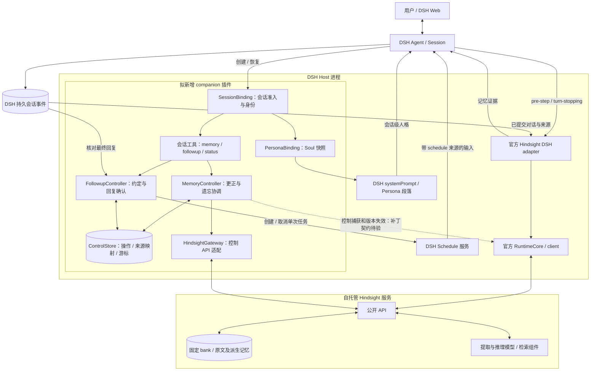
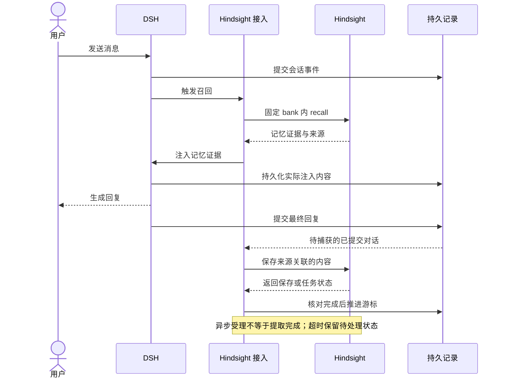
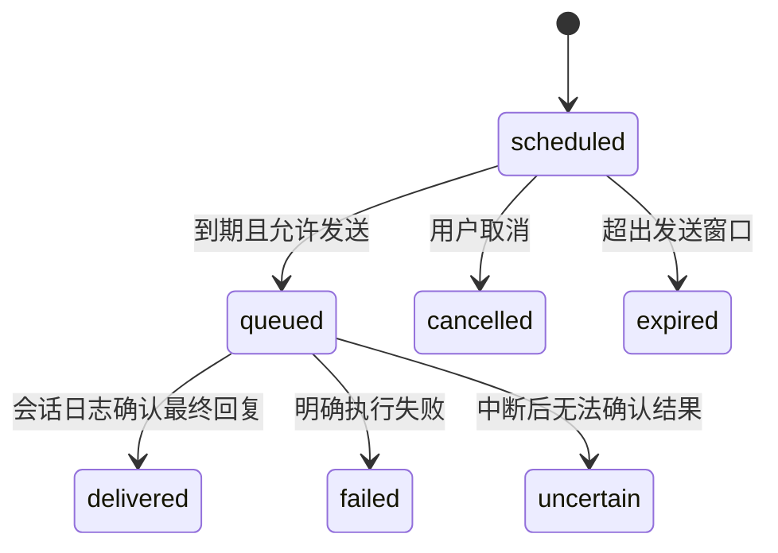

# Hindsight 记忆接入与 DSH 伙伴方案

> 2026-11-13 方向调整：后续工作以[总体设计](role-agent-design.md)与[初步落地](role-agent-initial-plan.md)为准。本文保留旧目标下的接入草案；范围、阶段和验收需重新评估，不能直接作为新方向的实施入口。此前后端选择记录保留，不代表整体角色架构已确定。

> 状态：草案，尚未实现或验收；完成：否。更新：2026-11-13。
> 实现 commit：未提交；验收基线：尚未建立。
> 目标：将 Hindsight 接入 DSH，提供跨会话记忆、记忆纠错与明确约定的回访。

## 1. 结论摘要

- Hindsight 保存长期记忆；优先复用官方 `@vectorize-io/hindsight-coding-agents` 的 DSH 入口。
- 拟新增一个 Host-only `companion/` 插件，内部拆分宿主适配、会话绑定、记忆控制与执行记录；人格复用 DSH 提示注册机制，定时唤醒优先复用 Schedule。
- 使用自托管服务、固定 bank 和专用伙伴工作目录，关闭官方插件的代码扫描、Git 导入及自动更新。
- 先跑通“对话保存 → 新会话召回”，再实现纠错、遗忘、故障恢复和回访。

## 2. 范围

首轮支持单用户、单伙伴、Linux Web，宿主为 DSH `0.2.2-rc.1`、Cordis `4.1.0`、Node 24。

本轮实现：跨会话记忆、Soul 注入、查看/更正/更新/遗忘记忆、已约定回访及重启恢复。回访仅在 DSH 在线时执行，默认关闭。

不包含：历史编码会话导入、多用户、多伙伴、外部聊天渠道、离线唤醒和管理面板。完成条件为第 5 节各阶段交付，并通过第 8 节对应验收。

## 3. 接入基础与待验证点

以下沿用 2026-11-12 的源码核对记录，**不是固定发布包的兼容性结论**。

| 官方组件 | 接入用途 | 实施前检查 |
|---|---|---|
| [包清单](https://github.com/vectorize-io/hindsight/blob/main/hindsight-integrations/coding-agents/package.json)与 [DSH patch](https://github.com/vectorize-io/hindsight/blob/main/hindsight-integrations/coding-agents/cordis.patch.yml) | 包提供 `/dsh` 入口及 bundle patch | 固定 npm 版本和完整性，确认安装产物与源码对应 |
| [配置模块](https://github.com/vectorize-io/hindsight/blob/main/hindsight-integrations/coding-agents/src/core/config.ts) | 固定 bank、限定工作目录、控制自动采集和注入 | 逐项验证第 4.3 节配置实际生效 |
| [DSH 入口](https://github.com/vectorize-io/hindsight/blob/main/hindsight-integrations/coding-agents/src/dsh.ts) | 会话事件、历史去重、记忆注入 | 验证当前宿主事件、恢复、压缩、取消及卸载 |
| [共享 runtime](https://github.com/vectorize-io/hindsight/blob/main/hindsight-integrations/coding-agents/src/core/runtime.ts) | 捕获、注入、flush | 验证写回完成、关闭 flush、重启游标和失败重试 |

已有兼容性疑点：上游入口使用的启动事件与本地 DSH 类型声明有差异；pre-step 返回值可能未保留完整决策字段。先用固定包复现，仅修已证实的问题；若需要改写决策，保留 `{ ...decision, messages }`。

## 4. 具体实现

### 4.1 参考实现与组件架构

#### 参考了哪些实现

2026-11-13 阅读以下源码/包文档，未安装社区插件或验证它们与本方案的组合。只借鉴与 Hindsight 接入直接相关的设计。

| 参考 | 实际设计 | 本方案采用什么 |
|---|---|---|
| [官方 Hindsight DSH 入口](https://github.com/vectorize-io/hindsight/blob/main/hindsight-integrations/coding-agents/src/dsh.ts) | DSH 事件适配 → 按 workspace 缓存的 `RuntimeCore` → Hindsight client；pre-step 召回、turn-stopping 写回；分叉只读取自身新增事件 | 复用事件适配与核心运行时，核对当前宿主契约；固定伙伴 bank，但工作目录准入仍需独立判断 |
| [companion-memory 固定源码](https://github.com/123zxs345/dsh-plugin-companion-memory/tree/be24c4525245b0eafb901d1a850af44914ccd6c9)及[技术说明](https://github.com/123zxs345/dsh-plugin-companion-memory/blob/be24c4525245b0eafb901d1a850af44914ccd6c9/docs/architecture.md) | Host 控制器管理 SQLite、整理任务和 Hindsight 索引；在 `agent/created` 下挂载会话子插件，分开注册上下文和工具；读取前后核对记忆版本 | 借鉴 Host/Agent 作用域拆分、短摘要与按需展开、版本失效和操作恢复。它以本地 SQLite 保存记忆、Hindsight chunks 做检索，与本方案不同，不整包叠装 |
| 本地 `@deepseek-ai/dsh-persona@0.2.2-rc.1` | 人格行只挂在 agent preset 作用域，使用 `systemPrompt.section` 遮蔽部署默认人格 | 复用人格段落契约；`companion` 只补 Soul 加载、快照和恢复，不重新设计提示词体系 |
| 本地 `@deepseek-ai/dsh-schedule@0.2.2-rc.1` | Host 持久化任务，统一管理 API，到期投递至 Session；回执只证明入队，可能至少一次投递 | 复用计时、持久化和冷会话恢复；伙伴层只维护回访政策、关联 ID 和回复确认 |
| [dsh-proactive 文档](https://github.com/john-walks-slow/dsh-proactive/blob/main/README.md) | Host 级闹钟、恢复冷会话、区分宿主唤醒与用户输入，允许无需打扰时静默结束 | 借鉴唤醒来源与静默判断。本轮不新增第二套闹钟，也不照搬会话压缩/墓碑机制 |

本地依据为对应包的 `README.zh.md`、Persona 的 `lib/index.js` 及 DSH Agent 类型声明。社区源码展示的是实现方式，不代表已通过本仓库验收；官方 Hindsight 与 proactive 的 main 链接需在 M1 固定提交。

#### 部署单元与模块边界

**仍只有一个拟新增插件，不把每个模块拆成独立服务或 npm 包。** DSH Host 管执行，Hindsight 服务管长期记忆，浏览器只提供现有聊天界面。



虚线不是上游已有公开接口。M1 先证明官方插件能够独立完成读写；M3 再验证更正期间能否控制后台写入。若没有公开控制点，使用固定版本的最小适配补丁；不能让 `companion` 通过私有 runtime 对象或监听器顺序碰巧控制写入。

#### Host 与会话作用域

| 层级 | 生命周期与职责 | 边界 |
|---|---|---|
| Host 入口 | 校验场景，打开 ControlStore，创建控制器，注册 Agent 生命周期监听 | 不在 import 时联网，不把人格全局挂载 |
| SessionBinding | 接收创建/恢复的根 Agent；检查 profile、preset、工作目录，绑定 companionId/bankId | 仅授权的伙伴会话挂载工具和人格；子 Agent 默认不重复捕获/召回 |
| 会话子上下文 | 注册人格段落、伙伴工具、必要的来源及回访观察器 | Agent 销毁时释放；Host 卸载也保留 disposer 统一清理 |
| 官方记忆接入 | 自动捕获、自动召回及普通记忆查询 | 同一会话仅一套自动路径；M2 不再在 companion 中复制 recall 钩子 |
| MemoryController | 显式更正、状态更新、遗忘及操作状态 | 所有控制调用都经过身份、来源和版本核对 |
| FollowupController | 约定授权、任务关联、取消及最终回复确认 | 不另写 Cron 求值器；Schedule 回执不当作已回复 |
| HindsightGateway | 封装固定版本的查询/更正/删除/任务状态接口 | HTTP 和 SDK 类型不泄漏给工具与业务模块；不直接修改服务数据库 |

#### 谁拥有哪份数据

| 数据 | 权威位置 | 本地允许保留的副本 |
|---|---|---|
| 用户/助手原始会话、实际注入内容 | DSH Session 日志 | 事件引用与派生游标 |
| 长期事实、经历、记忆源文档及派生结果 | Hindsight bank | 有界召回缓存，随版本变化失效 |
| 人格正文 | 本地 `SOUL.md`；会话使用启动时快照 | 可从合法会话记录恢复的正文及哈希 |
| 更正/删除执行状态、来源映射 | companion ControlStore | 内存索引，可重建 |
| 定时任务、下次触发和入队回执 | DSH Schedule | scheduleId 与回访操作的映射，不复制任务引擎 |
| 是否真的回复、回复属于哪个回访 | DSH 会话事件 + 回访关联记录 | 最终状态投影 |

ControlStore 拟优先使用宿主 `storageDomain` 注册独立领域，按 profile/companion 隔离键；不复制社区插件的记忆正文 SQLite。注册方式和恢复原子性在 M1 核对。状态更新采用同一伙伴内的短事务串行化，网络请求不占用存储事务。

#### 内部记录契约（拟新增，不是 Hindsight API 字段）

| 记录 | 最小字段 | 用途 |
|---|---|---|
| `SessionBinding` | profile、companionId、bankId、sessionId、cwd、soulHash | 将当前工具调用绑定到唯一伙伴；不让模型传 bankId 越界 |
| `SourceRef` | sessionId、稳定 event 标识、documentId、revision | 避免分叉/恢复重复写入；文档标识映射需验证上游支持 |
| `MemoryOperation` | operationId、kind、目标引用、预期版本、状态、后端任务引用、错误 | 区分已受理、执行中、已确认与结果未知 |
| `FollowupRecord` | operationId、scheduleId、sessionId、授权来源、时间窗、关联记忆引用、最终事件引用 | 取消相关约定，核对是否已实际回复 |

控制接口由工具与未来 UI 共用，不在工具 execute 中直接拼 HTTP 请求。M1/M2 的普通捕获仍由官方插件负责；只有 M3 确认需要协调时才增加控制记录与适配接口。

### 4.2 部署与数据隔离

- **服务**：固定 Hindsight 镜像版本与 digest，数据卷放在仓库和插件目录之外；API 与控制台绑定回环地址。
- **模型**：按固定服务版本配置提取/推理模型和 embedding、rerank 组件；验收记录模型名与参数，密钥不入库。
- **身份**：专用 DSH profile、无 Git 仓库的伙伴工作目录、固定 `bankId`。切换 cwd 不改变伙伴身份。
- **环境**：开发、测试、日常分别使用 bank、运行目录和数据卷；bank 分区不能代替 API 认证。
- **恢复**：一起备份 Hindsight 数据、Soul、控制记录及配置引用；恢复时暂停捕获和回访，核对游标后再启用。

### 4.3 官方插件配置

通过 `HINDSIGHT_CONFIG` 指向专用外部 JSON 文件，不覆盖默认配置。以下是**待固定版本验证的配置草案**，路径须替换。

```json
{
  "serverMode": "self-hosted",
  "apiUrl": "http://127.0.0.1:8888",
  "bankId": "companion-dev-primary",
  "dynamicBankId": false,
  "optInOnly": true,
  "optInPaths": ["<伙伴工作目录绝对路径>"],
  "autoUpdate": false,
  "autoSeed": false,
  "codebaseSurvey": false,
  "gitIngest": "none",
  "retainSessions": true,
  "autoInject": "recall",
  "injectTimeoutMs": 3000,
  "recallOptions": {
    "types": ["world", "experience"],
    "budget": "low",
    "max_tokens": 2000
  },
  "manageBankConfig": false,
  "pageTriggerType": "manual"
}
```

M1 必须验证：

1. 固定 bank 生效，非 opt-in 目录不采集。
2. 没有 Git 导入、代码扫描、自动升级或非预期的编码提示/页面初始化。`manual` 不等于禁用页面创建，`manageBankConfig: false` 的实际边界需核对。
3. `recall` 注入时机与同会话的话题切换行为符合预期；复杂查询才按需使用 `reflect`。
4. 专用配置路径在插件加载前传入进程；另行核查日志、缓存及技能同步路径，不能假定一个配置文件隔离了全部状态。

官方包使用自带 patch 安装，参考形式为：

```sh
dsh plugin --profile <伙伴profile> add @vectorize-io/hindsight-coding-agents@<固定版本>
```

实施时使用精确匹配的宿主 CLI，在隔离 profile 验证。自研 `companion` 插件使用仓库 `dev.mjs` / `install.mjs` 流程；官方第三方包单独记录版本，不假定仓库安装器已管理它。

### 4.4 记忆读写流程



图中触发点和完成确认是目标契约，具体映射以 M1 固定版本接口验证为准。

- 保存内容关联稳定文档标识、session/event 来源和版本；复用上游现有标识，不能自行假定 API 字段。
- 偏好、共同经历和约定可进入长期记忆；阶段状态带观察时间和有效范围，短暂情绪默认只留当前会话。
- 召回和 reflect 结果是证据或推断，不是用户指令。当前用户明确更正优先，记忆不得改写 Soul。
- Soul 新会话生效、会话内冻结；恢复与压缩继续使用原快照。使用宿主提示扩展点，不替换整个系统提示。
- Hindsight 不可用时继续普通对话，查询错误可见，写入标记待处理；恢复后按来源和版本重试，核对完成再推进游标。

### 4.5 更正、更新与遗忘

拟新增 `companion_memory` 工具：

| 操作 | 输入语义 | 完成条件 |
|---|---|---|
| `inspect` | 查询条件或记忆引用 | 返回内容、来源和可用状态 |
| `correct` | 目标引用、错误内容、更正内容 | 新内容可查，旧错误不再作为有效事实召回 |
| `update` | 目标引用、新状态、生效时间 | 保留历史时态，当前状态可区分 |
| `forget` | 目标引用和删除范围 | 源内容及相关派生数据核对完毕，旧任务不重新写入 |
| `status` | 操作 ID | 返回处理中、成功或失败及具体原因 |

执行步骤：记录操作和目标版本 → 协调受影响的捕获任务 → 调用固定版本支持的 API → 核对源文档、派生记忆及缓存 → 保存结果。具体删除/替换接口在 M3 确认，不直接修改数据库内部结构。

遗忘同时取消相关回访，检查 facts、observations、pages/mental models 与迟到抽取任务的联动。无法证明清理完成时，不报告遗忘成功。当前会话已含旧内容时追加更正或切换干净会话；原始 DSH 日志及备份不在该操作的删除范围内。

### 4.6 回访与重启恢复

拟新增 `companion_followup`（`schedule/list/cancel`）和 `companion_status`。约定记录包含操作 ID、话题、绑定会话、时区、发送窗口及状态。



执行分为两层：

1. **创建约定**：`FollowupController` 保存用户授权来源和时间窗，通过 Schedule 管理 API 创建单次 `at/after` 任务，绑定已有 Session，再保存 scheduleId。两个存储不是同一事务；中途失败标为待核对，不盲目再创建一份任务。
2. **到期入队**：由 Schedule 计时并恢复冷会话，使用宿主的 `schedule` 来源。业务层不能伪装成新用户消息；`queued` 只表示指令入队。
3. **生成前检查**：伙伴会话适配器根据操作 ID 检查约定、用户是否已回答、有效窗口和取消状态。过期或失效时走宿主支持的静默结束路径；不能只依赖模型遵守提示。拦截位置与取消语义是 M4 验证门槛。
4. **确认回复**：核对对应轮次的最终助手消息再标 delivered。Schedule 可能至少一次投递，因此用 operationId 核对重复唤醒；无法确定已经执行时标 uncertain，不自动补发。
5. **取消与卸载**：取消约定同时删除关联 Schedule 任务；若已入队，再阻止尚未开始的伙伴回复。已开始生成的中止能力单独验证。插件停用先暂停关联任务，再清理监听器；不删除其他来源的 Schedule 任务。

Schedule 缺失时回访功能明确不可用，记忆功能继续运行。它不是发送前策略钩子的现成保证：若当前宿主无法在生成前可靠检查取消和重复任务，M4 不验收、不默认启用；再决定是否需要一个最小唤醒适配器。

### 4.7 拟新增代码与交付

```text
companion/
├── package.json / cordis.patch.yml
├── src/
│   ├── index.ts               # Host 装配和统一清理
│   ├── targets.ts             # Web/Linux 场景守卫
│   ├── session-binding.ts     # 准入、身份、会话子上下文
│   ├── persona.ts             # Soul 快照、恢复、人格段落
│   ├── tools.ts               # Schema、调用者解析、调用控制器
│   ├── memory-controller.ts   # 更正/更新/遗忘业务流程
│   ├── hindsight-gateway.ts   # 固定版本公开 API 适配
│   ├── control-store.ts       # 操作、来源映射、版本与恢复
│   └── followup.ts            # Schedule 适配和回复确认
├── locale/
└── README.md
```

只有验证确认需要时，才增加 Hindsight 适配补丁；具体传输封装随固定 API 确定。Host-only 能力验证须覆盖真实工具调用，打包后使用 tarball 验证，不能仅验证源码 link。

停用顺序：停回访 → 停捕获 → 禁用插件。保留 bank 与备份，不因卸载删除记忆；版本升级前备份，数据回退能力按固定服务版本核对。

### 4.8 生命周期与错误处理

| 时点 | 执行路径 | 失败时行为 |
|---|---|---|
| Host 启用 | 场景守卫 → 加载配置 → 打开控制记录 → 注册监听/服务 | 存储不可读则拒绝控制操作，不丢弃旧记录继续启动写入 |
| Agent 创建或恢复 | 会话准入 → 绑定身份 → 恢复 Soul 快照 → 挂载局部工具/人格 | 未授权会话不挂载；缺失快照不得静默使用新 Soul 冒充旧人格 |
| 新用户输入 | 官方 adapter pre-step → recall → 持久注入 → 模型执行 | 超时继续普通对话并标记记忆不可用；工具续步不重复召回 |
| 回合结束 | 官方写回读取已提交事件 → retain → 完成核对 | 受理与提取完成分开；失败保留可恢复来源，不推进已确认游标 |
| 更正/遗忘 | 校验来源/版本 → 记录操作 → 协调旧任务 → 后端修改 → 回读 → 失效缓存 | 超时记 unknown/处理中；旧查询返回时重新检查版本，不注入过期内容 |
| Agent/Host 销毁 | 停止新请求 → 取消或等待在途操作 → 释放子上下文 → 关闭自有存储 | 保存未完成状态，重启先核对后端任务再决定重试 |

**记忆读取采用“短结果 → 按需详情”**：先在上下文提供有来源引用的有限摘要；确需细节再调用查询工具展开。借鉴社区的渐进披露方式，但不复制其 24 条候选、相似度阈值或三层本地正文库；本方案的 2000-token 配置只是初始实验预算。官方结果若没有可稳定展开的引用，M2 应先补引用映射或限制功能，不能捏造原话。

**写入和更正只有一个协调顺序**：M2 仅验证普通捕获；M3 引入记忆 revision、受影响来源的失效标记以及后端任务核对。普通自动捕获也必须服从这些标记，不能只给模型工具加 guard。没有可用控制点时，先固定补丁入口再开放更正/遗忘。

## 5. 里程碑

| 阶段 | 实现内容 | 出口条件 | 状态 |
|---|---|---|---|
| M1 | 固定服务/插件版本，验证配置、作用域、Persona/Schedule 与存储接口 | 确定原版或最小补丁；A1/A2 通过 | 待实施 |
| M2 | 官方记忆链路、Soul 快照与注入 | 真实跨会话记忆闭环；A3/A4 通过 | 待实施 |
| M3 | 记忆控制、状态时效、失败队列及恢复 | A5–A7 通过，删除和迟到任务无回流 | 待实施 |
| M4 | 回访记录、Schedule 适配、生成前检查、取消与回复核对 | A8 通过 | 待实施 |
| M5 | 固定 tarball、能力契约及交付说明 | A9/A10 通过，版本与实测记录齐全 | 待实施 |

所有阶段尚无实现 commit。M2 可提供最小体验，不代表纠错和回访已完成。

## 6. 实现决策

| 决策 | 实现约束 |
|---|---|
| Hindsight 为选定后端 | 长期记忆只写入 Hindsight |
| 官方 DSH 入口优先 | 仅对已复现的兼容或控制缺口做最小补丁 |
| 固定 bank | 不以 cwd 推导伙伴身份；仍检查工作目录准入 |
| Host 控制器 + 会话子上下文 | 操作状态集中，工具和人格只进入伙伴会话 |
| 复用 Persona/Schedule 契约 | 不另建人格注册体系或第二套计时引擎，缺失控制点通过实验判定 |
| Soul 与记忆分离 | 记忆影响回答依据，不自动修改人格 |
| recall 优先、reflect 按需 | 先验证召回效果和延迟，再增加综合推理 |

除后端选择已定，其余为本方案建议，需在 M1/M2 验证后落实。

## 7. 必须解决的接口问题

| 问题 | 解决阶段与方法 |
|---|---|
| 当前 DSH 的启动事件、pre-step 字段和卸载清理是否兼容？ | M1：固定包加载、恢复、取消和卸载实验 |
| 编码提示、页面初始化及技能同步能否关闭？ | M1：检查实际注入与文件/API 副作用 |
| 保存操作是否具有稳定标识、完成查询及可靠恢复？ | M1/M3：核对 API，注入断网和重启故障 |
| 更正/遗忘能否清理派生数据并阻止旧任务回流？ | M3：源文档、派生数据和迟到任务逐层回读 |
| Schedule 入队后如何可靠拦截已取消、过期或重复的回访？ | M4：验证生成前扩展点、取消与最终事件关联；不把入队回执当作回复 |
| Soul 快照和 ControlStore 如何使用合法持久接口？ | M1/M2：核对会话事件、提示注册与 storageDomain；验证恢复和作用域隔离 |

## 8. 验收状态

截至 2026-11-13，以下均**未实现、未执行验收**。使用合成资料与隔离 profile/bank；真实报告记录服务、插件、宿主、模型版本和实现提交。

| 编号 | 通过条件 |
|---|---|
| A1 | 固定包加载、工具调用、恢复与决策字段正常；非伙伴/子 Agent 无工具和人格泄漏 |
| A2 | 固定 bank 跨目录保持身份，非授权目录不采集，无编码副作用 |
| A3 | 提取完成后新会话能召回；同会话换话题可查询历史及来源 |
| A4 | Soul 快照在恢复/压缩后保持一致，reflect 不覆盖人格 |
| A5 | 临时状态不误存，历史状态与当前状态可区分 |
| A6 | 更正/遗忘后，旧任务、重启和派生页面不恢复旧事实 |
| A7 | 断网、超时、取消及重启不误报写入成功，待处理操作可恢复 |
| A8 | Schedule 回访在约定窗口触发；已入队取消、至少一次投递、冷恢复及未知状态均不误报已回复 |
| A9 | tarball 独立安装、Host 能力契约、卸载清理通过 |
| A10 | 至少 20 组偏好、回忆、更正和回访样例，记录质量、延迟与模型用量 |

## 9. 实施结果与修正

- **2026-11-12**：完成官方入口、配置和 runtime 的源码核对，形成接入草案。未部署服务或编写插件，功能验收未执行。
- **2026-11-13**：聚焦 Hindsight 接入实现，移除后端比较、废弃路线及重复说明；补充组件架构、记忆读写时序、回访状态图和拟新增代码结构。仅整理文档，未新增运行验证。
- **2026-11-13 架构细化**：对照官方 Hindsight、社区 companion-memory 源码及本地 Persona/Schedule 包，新增作用域、数据归属、内部契约、生命周期和错误路径。原“自建回访调度器”细化为优先复用 Schedule 的方案，新增生成前检查门槛；保留 Hindsight 为长期记忆权威，不照搬社区 SQLite 记忆库。未安装或验收这些组合。

## 10. 当前未完成事项与下一步

从 **M1 固定版本并验证官方 DSH 入口**开始：

1. 固定 Hindsight 镜像和官方 npm 包版本，记录 digest/完整性与对应源码。
2. 部署隔离服务，配置模型、测试 bank 和专用工作目录。
3. 验证第 4.3 节配置及第 7 节宿主接口问题，确定是否需要最小补丁。
4. 通过 A1/A2 后进入 M2，实现 Soul 与真实跨会话记忆闭环；随后依次完成 M3–M5。
