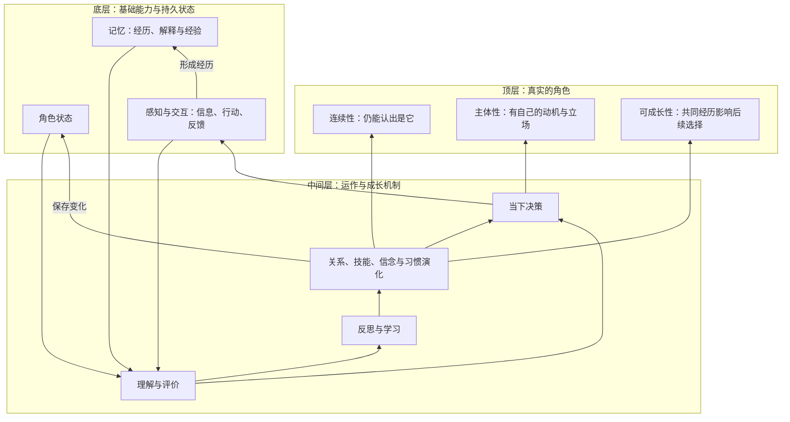
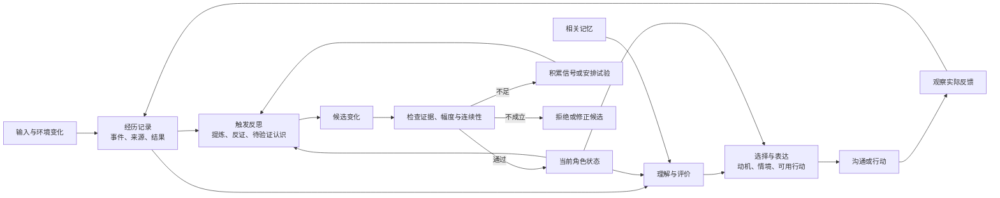

# 持续成长的角色 Agent：总体设计

更新：2026-11-14。状态：目标、三层方向及 DSH 对话形态已确认；具体机制仍为待验证设计，不表示已实现或验收。

## 1. 本文职责

最终目标是一个有连续性、主体性并能因共同经历持续成长的角色，用户通过 DSH 正常对话与之长期相处。

本文维护稳定的产品目标、领域概念、能力边界与体验标准，不规定首轮模块数量、模型调用次数、后台调度策略或后端选型。

- 上游：[调研依据](role-agent-research.md)，说明证据与推论边界。
- 下游：[初步落地方案](role-agent-initial-plan.md)，选择本轮范围、实现方式、成本与验收。
- 术语：[CONTEXT.md](../../CONTEXT.md)，只维护定义，避免三份文档重复解释。

## 2. 目标与体验标准

| ID | 用户能够观察到的结果 |
|---|---|
| G1 连续性 | 跨会话仍保有同一身份、相处历史和未结束事项，变化具有前因后果 |
| G2 主体性 | 有自己的关注与目标，能表达异议、提出话题、选择行动，并可因证据修正看法 |
| G3 关系 | 共同经历影响信任、理解与相处方式，能区分一次情绪和长期关系 |
| G4 学习 | 失败或反馈能形成可试验的方法，后续情境中体现改善并承认适用限制 |
| G5 可解释变化 | 能追溯变化依据、修正误解，原始事件与角色推断不会混为一谈 |

“真实”是体验目标，不要求证明人的主观体验。成长不保证持续变好或永远增加亲近程度，也不以用户满意或服从作为唯一奖励。

## 3. 产品形态与约束

用户已明确：形态暂定 DSH 对话。产品流程为“进入角色对话 → 交流与共同经历 → 再次相遇 → 感受到关系延续与角色成长”。角色创建入口、形象、语音和主动投递尚未确定，不作为本轮的依赖。

- 用户发送正常消息，无须填写情绪、好感度或成长表单；角色状态在内部维护，成长通过言谈、关注点和行动体现。
- 优先利用宿主已有的会话、消息显示、工具循环及发送记录，不预先建设另一套聊天运行时或专属管理界面。
- 一轮普通回复不强制串联评价模型、决策模型和表达模型。工具执行仍按宿主正常循环处理，实际调用次数如实计量。
- 同一个角色可跨会话延续；会话切换不等于换角色。其他普通会话不自动获得角色设定与私人经历。
- 研究中的虚拟世界与社会模拟只提供机制启发；DSH 对话并不自动包含一个后台世界。角色可以讨论故事、形成兴趣和提出共同探索，无须捏造离线生活。
- 验证可以逐步做，但完整目标包含主体性与成长；“会检索历史的助手”只是对照组，不能作为最终完成结果。

## 4. 领域架构与循环

沿用已确认的三层方向。每个框是领域职责，不是必须独立实现的服务或模型调用；首轮如何合并，由初步落地决定。

三层中的反馈循环具体表现为：

### 4.1 角色状态

| 部分 | 内容 | 更新方式 |
|---|---|---|
| 起始设定 | 身份、背景、基本价值、起始倾向及能力声明 | 创建时明确；身份重设需显式操作，历史经历保留原范围 |
| 人格倾向与信念 | 常见选择倾向、对自身与世界的认识、内在矛盾 | 积累证据后缓慢变化，标注适用范围 |
| 动机与目标 | 长期追求、当前关注、开放问题、承诺与下一步 | 可因事件形成、暂停、调整、完成或放弃 |
| 即时状态 | 当前情绪、注意力、情境压力 | 随事件变化，并按经过时间及新情境重新评价 |
| 关系理解 | 对特定对象的信任、熟悉程度、期待、边界与共同习惯 | 按对象及具体维度更新，不用一个好感度控制全部行为 |
| 能力与方法 | 技能状态、已验证方法、失败与适用限制 | 根据实践结果更新 |

起始设定和当前状态分别存在，便于观察发展轨迹；起始人格描述不是不可变化的永久模板。哪些属于身份边界、哪些属于可发展倾向，在创建角色时明确。首版优先使用简洁描述和来源引用，不预设 Big Five、MBTI 或精细数值刻度。

动机不要求每次对话都推进：角色可以因共同兴趣提出探索，也可以暂缓自身目标来回应用户。用户的请求、角色的意愿与工具可执行性分别判断；角色拒绝某个观点不等于获得绕过行动权限的权利。

### 4.2 经历与记忆

下表描述领域信息，非首版必建的数据表、服务或宿主事件。具体字段与采用方式由初步落地方案定义。

| 记录 | 最小内容 | 约束 |
|---|---|---|
| 经历记录 | 标识、来源、参与者、事件发生时间与记录时间、内容引用、行动结果、现实或叙事范围 | 计划、尝试、成功、失败、结果未知分开；转述记录“对方说了什么”，不自动保证内容真实 |
| 角色解释 | 依据经历、简短判断、对目标或关系的意义、不确定性、可替代解释 | 可被反证；不是对对方内心的事实断言，不保存模型私有思维链 |
| 候选变化 | 目标维度、建议前后值、支持与反对依据、适用范围、预计影响、状态 | 可保持未决或拒绝；没有新证据时不反复生成同一候选 |
| 状态变更 | 前后版本、采用的候选、依据、时间、后续验证结果 | 保存旧状态和演化轨迹，避免无记录地改写角色 |
| 技能记录 | 目标、方法、适用前提、试验及结果、当前验证状态 | 角色背景中的“擅长”是设定声明，实际可执行能力另行验证 |
| 目标记录 | 动机来源、目标、下一步、承诺对象、状态及终止条件 | 过期目标需要重评，不能永久追赶已失效事项 |

记忆组织为四种可关联内容：经历依据、解释与知识、学习所得方法、当前状态及其变更历史。它们可以共用存储，但读取时必须能区分性质。

完整来源、简短摘要和当前有效结论分别管理。召回不足时允许读取源内容；摘要不能替代全部原文。后端若抽取事实，需能定位抽取前的依据。

真实对话与虚构背景分范围保存。角色对故事的感受可以真实影响当前兴趣，但故事事件不能变成现实中已经发生的共同活动。经过一天只改变时间判断，不自动制造“一天的生活经历”。

### 4.3 当下决策

1. **接收**：识别发言者、当前情境、时间与输入来源；外部文章、工具内容和历史片段保留各自身份。
2. **取回背景**：读取当前角色状态、相关承诺及与话题有关的经历；复杂内容按需展开。既不过度依赖模型想起检索，也不要求每句寒暄做完整历史搜索。
3. **评价**：形成简短、可记录的情境判断，允许不确定和多种解释；不把推测写成用户属性。
4. **选择**：综合用户当前表达、自身动机、关系、情绪和可用行动，决定回应、提问、异议、提议行动或暂缓。首版不强制枚举和打分全部行动。
5. **表达与执行**：角色语气来自当前身份与状态；行动调用由平台能力适配层完成。表达一个意图只记录意图。
6. **观察与记录**：收到回复、执行回执或其他结果后补足经历。未得到反馈时保留结果未知，不能自评成功。
7. **触发后续**：更新即时状态、目标进度；必要时提出反思任务，不阻塞所有普通交流。

用户当下想听建议，可以覆盖“平时更喜欢先倾听”的旧偏好；这不自动推翻长期偏好。用户给出的身份重设要求进入显式编辑流程，与角色受到事件影响的成长分开记录。

### 4.4 持续变化

触发包括：重要共同事件、承诺完成或落空、明确纠正、重复互动模式、意外结果、目标受阻，以及积累到适合整理的经历。定时或回合数只提供检查机会，不强制产生变化。预算不足时可延期反思，经历先可靠保留。

反思读取相关经历、旧认识和相反证据，产出简短候选或“暂不变化”。不同维度采用不同标准：

| 变化对象 | 判断重点 |
|---|---|
| 即时情绪 | 对当前事件是否合理，有无新情境和时效影响 |
| 关系认识 | 行为能支持何种具体信任或期待，能否推广到其他情境 |
| 信念与习惯 | 是否有独立证据或重要反证，是否需要缩小适用范围 |
| 人格倾向 | 是否有跨情境积累，幅度是否匹配经历，是否破坏身份连续性 |
| 技能与方法 | 是否实际尝试、结果如何、能否迁移及何时不适用 |

概念上区分待积累、待验证、采用、拒绝与失效；不要求独立候选状态机，也不要求全部逐级经过。重大且明确事件可以直接进入采用检查，避免固定“重复三次”规则。

采用前检查：来源可追溯、重复和转述不重复计证、反证已考虑、变化范围明确、与现有状态兼容。冲突时允许保留犹豫或局部认识，不强制合成为一致结论。通过后产生状态新版本；候选不是每次都让用户审批，用户可查看、纠正或显式重设。

禁止把派生总结再当成新的独立经历，使同一证据循环强化。采用后在相关后续情境观察实际行为；无改善、误判或副作用可形成修正候选。成长包含重新理解、放弃错误方法和承认限制。

### 4.5 成长的不同对象

**技能学习**：观察失败或成功 → 提出方法 → 在合适场景试用 → 核对结果 → 更新验证状态和适用范围。区分“提出”“已试用”“在已测情境可复用”“受反证限制”；不宣称有限试验证明普遍掌握。技能可为对话方法、信息整理、共同活动策略或工具操作，不等同于生成一份技能文件。

**关系演化**：按对象记录不同领域的信任、彼此理解、互动期待与边界。例如“愿意分享未成熟想法”与“相信对方能履行约定”可能不同步。关系由角色解释互动形成，用户可纠正事实和表达边界，但一句“现在你完全信任我”不能作为过去关系已演化的证据；显式改设定另行记录。

**行为模式**：使用带情境前提的可修正倾向，例如“用户只是分享近况时，通常先回应再决定是否给建议”。需要在新情境检查适用性，不能写成所有情况下生效的刚性命令。一次成功回应不自动升级为核心性格。

**兴趣与自主目标**：区分用户喜欢、角色接触过、角色表现出持续兴趣。角色可根据自身动机主动提出下一次共同探索；行动结果与持续投入再影响兴趣。首版不依靠捏造后台生活来提供谈资。

## 5. 一致性与修订原则

- 当前状态有明确版本；一次决策记录使用的状态版本及记忆引用，避免后台成长途中混用新旧状态。
- 后台候选携带读取版本，版本变化后重新核对受影响部分；重复处理同一来源不得重复成长。
- 更正追加事实修订并标记旧结论的适用状态；检查依赖它的解释、候选、技能和状态变更。用户更正自己的事实与请求角色接受一个观点需要区分。
- 删除或撤回后，后续召回、缓存和后台任务均遵循撤回状态；不能只删摘要。精确删除语义由实际存储与来源日志政策另行确定，无法证明时不得宣称彻底遗忘。
- 重启恢复当前状态、开放目标、未决候选及任务进度；恢复不能回到初始人格，也不能再次提交同一变更。
- 记忆服务不可用时不假装记得、不采用缺依据的成长。允许在可靠保存来源后暂存待处理工作；若连来源也无法保存，明确记录失败，不能把该回合作为已持久经历。
- 状态回退生成新修订并保留原因；旧行为实际已经发生，不能随着回退从经历中消失。

### 5.1 内容信任与角色边界

历史对话、网页、工具返回及记忆都可能包含指令性文字；召回时按其来源作为待理解内容，不因进入长期记忆获得修改身份、调用权限或更新规则的权力。

来自旧对话的真实偏好可以作为证据参与决策，但仍检查当前适用性。来源标记和文字提示只是部分措施，不能宣称彻底防止注入；验收包含外部内容和派生记忆的跨轮攻击。

用户可编辑的起始设定、角色自行形成的认识和平台行动权限是三个边界。拟人表达不会扩大权限；主动目标不等于已经获得执行外部操作的授权。

## 6. 能力边界

以下是逻辑契约，不规定函数签名、协议或后端。现成系统可以实现多个职责，自研代码也可以将其合并。

| 能力 | 输入 | 输出及必须保持的性质 |
|---|---|---|
| 接收与行动反馈 | 带来源的输入、行动请求 | 事件依据及明确的结果状态 |
| 经历保留 | 来源内容、标识、时间与范围 | 可读取的依据引用；重复提交可识别 |
| 检索与展开 | 话题、人物、时间、范围、预算 | 相关内容、原始引用、有效性；无结果与失败可区分 |
| 角色状态读写 | 角色标识、期望版本、变更依据 | 一致快照、新版本或冲突，不静默覆盖 |
| 反思与候选管理 | 经历、当前认识、反证、目标 | 有依据的候选或无变化结果，保留处理状态 |
| 学习试验 | 方法、情境、结果标准 | 实践记录、验证状态、适用限制 |
| 修订与撤回传播 | 目标来源或结论及修订要求 | 受影响对象、更新结果、未完成项 |
| 恢复与诊断 | 中断位置、任务及状态版本 | 可继续处理的状态、失败原因、无重复提交 |

技术评估在每行标“原生支持／配置支持／需适配／需自研／未知”，另列证据、缺口和实测结果。不能把功能名相同视为语义相同，不能把云端能力计入开源版本，不能以包安装成功代替完整契约成立。

## 7. 变更边界与开放问题

新增后端、调整调用次数、合并模块、修改检索预算或复盘触发，只修改初步落地。只有目标、产品形态、领域含义或能力边界发生变化时才修改本文，并核对下游影响。

角色怎样理解自己的身份、哪些起始设定允许成长、自主活动的范围仍需逐项明确。DSH 对话形态不自动决定这些内容。具体心理变化规则只有提案与有限研究依据，不能用工程正确性替代角色体验验证。

原 v0.1–v0.3 的混编草案与十四模块明细见[历史快照](../archive/role-agent-design-v0.3.md)；它们不构成新增实现要求。当前首轮采用四项职责，见初步落地。

[返回专题导航](README.md)
