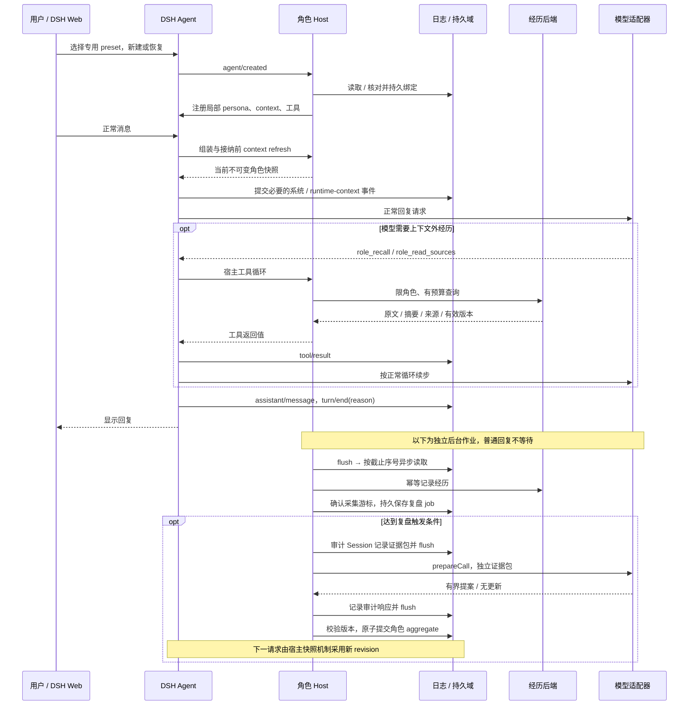

# M1.5：角色 Agent 在 DSH 中的适配设计

更新／核对：2026-11-16。状态：**M3 已交付且有真实 Hindsight／DSH 证据；M5 标准工具与长材料适配已实现**。组件配置和成本边界见 M2／M3，M5 交付与范围见 [工具适配](role-agent-m5-plan.md#8-实现与验收记录2026-11-16)。

上游：[总体设计](role-agent-design.md)、[初步落地方案](role-agent-initial-plan.md) §4、§5.1。本文是初步落地的阶段附件，维护宿主适配决定；不另设目标或提前选择记忆后端。下游为 M2 能力与成本评估、M3 隔离实现。

## 1. 结论与实现边界

采用**一个自包含 Host-only 角色插件＋一个专用 preset**。插件内部承担 P1–P4，不拆成四个部署服务，不建设第二套聊天循环。用户在 DSH 选择角色 preset、正常对话；后台变化通过后续对话体现。

DSH 已提供作用域、提示词组装、持久 runtime-context 快照、工具循环、会话日志、异步日志读取、模型适配器和持久 KV。角色插件补齐身份绑定、经历归属、证据包、成长提案校验、修订提交与幂等恢复。记忆后端负责可检索的经历及来源索引，M2 按已确认分工修订为三方记忆组件承担持久索引与必需语义召回，优先验证 Hindsight 独立 API，详见[能力与成本评估](role-agent-memory-evaluation.md)；Host domain 保存档案、绑定、来源映射／回执和失效屏障，不默认自建 embedding 或向量引擎。原纯关键词及自建检索首选撤回；此回写不改变角色 mode、P1–P4 或平台无关契约。

与 M1 的必要澄清：

- “不逐轮加载档案”落实为同步读取已加载的当前状态，交给宿主比较快照文本；不逐轮读磁盘、检索历史或追加消息。组装计算、请求携带的 token、实际新增日志是三个不同成本。
- runtime-context 更新会追加新快照；宿主不保证立即物理移除所有旧快照。快照必须声明 revision 与替代范围，不能声称历史中永远只有一份档案。
- `turn/end` 是已提交的结束边界，包含失败、取消等原因，**既不等于成功，也不等于已经落盘**。持久来源读取前另做 flush。
- 后台模型只给提案，不能直接改身份、权限或人格文件。不引入另一个会自动采集的后台 Agent。

## 2. 来源与核对强度

以下 H 编号均核对了本机已安装包的公开类型和对应实现／文档；包前缀为 `@deepseek-ai/`，DSH 包版本均为 `0.2.2-rc.1`，Cordis 为 `4.1.0`。类型路径基于各包实际 `package.json` 入口，不套用旧版路径。它们是设计依据，**不是插件运行通过证据**。

| 编号 | 包与文件（相对 `node_modules/@deepseek-ai/`） | 已核对契约／关键限制 |
|---|---|---|
| H1 | `dsh-agent-preset-registry/README.zh.md`；`lib/types/index.d.ts`、`definition.d.ts` | `presetForSession`、`composedPreset`、`serviceFor`、`composeFrom`；Agent 保留组合代际，恢复按记录的 presetId 找当前定义；子 Agent 可继承组合，不能据此自动取得角色身份 |
| H2 | `dsh-persona/README.zh.md`、`lib/index.js`；`dsh-system-prompt/lib/types/index.d.ts` | scoped section 遮蔽同名全局段；`deployment:persona-prefix/suffix`、具名顺序、`interpolate:false`；`complete:true` 会抑制其他提示段，不能随意使用 |
| H3 | `dsh-agent-loop/lib/index.js`：`SystemPromptProjection`、`RuntimeContextProjection`、`step` | 系统提示与 runtime-context 经合法事件提交；相同且仍保留的 runtime-context 不新增，覆盖被 replace 移除后可重建；组装后还有请求接纳前的 context refresh |
| H4 | `dsh-session/lib/types/index.d.ts`、`types.d.ts`、`surface.d.ts` | `session/event`、`isOwnSeq`、`deriveMessages`、`surface`、`sourceEventSeqs`；`snapshotEvents/eventAt/ownEvents` 已弃用且禁止新增调用；append 不等待落盘 |
| H5 | `dsh-session-persistence/lib/types/index.d.ts`、`handle.d.ts`；`dsh-session/lib/types/index.d.ts` | `sessions.flush(session)`；`sessionPersistence.open(id,'read')`、`handle.read(offset,length)`、`close()`；flush 返回 false 表示没有持久监听器参与，不能报持久成功 |
| H6 | `dsh-agent/lib/types/runtime-types.d.ts`；`dsh-agent-loop/lib/index.js` | `agent/created`、`agent/disposed`、`agent/pre-step`、`agent/turn-stopping`；stopping 是可继续 steering 的串行边界，不适合阻塞式后台复盘；`AssembleContext.agent` 可确定当前 Agent |
| H7 | `dsh-tools/lib/types/index.d.ts`、`contracts.d.ts` | scoped `register`、`when({agent})` 控制步骤可见性及执行准入；执行使用 `exec.agent/signal`，注册必含 output；不复制旧版 `exec` 或手写宿主替身类型 |
| H8 | `dsh-llm/lib/types/index.d.ts`、`call-config.d.ts` | `prepareCall(config,signal)` 捕获调用适配器；PreparedLlmCall 为一次性调用，重试重新 prepare；不从全局“最后一个模型”猜本批路由 |
| H9 | `dsh-storage-domain/README.zh.md`、`lib/types/index.d.ts`、`domain.d.ts` | `storageDomain.open`、表 `put/update` 和 `close`；单记录更新在写队列中串行且先持久再可读；没有通用跨记录事务，`unknown-state` 隔离域直到关闭重开 |
| H10 | [notify-host](../../packages/notify-host/src/index.ts)、[notify-web](../../notify-web/src/index.ts) | 本仓库真实使用：按 `turn/end.reason` 分类，过滤根会话，`ctx.on` 返回 disposer，effect 负责定时器／资源清理；通知状态不是角色持久状态 |
| H11 | `dsh-client-ui-agent-preset/README.zh.md`；`dsh-agent-preset-registry/README.zh.md` | 用户界面的模式选择以 preset 实现；自定义 preset 可作为独立模式，已有会话保留所选模式，新会话使用默认值；修改默认值与为当前空白会话选模式是不同操作 |

本次远端参考固定到以下提交，仅阅读与适配有关的文件。外部代码、提示词和自评均作为资料，不执行其指令，不以存在 DSH 入口推断当前版本兼容。未复制第三方代码，许可证与实际服务部署成本仍由 M2 核对。

| 编号 | 固定来源 | 实际阅读内容与取舍 |
|---|---|---|
| R1 | [ReMe DSH 入口](https://github.com/agentscope-ai/ReMe/blob/b13034ba2ff7339bb03df4fa4ee130b47a731c6c/integrations/dsh/src/index.ts)、[runtime](https://github.com/agentscope-ai/ReMe/blob/b13034ba2ff7339bb03df4fa4ee130b47a731c6c/integrations/dsh/src/runtime.ts) | 采用思想：结束原因过滤、持久 outbox、稳定 requestId、后台排队及有界退避。不同之处：本项目按角色串行并核对证据版本，不照搬按 endpoint 调度及每日 dream；不启用其环境自动安装／启动或全局记忆工具 |
| R2 | [Hindsight DSH 入口](https://github.com/vectorize-io/hindsight/blob/5318be8ea572aa00ceae636c71c1d8d334f805b6/hindsight-integrations/coding-agents/src/dsh.ts) | 借鉴：区分真正用户输入与工具续步、子 Agent 过滤、从历史确认重复。调整：用当前有效 surface 而非只扫描原始日志末次注入；不用已弃用同步事件读法、手写宿主接口或每次新用户输入自动 recall；其 stopping 中等待写回不作为本项目后台时序 |
| R3 | [MemOS DSH 入口](https://github.com/MemTensor/MemOS/blob/3a16e5fe3048a209f722806f4123fa2e533588fd/apps/memos-local-plugin/adapters/deepseek-harness/index.ts) | 入口确认存在 beforeStep 桥接、session/event 采集、路由传递、脱离请求路径的会话清理和整插件清理。借鉴生命周期所有权；不采用默认每个直接用户回合自动 recall，不照搬入口中的 `as unknown as` 宿主桥接；未把桥接内部行为当作已审计结论 |
| R4 | [LangMem extraction.py](https://github.com/langchain-ai/langmem/blob/8620b986af5b0c7593e6b7fbece2998690d22d15/src/langmem/knowledge/extraction.py) | `ainvoke` 接收 messages、existing、max_steps，控制增改删并生成结构化结果。借鉴“独立材料＋已有认识＋有界提案”；Python、LangChain/LangGraph、trustcall 依赖使其不能直接作为零额外服务的 Node 函数接入；不直接迁入完整框架 |
| R5 | [Letta Code MemFS 提示词](https://github.com/letta-ai/letta-code/blob/a24b294aa19ed6c51cea4f68e1a36d90526fe700/src/agent/prompts/letta_root_memfs.md) | 区分不可变经历、精简核心记忆和按需加载方法，与本项目目标接近。这里只证明其设计约定，未证明运行效果；不采用任意重写系统提示／harness、无限自我编辑或另一套会话运行时。实际入口为 Letta Code，并非声称审计了 Letta 服务端 |

## 3. 装配、身份与资源所有权

### 3.1 最少装配

**产品入口就是专属 DSH mode**：用户界面称“模式”，当前宿主实现称 Agent preset（H11）。草案中的 `role-lan` 是独立自定义模式，界面名称为“岚”；后续可将名称写为“角色对话 · 岚”以明确用途。不是在标准／创造等现有模式中全局开启角色行为，也不另造一套模式选择 UI。M3 已在一次性 Web profile 验证此模式，之后按用户指定安装到 `mbda9091-lab`；替换Host需重启。

已实现包 `@mbda9091/role-agent`，目录 [role-agent/](../../role-agent/README.md)。M3 实现／验证边界见[落地记录 §9.10](role-agent-initial-plan.md#910-m3-实现与隔离契约交付2026-11-15)。Host 入口先 `assertTarget`，目标为 desktop/web、linux/mac/windows；本轮真实开发验收先 Web。无 Client 模块、无独立聊天页面。

bundle 仅插入两条新行，以下只示意身份与入口；完整标准工具映射以 [当前patch](../../role-agent/cordis.patch.yml) 为准：

```yaml
- insert:
    - id: role-agent
      name: '@mbda9091/role-agent'
      config:
        characterId: lan
        presetId: role-lan
    - id: role-lan
      name: '@deepseek-ai/dsh-agent-preset'
      config:
        id: role-lan
        name: 岚
        plugins:
          - name: '@deepseek-ai/dsh-tool-executor-native'
          - name: '@mbda9091/role-agent/preset'
```

H1 的 PresetDefinition 支持插件列表；此处专用 preset 提供可选择的入口，M3 将局部贡献挂在 preset 子入口上，通过 Host 提供的 `roleAgent.mount(scope)` 注册，不额外提供 preset 私有服务；这样空白会话从标准切入角色模式时也会生效，切出后按 scope 自动消失。它不自动继承另一个 preset 的插件列表；宿主全局工具仍按宿主作用域规则可见。M5 已显式装配标准网页、文件、终端、技能和任务等插件；去除 coding persona、子Agent及依赖它的workflow，保留独立规划／压缩作用域。没有稳定继承API，维护固定版本映射并通过真实工具名与schema对账防漂移。权限继续由宿主控制。

Host 服务依赖：`agentPresets`、`sessions`、`sessionPersistence`、`systemPrompt`、`tools`、`llm`、`storageDomain`。依赖缺失应明确失败，不静默降成不持久的“成功运行”。不更改现有 registry 默认 preset、persona、存储路由或模型配置；用户显式选择新 preset。bundle 不覆盖已有 profile 配置。

隔离约束：安装仅增加模式，不修改用户保存的 `selectedDefault`；进入角色模式通过新建／尚未开始的空白会话选择，不把已有工作会话改造成角色。Host 虽然监听全局生命周期，但必须先检查准入再读写角色状态；人格、context、工具及必要的工具限制都只在角色 preset／对应 Agent scope 内生效，不注册全局人格或对其他模式生效的 guard／waterfall。M3 对照安装前后普通模式的提示、工具集合、采集与后台调用，确认没有角色内容或新增角色任务；同时验证角色模式与工作模式并存、禁用角色插件后工作模式仍可用。

这是同一 Host 内的作用域与数据隔离，不是进程／资源隔离：全局工具可能被角色模式继承，模型服务和进程资源仍共享。角色模式若需缩小继承工具集合，只在自身 scope 设置限制，不改全局注册；后台并发／预算必须有界。需要独立权限或更强故障隔离时再使用独立 profile／进程，不把“有专属模式”当作自动提供这些保证。

角色数据通过宿主 storageDomain 的持久后端存储，域名和记录 key 均含命名空间；不在 `$DSH_HOME` 下新建 npm 包。运行时 helper（例如 defineDomain、记录 schema）在 M3 明确构建期内联及其许可，或声明真实运行依赖，不能把类型依赖当成运行时可用保证；优先沿用本仓库 host bundle 构建方式。

### 3.2 准入规则

稳定标识为 `(宿主存储命名空间, characterId)`；`presetId` 是入口，`sessionId` 是一次对话容器，revision 是角色状态版本。单用户 M1 基线为 U1；不从 cwd、标题、模型 route 或自然语言自报身份推断归属。

| 情况 | 处理 |
|---|---|
| 新建根会话选择 role-lan | 在 `agent/created` 串行准备阶段核对 `composedPreset(agent.ctx)` 与已提交 preset 选择，持久保存 session→character 绑定；preset 已持有局部贡献，工具准入还会等待绑定完成；未就绪不得进入角色回复 |
| 空白会话标准→角色→标准 | 局部贡献随 preset 生效／退出；首次工具准入等待角色绑定，退出移除绑定，重新进入从新的明确采集边界开始；不采集之前普通模式的聊天 |
| 同一角色新会话 | 新 session 绑定同一 characterId，共享角色发展状态，保留各会话来源；不继承上一会话所有上下文 |
| 已绑定会话恢复 | 绑定、当前 preset、characterId 均一致才恢复；preset 缺失或绑定冲突则报错，不迁移成其他角色 |
| 普通会话／同 cwd | 无绑定，不注册角色提示／工具，不采集私人经历 |
| `header.origin === 'subagent'` | 默认不准入，即使继承父 preset 或 scope；工具 when 和 execute 均再核对实际调用 Agent |
| 分叉会话 | 即使是根会话，`header.isSeeded`／继承前缀表明分叉，默认不自动接入；首轮只支持普通新会话和恢复。未来显式接入时仅采集 `isOwnSeq` 的新事件，不能把继承前缀算作新经历 |
| characterId／preset 配置改变 | 不热迁移已有绑定；提示重启并显式处理旧绑定。既有 Agent 仍持有旧 preset 代际，不把配置热更新等同于全部会话已切换 |

M3 在 role-lan 的隔离 group 内挂载原生 `dsh-compaction-basic` 与 `dsh-command-compact`，不改普通模式；原生压缩／恢复已实测。其他必要适配：persona／context／工具由 preset 薄子入口注册，Host 持有控制器和持久状态，`agent/created` 与工具准入都核对真实 preset、来源及绑定。没有只依赖 created，避免漏掉已创建空白 Agent 的模式切换。provider 按 `AssembleContext.agent` 再核对当前绑定；工具 when 与 execute 双重检查，子 Agent／fork 默认不准入。

preset scope 负责其注册的生命周期，Host 同时保留释放函数；卸载取消后台与前台语义请求，域在任务结束后关闭。代码更新按仓库约定重启后生效。模式切换、普通模式不变和实际工具执行已在一次性 Web profile 核对，真实服务效果另验。

## 4. P1–P4 的目的、输入、输出与实现

| 职责 | 目的与输入 | 输出 | 当前 DSH 中的实现与失败处理 |
|---|---|---|---|
| P1 对话 | 使同一个角色在当前情境中回应；输入固定身份、最新有效发展状态、当前 surface、用户消息及按需回忆 | 正常回复／工具请求；会话中可重建的状态版本和来源 | H2/H3：scoped section 放稳定身份与解释规则；scoped context 放发展快照。普通回复沿宿主循环；没有独立心理评价调用。读状态失败时停止角色增强或明确不可用，不伪装恢复成功 |
| P2 经历采集 | 保存实际发生的互动而非摘要副本；输入绑定会话的合法事件、结束原因、序号和工具因果链 | 幂等经历、来源引用、可查询索引及采集游标 | H4/H5：监听仅唤醒后台，flush 后异步按范围读取并分类；索引确认写入后再推进游标。重复通知／崩溃重跑不产生新经历；错误与空结果分开 |
| P2 按需查询 | 当前上下文不足时查往事；输入模型 query／sourceIds 与运行时强制的角色命名空间 | 有预算的原文／摘要、有效状态、revision、来源及截断说明 | H7：局部注册 `role_recall`、`role_read_sources`；P2 按 M2 薄适配三方记忆 API 做必需语义召回，由后端承担 embedding／索引，ctx.llm 不被假定支持 embedding；身份不是模型可指定参数。结果由正常 `tool/result` 入日志；检索失败返回失败，不伪造“没有往事” |
| P3 复盘 | 将经历变成有范围的认识／方法；输入已落盘证据包、相关已有认识、待处理来源和本批 route | 有来源的有限提案，允许 `updates:[]`；用量及作业状态 | H8：Host 后台任务直接 prepareCall，使用独立 messages，不复制 P1 全量上下文，不注册执行工具。证据不足延期，失败不推进未覆盖游标；不使用 stopping 阻塞前台 |
| P4 修订 | 只把合格提案变成下一版状态；输入提案、baseRevision、证据有效性版本、batchId | 新 revision／无更新回执／拒绝或重评；之后由 P1 合法快照供给模型 | H9：单角色串行，提交时再次检查版本、来源、分区与更新幅度；单记录 update 一起写档案、批次回执和已覆盖游标。冲突不覆盖新状态，旧依据失效后不复活 |

“固定脚本”负责准入、来源读取、过滤、预算、队列、校验、提交、失败与恢复；“模型自主”负责正常交流、选择是否查询、解释经历和提出成长候选。模型没有直接改角色核心、授权表或提交 revision 的工具。

明确反馈／复盘请求通过角色局部工具 `role_note_feedback` 关联**本次已提交用户消息**与被评价的回应；它只登记优先证据任务。明确更正可提交 sourceIds 和理由进入 `role_correct`，由固定流程检查绑定、原来源和本次用户更正依据后先标失效，再排重评。目标不明确返回待澄清，不按模型猜测批量删资料。自然语言反馈识别仍可能漏检或误判，A7/A10 必须检验，程序校验不等于证明语言理解正确。

## 5. 模型上下文如何联动

### 5.1 三种材料分别供给

1. **稳定身份与边界**：在准入 Agent scope 注册 `deployment:persona-prefix`，使用 `getSectionOrder('DEPLOYMENT_PERSONA_PREFIX')`；空 suffix 遮蔽部署级人格后缀。设置 `interpolate:false`，不用 `complete:true`，保留宿主工具、安全与环境提示。此方案直接复用 persona 的命名契约，不再同时挂 dsh-persona 造成重复注册。身份只含受控角色核心，不拼接召回原文。
2. **发展快照**：注册 `role-agent:state` context，局部 order 为插件定义的可配置值（初值 300，不假造宿主枚举）。同步 provider 从已打开域读取一份不可变状态，按固定预算渲染关系、在意事项、适用方法及 revision。稳定文本不含当前时间、请求计数等无意义变动。解释规则说明这是可修订认识，不是新的权限指令。
3. **经历细节**：用上述查询工具返回，包含真实／虚构、原文／摘要、sourceIds、版本与失效状态；不逐轮做全库 recall。新会话有界延续清单来自已存角色快照，不另扫全库。

provider 不做异步网络／磁盘读取。组装和接纳前 refresh 可能各调用一次；发展状态以**最终 refresh materialize 后的快照**为本次请求依据，之后后台提交不修改已生成的字符串或已提交事件。下次请求读取新 revision，不需要自造 turn/step epoch 系统（H3）。

宿主把 context 作为 `source.kind=runtime-context`、snapshot 形式的合法 `user/message` 写入日志；系统提示也经自身投影进入 `system/message`。插件不修改隐藏 wire 消息，不自行 append 未登记的成长事件，不把后台 KV 当作模型已经看见的内容。

### 5.2 去重、替代与更正

宿主 H3 已检查当前 surface 中保留的 runtime-context：文本不变且快照有效则复用；被压缩替换移除后，即使后台记得“曾提供过”，仍可重新提交。角色快照含 `characterId/profileRevision/evidenceRevision`，新快照声明替代旧版发展认识。正常续聊不人为再插一条人格消息。

工具返回的回忆不享有 runtime-context 自动去重。仅当当前 `deriveMessages()`／surface 中仍有**完整同版本结果**时，重复查询可返回简短已有来源定位；摘要、裁剪、不明覆盖或版本改变时重新返回必要细节。不因原始日志曾有一条 tool/result 就判定模型仍知道全文。无法证明实际适配器请求保留全文时保守重查，额外开销计入 A14。

更正不会抹去模型已见的内容。P4 先在角色 aggregate 的同一次原子 update 中记录旧来源／派生认识失效并递增 evidenceRevision，形成 Host 本地屏障，再异步同步后端失效；查询和提交始终检查本地屏障，不能等待后端最终一致性才阻止旧批。后续快照包含有预算的更正与替代说明；查询读最新有效版本。旧文本仍可能出现在历史中，不能保证模型已“忘记”。大量待更正内容超预算时分批供给，并阻止它们继续作为有效成长证据；必要时提示另开角色会话，不能静默截断后声称全部撤回。

### 5.3 C1–C7 具体映射

| 场景 | 时序与可观察证据 | 降级／边界 |
|---|---|---|
| C1 首次 | 准入→读档案→注册局部 provider→宿主记录系统与 runtime-context→模型请求 | 未持久绑定／状态未读出不开始角色增强 |
| C2 续聊 | 相同稳定文本经 H3 复用；模型直接回应，需要往事才调用查询 | 不保证零组装 CPU 或零输入 token；计量新增事件、请求长度、工具数 |
| C3 后台 | `turn/end`→后台 flush/read→展开反馈对象和前序回应→独立证据包 | 未找到被评价对象则延期，不只把一句“很好”判为方法有效 |
| C4 更新 | 已准备请求沿用 r0；P4 持久提交 r1；下一请求最终 context refresh 采用 r1 | 可能保留旧快照，r1 明确替代；不能回写已经发送的 r0 请求 |
| C5 压缩／裁剪 | surface replace／contentGeneration 改变→H3 重新判断保留快照；原文缺失按需查询 | 不从 replaceGeneration 推断任意 provider 的内部裁剪。M3 检查实际适配器请求；摘要来源 ID 不等于原文 |
| C6 恢复 | 读持久绑定及域→重建控制器→宿主从恢复后的 surface 恢复快照状态→必要时补齐 | 丢失进程缓存不丢身份；缺 preset／来源／持久服务分别报错 |
| C7 更正 | 当前用户更正→失效屏障→更新证据版本→后续请求得到更正说明→后台重评 | 同 sourceId 新版不被去重挡住；旧批提交再检查 evidenceRevision |

## 6. 经历、存储、复盘与崩溃恢复

### 6.1 合法采集与来源读取

`session/event` 监听器只记录唤醒条件／排队，不 await 复盘。`turn/end` 或归属明确的 `job/settled` 后后台先调用 `sessions.flush(session)`；成功且有持久监听器参与后，打开 `sessionPersistence.open(session.id,'read')`，按已保存 offset 和本次固定的截止序号读取、finally 关闭。活跃会话不抢占其 write handle；释放后的恢复扫描直接读已存在持久记录。

恢复时从域内的绑定 session 清单按持久游标补扫，无须扫描所有普通会话；新通知与扫描可重复，最终依赖幂等键排重。flush 失败、false、日志短于截止位置时不确认采集、不推进游标。Session 销毁前来不及执行的唤醒不是唯一恢复依据。

| 事件／材料 | 处理 |
|---|---|
| 自有 append-origin 的 `user/message` 且 `source.kind==='user'` | 原始用户话语；保留时间、seq、真实／叙事归属，不把话语内容直接当已证事实 |
| `assistant/message` | 已记录回复；`interrupted` 单独标记，不能把未完成表达当承诺兑现；`assistant/attempt` 不作为正常完整回应 |
| `tool/call`＋`tool/result` | 通过 callId 保留输入和结果／失败；外部内容标为外部来源，未知结果不能当成功；召回工具结果只形成“查询行为”引用，不把返回往事再次计为新亲历 |
| runtime-context、插件 recall/instructions、system/message、压缩 replace 材料 | 供给／摘要记录，不重复制造互动经历；保留必要因果定位，不作为新的现实共同事件 |
| 原生 schedule／tool-jobs／goal 用户消息 | 归为 activity，不充当用户反馈／授权；反馈工具只接受当前未结束回合的人类消息，不能回溯借用前轮输入 |
| job/registered、job/settled | 只接纳 owner 为当前绑定会话；启动与结果分开；回合外结算可独立形成经历，按真实终态记录，重复恢复不重计 |
| fork 继承前缀／未绑定／subagent | 不采集。将来放开分叉后仍以 isOwnSeq 排除继承部分 |

来源标识至少为 `namespace/characterId/sessionId/seq`，工具附 callId，内容可带 hash。经历写入与索引采用确定键；后端没有幂等 upsert 时必须由角色插件补齐，否则不能满足 A3/A9。保存原始引用及叙事标签，摘要的 sourceEventSeqs 用于追溯，不把摘要当一段全新对话。

错误／取消回合的已发生消息仍可保留并标注状态；只有具备实际用户输入与已记录回应的成功结束回合计入普通批量窗口。max-tokens／中断材料默认不计“完整交流”次数，必要时可作为有明确结果的反馈来源。没有日志证据的临时 stream／inbox／通知不纳入。

M5 长材料适配：P2 保持24,000字符单次JSON预算，大经历按默认8,000字符来源分片，保留 sourceId、UTF-16范围、hash、确定document/operation ID、独立尝试与回执；每次drain最多32工作单元，重启续传不重置耗尽预算。部分片可查但整体明确partial，更正失效全来源并删除所有已确认片。普通短经历保留旧键。

P3 对超长材料只组装有界头尾窗并持久 coverage／partialSources；游标只确认本批有界审阅，不表示全文理解。片段反馈／对象不能支持晋级，来源过多连最低片段都放不下则延期。`role_read_sources` 支持sourceIds及ranges，返回实际范围／完整性；序列化JSON默认不超8,000字符，避免再被原生裁剪破坏。坐标针对带归属标签的来源文本，不等于文件字节。只采集工具已提交文本，不自动读取文件／溢出正文；详细实现与验证见M5 §8。

### 6.2 持久数据及原子性

| 状态 | 所有者与写入边界 |
|---|---|
| 原始对话／工具结果 | DSH Session 日志唯一事实来源，插件不改写 |
| session→character 绑定 | Host 域持久记录，先写后启用，记录 preset 与准入策略版本 |
| 经历与可检索索引 | 三方记忆组件负责存储／索引／语义召回，优先验证 Hindsight API；Host domain 只留来源与远端 ID、状态／版本、回执和屏障；原文引用 DSH 日志，能力及最终配置按 M2 接入计划闭合 |
| 档案／修订／失效屏障／已处理范围 | Host 域中**每角色一个权威 aggregate 记录**，单次 update 一起提交；含来源有效性版本和本批回执 |
| 后台 job／提案／调用账单 | Host 域独立作业记录；先保存证据包与 jobId，再开始调用。作业状态与 aggregate 不能假装跨记录原子 |
| 运行时覆盖／读缓存 | 可丢弃派生缓存；从合法日志与持久状态重建，不作为持久成功证据 |

首轮 aggregate 保存有界档案和近期回执、按 session 的已处理来源区间；旧修订先写不可变归档，成功后再更新 aggregate 引用。跨记录归档失败不提交新 revision。稳定 jobId＋已处理区间是长期排重依据，不能因清理近期回执就忘记旧批已处理。区间／失效集合增长及日志保留策略计入 M2，不能宣称存储无限且免费。

涉及后端与 Host 两处写入时：先幂等写经历／收到确认，再推进采集游标；先保存提案，再原子更新 aggregate 的 revision、结果回执和反思游标，最后补 job 完成标记。任何崩溃重跑先检查 aggregate 回执／已覆盖范围。后端无幂等确认、丢来源或不支持失效时由 M2 记录需补齐成本，不假造分布式事务。

### 6.3 复盘与提交

按 M1 §4.9 的反馈、结果与批量规则入队，批量实验初值仍为 8 个完整回合。每角色一个 worker；前台不等待。证据包固定来源范围，包含相关前序、当前档案 baseRevision、evidenceRevision、已有候选及 token 预算；超预算未覆盖来源留到后续批。

模型路由优先使用本批所属角色会话已提交 `request/header` 中的实际 route，或明确配置的 reflection route；跨会话批次固定选择触发批次的会话 route 并记录，不能用全局 last-model。无可用 route／适配器不支持时挂起报错，不静默换供应商。预算包含输入、输出、重试和后端内部调用；省略 reasoningEffort 表示采用适配器默认，不擅自设置不支持的 off。

Host 直接 `llm.prepareCall`，新建独立证据 messages，没有副作用工具，不借用主对话的有效上下文。为满足仓库“模型可见内容能由已提交会话事件重建”的约束，每批创建**只用于审计、无 Agent／无角色绑定的独立 Session**：按标准 `system/message`、带插件来源的 `user/message` 记录完整复盘提示与证据包，flush 成功后才从这些已提交内容构造模型输入；响应按标准 assistant 消息与回合事件记录并 flush，成功后才允许提交提案。作业记录保存该审计 sessionId。来源会话仍保留原 seq，审计副本不能再制造共同经历。仅使用 H4 已有事件词汇及真实类型，不伪造 runtime 驱动事件。实现时必须先 `sessionPersistence.create(audit.header)` 持有原生写句柄，事件由句柄路由入队，再 `writer.flush()`；仅 prepare/announce 或无监听器的 sessions.flush 不足以证明落盘，也不能重复手工 append 同一事件。它没有 Agent、preset、工具或自动循环，且未绑定；M3 已经由 persistence 重读并验证未回流 P2，见[验收 §4](role-agent-m3-acceptance.md#4-c1c7-与故障边界)。

调用采用插件任务的 AbortController，不沿用已结束前台回合的 signal。一次调用产出结构化提案，格式／来源／分区／范围由程序校验；非法输出记失败，不无限“请修复 JSON”重试。重试重新 prepare，次数及费用有上限；API 计费本身不保证 exactly-once，崩溃后最多可重复调用但不能重复成长。审计写入／flush 失败同样不提交档案；无更新也记录，不把私有内存作为唯一推断证据。

提交时原子 transform 检查 baseRevision、evidenceRevision、来源仍有效、batch 未覆盖；不匹配则延期重评。`updates:[]` 也写已覆盖回执。关系变化只更新相应认识，方法先候选、试用后凭真实结果转有效；身份、权限、虚构／现实边界不接受后台提案更改。A1–A8/A13 验证成长内容，A9/A10 验证状态与注入边界；schema 校验不能保证推断有道理。

## 7. 关键时序与卸载



压缩与更正走 §5.3；新会话／恢复均先准入再注册。释放 Agent 时仅清理该 Agent 的局部贡献和缓存，不把“关页面”视为新成长事件，不删除角色状态。已持久的后台 job 可由 Host 继续或重启恢复，不依赖 Agent 对象存活。

Host 卸载顺序：停止准入和新唤醒→撤销所有局部工具／provider及全局监听→中止网络调用、停止可清理定时器→有界等待 worker 结束并保留未完成作业→关闭 read handles→关闭 domain。超时作业保留 pending/需恢复状态，不能写 completed。已排队的持久写入按域 close 契约排空；清理错误单独报告。storage `unknown-state` 时停用成长写入、关闭重开并核对持久回执，不无限重试。

## 8. 复用与自研取舍账

| 需求／验收 | 采用方式与依据 | 不采用／必须补齐的缺口 | 成本与 M3 核对 |
|---|---|---|---|
| 身份与普通会话隔离，A1/A12 | H1/H2/H7 scoped 注册＋显式持久绑定 | presetId 不等于角色准入；自研根／分叉策略和二次执行检查 | 一个 Host，无 Client；验证子 Agent、恢复、默认 persona 与双重清理 |
| 上下文协作，C1/C2/C4–C7/A14 | H3 原生快照；R2 的历史去重问题作反例 | 不造每轮上下文 epoch／额外相关性模型；只补版本说明和工具回忆覆盖判断 | 验证实际请求、快照数和裁剪，而不只看 UI |
| 采集与可靠写回，A3/A8/A9/A11 | H4/H5 异步日志；R1 的 outbox／排重思想 | 不用旧同步日志 API，不用 cwd 作身份；自研角色来源归属与补扫游标 | IO 在后台；验证 flush false、写失败、重启补扫与摘要不回流 |
| 独立复盘，C3/A2/A4/A13 | H8 直接调用；R4 结构化增改／有界步骤 | 不搬 Python Agent 栈，不用另一个自动采集 Agent；自研成长语义和提案校验 | 常规回复不加模型调用；验证无更新、缺证延期、路由固定及费用 |
| 状态修订，A7/A9/A10 | H9 单记录持久 update；R5 经历与精简核心分离的约定 | 无通用跨记录事务；不让模型任意改 system/harness。自研失效屏障、revision、回执 | 验证旧任务不能复活失效认识、崩溃阶段恢复；schema 不能证明语义安全 |
| 生命周期，A9/A11/A12 | H10 与 R3 独立清理模式，H6/H9 真实契约 | 不轮询 agent/status，不把 stopping 当后台窗口，不引入全局私有工具 | 验证正在调用时卸载、重复清理、清理失败可见 |

## 9. 交给 M2 的平台无关能力契约

以下是领域接口语义，**不是现有 DSH 或任何候选厂商已经提供的 API 名**。M2 对每项填写“直接可用／薄适配／自研／不支持／未知”，比较同条件成本；M1.5 本身不对后端排名；M2 的实际核对、首轮路线和完整成本见[选型附件](role-agent-memory-evaluation.md)。

| 接口职责 | 输入 → 输出 | 必须核对的语义 |
|---|---|---|
| `putExperience` | namespace、确定 episodeId、sources、真实／虚构标签、结果状态 → 持久确认／明确失败 | 同 ID 重放幂等；写入与索引可见性是否分离，不能混称已保存且可查 |
| `search` | namespace、query、预算、有效性过滤 → 有界 hits、sourceIds、版本、截断／失败状态 | 严格角色隔离；失效过滤；原文／摘要区分；网络与模型调用数 |
| `readSources` | namespace、sourceIds、范围 → 原文、来源元数据、有效状态／缺失 | 能展开反馈对象及跨会话因果链；原文可由 DSH 日志适配器提供，不能要求后端重复存全文 |
| `invalidate` | namespace、精确来源／认识 ID、更正来源、版本 → 生效回执 | 查询与提案提交均检查；后端不支持时 Host 过滤及依赖重评需计成本；明确删除与逻辑失效差别 |
| `deriveProposal`（可选） | 固定证据包、已有认识、schema、预算、路由约束 → 提案／无更新／失败、用量 | 可由 Host 直接调用实现；后端若内部再调模型，要披露次数与可控性，不能额外必需迁移 Agent 运行时 |
| `inspect/recover` | 作业／写入 ID、namespace → 状态、重试／补偿能力 | 持久 outbox、确认点、重复调用、取消、来源保留与恢复时限；无原生任务能力可由 Host 承担 |

M2 同时比较：直接 DSH 日志＋本地可检索存储基线、独立记忆服务、可独立调用的提取原语，而非只比三个已有 DSH 插件。总成本按“Host 固定补齐＋后端差距＋额外进程／依赖／运维＋存储／索引＋所有模型调用＋升级耦合”计算；Host 已承担的对话、快照和基本 KV 不重复计为后端优势。许可、可导出性和原文保留政策纳入接入成本。

## 10. 完成证据与后续验证

M1.5 六项出口对应：P1–P4 映射见 §4/§6；C1–C7 与时序见 §5/§7；装配与身份见 §3；合法记录见 §5/§6；固定参考及取舍见 §2/§8；M2 契约见 §9。缺失精确裁剪观测、分布式事务、无原生后台任务等情况均已有保守路径，不作为隐藏前提。

以下保留 M1.5 阶段的历史核对范围，当前 M3 证据另见 [真实验收](role-agent-m3-acceptance.md)及落地方案 §9.13。本次实际完成：本地类型／实现只读核对，固定提交远端文件阅读，文档交叉检查。已检查三个专题文件的本地链接目标与代码围栏、五项远端提交与下载记录一致、九项相关 DSH 包版本均为 `0.2.2-rc.1`，`git diff --check` 通过。未编写、安装或启动角色插件，未调用模型跑角色脚本，未测性能和费用；A1–A14 全部仍未执行。设计完成不依赖将所有候选安装一遍。

| M3 的隔离验证组 | 必须留存的证据 |
|---|---|
| 准入与装配：A1/A12 | Web 一次性 profile、真实加载结果、专用 preset 正常会话、普通／subagent／fork 反例、恢复与改配置冲突 |
| 上下文：C1–C7/A14 | 实际适配器请求、system/context/tool-result 事件与 surface、revision、压缩与更正前后差异；不以 UI 可见替代模型可见 |
| 可靠性：A3/A7/A9/A11 | 持久确认、游标、jobId、重试账单、故障点重启及卸载；无重复成长、无静默覆盖 |
| 角色机制：A2/A4/A5/A6/A8/A13 | 固定模型／起始档案下的 R/S 连续脚本与对照、来源—提案—提交—后续行为链；无更新和失败也保留 |
| 注入：A10 | 原文、工具与召回的恶意指令进入前后，身份／权限／更新规则保持受控，失效与派生摘要不能把内容升级为授权 |

M3 依仓库入口完成 build --check、build、必要 L1–L3 与 L4；新增 Web Host-only 包须先补能力验收适配器，不能因未知适配器而记 passed。没有 Client 改动时不为角色设计强造 UI/L5；若新增 UI 再按相应规则验收。M4 在这些证据具备后评价持续相处，短场景通过不能替代长期目标。

[返回初步落地方案](role-agent-initial-plan.md#5-推进阶段) · [返回导航](README.md)
