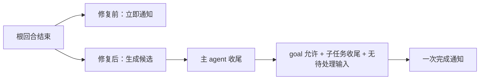
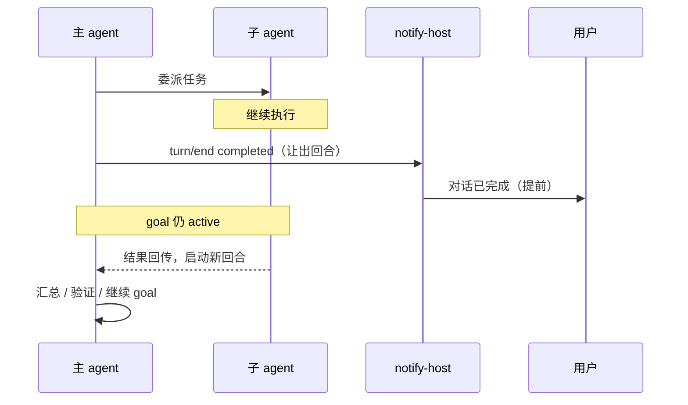
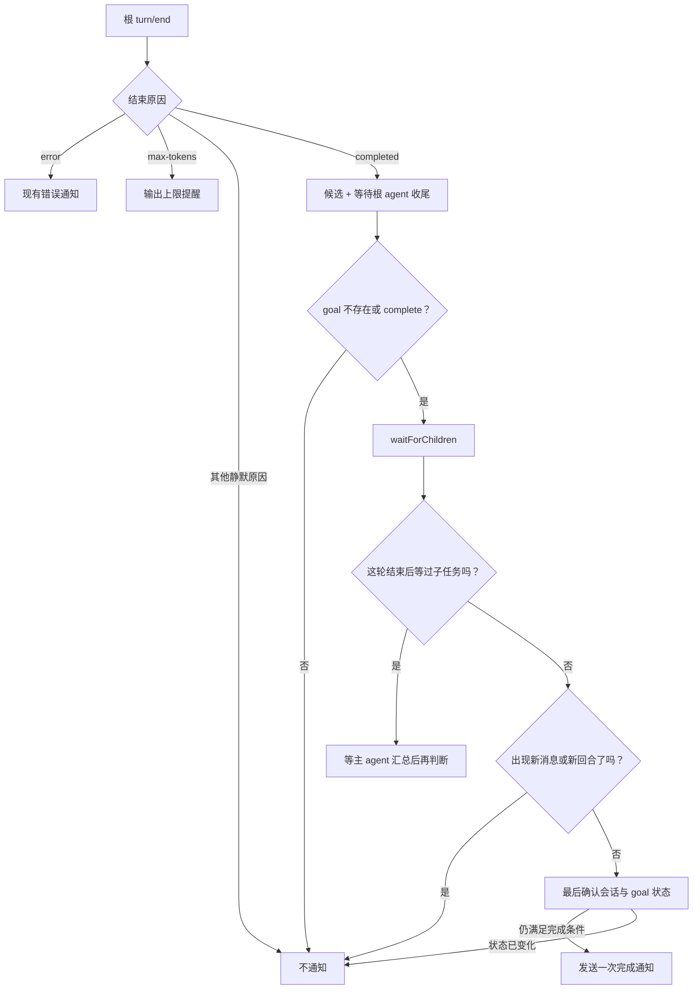
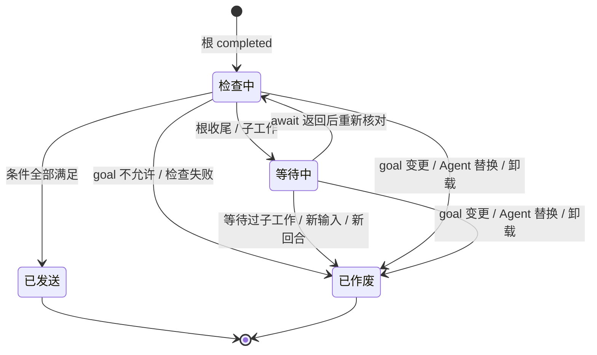
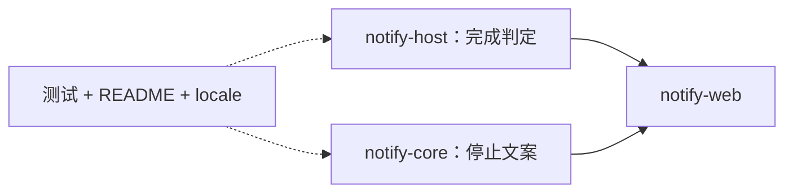

# Notify 完成判定修复方案（图表版 v0.4 · Web）

| 状态 | 完成 | 更新日期 | 实现 commit | 修复验收 |
|---|---|---|---|---|
| 已实现 · 用户初验通过 | 否 | 2026-11-24 · Asia/Shanghai | `f6303f5e7f2d14114151b66aac1ce2a83d94bc90` | 本地自动化通过；专项覆盖见第 8 节 |

调研基线：`6ff6069ce1760dc914770e8b4496b0e3c2e38f09`。完成日期：—。未归档。

验收对账：实现提交 `f6303f5e7f2d14114151b66aac1ce2a83d94bc90`（与上述基线 + 本轮已测改动一致，仅提交元信息变化）；Node v24.16.0、macOS、workspace DSH 0.2.2-rc.1、系统 Chrome。

## 1. 结论摘要

## 2. 范围

**仅 notify-web；desktop-notify 不纳入本轮改造与验收。**

| 修改 | 复用 | 本轮边界 |
|---|---|---|
| notify-web 的 Host 完成判定 | Web SSE 投递 | DSH 0.2.2-rc.1 |
| 输出上限停止文案 | 通知开关、权限、去重、导航 | 不改调度器、协议与配置项 |
| 回归测试与 README | goal / subagent 公开接口 | 不轮询、不用固定延时 |
| 仅 notify-web 改造与验收 | 宿主日志及投影 | 不新增暂停 / 阻塞通知 |

| 本次交付 | 后续启动条件 |
|---|---|
| 代码、回归用例、方案与可视化回写 | 用户已于 2026-11-24 明确要求实施 |
| 已按用户指令安装 macos-web；不自动重启、不操作 PKM | 安装授权：2026-11-24“安装日常环境” |

## 3. 修复前问题（调研基线）

| 修复前事实 | 依据 |
|---|---|
| 根回合 completed / max-tokens 立即通知 | `packages/notify-host/src/index.ts:211` |
| 等待子结果时，工具要求主 agent 结束回合 | `node_modules/@deepseek-ai/dsh-tool-subagent/lib/index.js:507` |
| goal 续跑会等待子 agent | `node_modules/@deepseek-ai/dsh-goal-round-driver/lib/index.js:128` |
| Web 使用共享通知源 | `notify-web/src/index.ts:169` |
| 输出上限目前显示完成文案 | `packages/notify-core/src/index.ts:120` |
| 原测试缺少 goal / 等待场景 | `test/src/l3/notify-host.test.ts:184` |

历史：[通知实现与验收](archive/notification-host-design.md)。后续 `dcfff6c` 调整提问通知，`5e57cda` 调整页面关闭后的投递；本轮独立修复完成语义。

## 4. 具体方案（已实现）

### 4.1 判定流程

| 状态 / 事件 | 成功通知 | 后续行为 |
|---|---|---|
| goal active（armed 或 disarmed） | 0 | 等待后续有效根回合 |
| goal paused / blocked | 0 | 不新增独立提醒 |
| 工具中标记 goal complete | 0 | 等待根回合收尾 |
| goal complete / 无 goal，检查通过 | 1 | 按根回合 seq 去重 |
| 子 agent 结束 | 0 | 由主 agent 消费结果、汇总 |
| 等待过子工作 / 结果待消费 | 0 | 作废旧候选，等待后续根回合 |
| max-tokens | 非成功提醒 | “本轮已达到输出上限” |
| 子会话 / aborted / blocked / interrupted / forked | 0 | 保持静默 |

| 图中判断 | 含义 |
|---|---|
| 这轮结束后等过子任务吗？ | 等过：子结果还需要主 agent 消费和汇总，不能发旧回合通知 |
| 出现新消息或新回合了吗？ | 出现过：工作已继续，不能发旧回合通知 |
| 最后确认会话与 goal 状态 | 仍是同一个 Agent、当前回合未过期、goal 允许、没有待处理输入 |

### 4.2 候选生命周期

| 约束 | 设计 |
|---|---|
| 每根会话最多一个候选 | Agent 实例 + 回合号 + seq + 检查代次 |
| 事件派发不被阻塞 | 异步检查；每次 await 后重新核对 |
| 新输入入队 / turn/start / goal 变更 / dispose | 旧检查失效；不补发旧通知 |
| goal 事实 | `goals.get(agent)`，复用宿主日志投影 |
| 子工作事实 | `subagents.waitForChildren(agent)`；不取消子 agent |
| 服务缺失 | 原本无服务：按无 goal / 子任务处理；检查中消失：作废 |
| 读取或等待失败 | 抑制成功通知 + 诊断 |
| 重启 / HMR | 不回放旧候选；不新增 session event |
| completed goal 留存 | 后续普通回合仍可通知；不按 goal id 永久去重 |
| 清理 | 每个实际等待只有一组 Promise 回调；旧观察者可移除；不取消子任务 |
| 服务身份 | 比较 Cordis 原始 provider；子等待按 provider + Agent 缓存 |

### 4.3 改动位置

| 已改位置 | 内容 |
|---|---|
| `packages/notify-host/src/index.ts` + `completion.ts` | 候选、goal / 子工作检查、失效与清理；仅 Web 启用 settled 模式 |
| notify-host `package.json` + `pnpm-lock.yaml` | goal / subagent 类型开发依赖，精确 0.2.2-rc.1 |
| `packages/notify-core/src/index.ts` + `notify-web/src/client/index.ts` | Web 显式启用输出上限新文案；字典由 Client 注册，meta locale 无需重复 |
| notify-host / core / notify-web 测试 + Web fixture / L5 清单 | 判定、并发、生命周期与真实宿主调度、SSE 回归 |
| notify-host / notify-core / notify-web README | 新完成条件与停止语义 |

| 兼容项 | 处理 |
|---|---|
| notifyOnTurnEnd / notifyOnTurnError | 原有控制范围保留 |
| 运行时依赖 | type-only import；共享库仍构建内联 |
| 更新 / 回退 | 已更新 macos-web；需用户重启 Host 并刷新页面；不自动回滚 |

## 5. 里程碑

| 阶段 | 出口条件 | 状态 / commit |
|---|---|---|
| M1 | 根收尾、子结果回传、goal 变更与等待清理 | 已验证 / `f6303f5` |
| M2 | 构建、类型检查、L1–L3 | 本地通过 / `f6303f5` |
| M3 | Web 集成、浏览器通知、证据对账 | L4 / L5 通过；原生弹窗与提交对账待完成 |

## 6. 决策记录

| 提议 | 原因 | 状态 |
|---|---|---|
| 复用共享 Host 修复 Web 判定 | 完成触发逻辑位于 notify-host | 已定并实现 |
| goal 完成 + 根回合收尾 | complete 工具可能早于最终回复 | 已定并实现 |
| 子工作推进后作废旧候选 | 结果仍需主 agent 汇总 | 已定并实现 |
| 输出上限独立文案 | 停止不等于成功 | 已定并实现 |
| 不使用固定延时 / 只查 idle | 等待和续跑可跨回合 | 已定并实现 |

## 7. 风险与开放问题

| 风险 | 验证 / 对策 |
|---|---|
| 子结果入队与等待返回竞争 | M1 核对；await 后重查；旧候选作废 |
| waitForChildren 无取消参数 | 已采用可移除观察者；10 轮失效仅一组底层订阅，卸载后零通知 |
| goal clear / 更换 / 服务消失 | 候选失效，下一根回合重查 |
| completed goal 留存 | 后续普通用户回合回归 |
| 模拟测试不足以证明调度与弹窗 | 真实宿主调度与 SSE 已测；原生系统弹窗未测 |

## 8. 验收状态

| 验证 | 结果 | 证据 |
|---|---|---|
| 构建 / 类型门禁 | 通过 | `.tmp/notify-goal-investigation/check.log` |
| L1–L3 | 334 通过、0 失败、1 跳过 | `.tmp/notify-goal-investigation/test.log` |
| L4 固定包加载 | 通过，含清理 | `.tmp/l4/run-TwMxkE/report.json` |
| L5 | 基线 1 项 + 插件 10 项通过，含清理 | `.tmp/l5/run-knDsPO/report.json` |
| 独立复审 | 三项必改已关闭，无新增必改 | 第 9 节 |
| 原生系统弹窗 | 未执行 | L5 使用 Notification 桩 |

以下覆盖与限制按真实执行范围记录。

| 编号 | 场景 | 预期 | 验证结果 |
|---|---|---|---|
| A1 | active goal 等子 agent | 中间轮 0 通知 | 通过：L3 + 双子任务真实宿主集成 |
| A2 | active goal 无子 agent 多轮 | 中间轮 0 通知 | 通过：L3 连续中间轮；Web 子结果唤起中间轮 |
| A3 | complete 工具 → 根收尾 | 工具时 0；收尾后 1 | 通过：goal complete 时仍静默，最终回复后一次 |
| A4 | 多层 / 多个子 agent | 汇总前 0；完成后 1 | 双子任务通过；嵌套拓扑专项未执行，递归等待复用宿主契约 |
| A5 | 普通模式 / 异步委派 | 普通 1；等待 0；汇总后 1 | 通过：L3 + 双子任务真实宿主集成 |
| A6 | paused / blocked / disarmed / max-tokens | 不误报成功；上限提醒独立 | 通过：L1 / L3 + 中英文 L5 上限提醒 |
| A7 | 新输入 / 回合 / goal / Agent | 旧候选 0 通知 | 通过：L3 |
| A8 | 卸载 / disposed / 重启 | 旧候选 0 通知；监听清理 | 卸载 / disposed 通过；持久化重启专项未执行 |
| A9 | 审批 / 提问 / 错误 / 撤回 | 原行为与开关有效 | 通过：L1–L3 + 既有 L5 提问 / 审批链路 |
| A10 | completed goal 后新用户回合 | 仍正常通知 | 通过：L3 |
| A11 | Web SSE / 去重 / locale | 顺序与内容正确 | 通过：真实 SSE / Chrome；系统通知为桩 |

| 后续检查入口 | 环境 / 证据 |
|---|---|
| `node scripts/dev.mjs build --check` | 类型与仓库门禁 |
| `node scripts/dev.mjs test` | 构建 + L1–L3 |
| `node scripts/dev.mjs l4` / `l5` | 一次性 profile；报告 / trace |
| 系统弹窗 | Web 浏览器人工记录；未测不算通过 |

完成条件：必要验收通过 + 实现 commit / 证据对账。当前本地核心流程已通过，嵌套 / 重启专项、原生弹窗与提交对账仍有缺口。

跳过项：Windows Node shim 专项（当前 macOS）。证据均在本机临时目录，清理后可能失效。

## 9. 实施结果与修正

| 日期 | 对象 | 结果 | 边界 |
|---|---|---|---|
| 2026-11-24 | 前置事件注入 | active goal + child running 时仍产生完成意图 | 模拟 Context，直接导入当前 TS 源码 |
| 同日 | 旧 notify-host 测试 | 9 / 9 通过 | 既有编译产物；缺少本问题场景 |
| 同日 | 范围收敛 | 仅 notify-web，按用户要求移除桌面改造与验收 | 仅方案调整 |
| 同日 | 方案交付 | v0.1 → 图表版 v0.3（仅 Web） | 仅文档；业务源码未改 |
| 同日 | 修复实现 | 完成候选、goal / 子任务检查、停止文案、回归与 fixture | 未提交；未安装日常环境 |
| 同日 | 本地验收 | L1–L3、L4、L5 通过 | 原生弹窗 / 嵌套 / 重启专项未执行 |

| 调研证据 | 位置 |
|---|---|
| 临时复现脚本 | `<repo>/.tmp/notify-goal-investigation/repro.mjs`，清理可能失效 |
| 旧测试命令 | `node --test test/.build/l3/notify-host.test.js` |
| 环境 | Node v24.16.0；workspace DSH 0.2.2-rc.1 |
| 未覆盖 | 用户实际会话、真实模型、系统弹窗 |

### 9.1 实施修正

| 发现 | 修正 | 复验 |
|---|---|---|
| Cordis 服务代理每次读取不同 | 比较底层 provider | 服务代理回归 + 真实 Web 通过 |
| 旧等待的 Promise 回调会累积 | PendingWork 单组底层订阅 + 可移除观察者 | 根 idle / 子等待各 10 轮订阅计数通过 |
| 更换 subagent 服务复用了旧等待 | 按 provider + Agent 缓存 | 服务替换回归通过 |
| 共享上限文案会改变其他消费者 | 默认保留旧文案，仅 Web 显式传 stopped | 默认兼容 + Web 中英文 L5 通过 |
| L5 新增两项但报告清单未登记 | 同步必需检查与缺项拒绝测试 | 完整 L5 报告通过 |
| 并行构建触发源码变化门禁 | 串行重新构建与验收 | 最终报告均通过 |
| workspace 链接缺失 | 冻结离线安装恢复链接 | 测试恢复；postinstall 安全脚本仍因旧安装清单版本不一致失败，未更改安全配置 |

### 9.2 复审

| 维度 | 结论 |
|---|---|
| 正确性 / 性能 | 等待回调增长、服务替换问题已修正并回归 |
| 架构 / 可读性 | 完成检查独立模块；Web 内部选择策略，无新增用户配置 |
| 安全 / 依赖 | 使用已锁定 DSH 类型；无新增运行时依赖；fixture 仅隔离认证入口 |
| 独立复审 | 三项必改关闭；未发现新的必改项；复审未另行运行测试 |

### 9.3 日常环境安装（2026-11-24）

| 项目 | 结果 |
|---|---|
| 授权 | 用户明确要求“安装日常环境” |
| 目标 | 普通 Node DSH 0.2.2-rc.1；`~/.dsh`；profile `macos-web` |
| 范围 | 仅 `@mbda9091/notify-web`，保留现有配置 |
| 安装入口 | `node scripts/install.mjs install --profile macos-web --only @mbda9091/notify-web`，显式选择已准备 pnpm 11.28.5 |
| 固定批次 | `a4dbda6b-08a0-4e84-b981-280396cf5e34` |
| 归档 | `~/.local/share/dsh-plugin/releases/<批次>/mbda9091-notify-web-2.3.1.tgz` |
| 归档 SHA-256 | `dd81dd38f2e29c15cf55d160898b3e107096b7a92cf34d2c6b1edb13002551bb` |
| 回读结果 | installed；bundle registered；warnings 空；Host / Client 字节与本轮构建一致 |
| 状态入口 | `node scripts/install.mjs status --profile macos-web`：tarball stable、bundle on、compatible |
| 安装报告 | `dist/consumption/run-JmE15a/report.json`；持久回执位于 `~/.local/share/dsh-plugin/receipts` |
| 生效条件 | 未自动重启；用户重启日常 DSH 并刷新页面后加载新 Host / Client |
| 覆盖边界 | 文件与 bundle 已校验；日常运行时行状态、实际通知能力尚未确认 |

### 9.4 用户本地验证与提交授权（2026-11-24）

| 项目 | 记录 |
|---|---|
| 用户反馈 | “我本地验证暂时没问题” |
| 验证对象 | 已安装到 macos-web 的本轮 notify-web 固定包 |
| 结论 | 用户初验暂未发现问题；未提供逐项操作记录，不扩展为嵌套拓扑或持久化重启专项通过 |
| 授权 | 用户明确要求“提交 push” |
| 提交范围 | 本轮修复、回归测试、fixture、验收清单与文档；不提交生成产物 |

### 9.5 提交与安全扫描（2026-11-24）

| 项目 | 记录 |
|---|---|
| 实现 commit | `f6303f5e7f2d14114151b66aac1ce2a83d94bc90` |
| 标题 | `fix(notify-web): wait for goal and subagent completion` |
| 代码范围 | 21 个源码、测试、fixture、依赖与 README 文件；生成产物不入库 |
| 安全工具修复 | 旧 v0.2 安装回执已备份；标准 setup 生成 schema 2 / v0.3 就绪记录并注册原生 hook |
| 安全边界 | 保留全部原有 hook、扫描规则和工具；没有跳过或禁用检查；无已跟踪安全文件改动 |
| 提交扫描 | 两次正常 hook 扫描均覆盖 21 文件，0 findings |
| 文档对账 | 用户初验与安装记录在后续独立文档提交保存；本文无需记录自身提交号 |
| 推送目标 | `origin/main`；普通 fast-forward 推送，不使用 force |

## 10. 当前未完成事项与下一步

| 当前 | 下一步 | 条件 |
|---|---|---|
| 实现与核心自动化完成，用户初验通过；代码已提交 | 推送代码及文档记录 | 用户已明确授权 |
| 嵌套拓扑 / 持久化重启专项未测 | 补充专项集成证据 | 不以当前直接双子任务结果代替 |
| 原生系统弹窗未测 | 在实际浏览器 / 系统人工确认 | 不以 Notification 桩代替 |
| macos-web 已安装，用户本地初验通过 | 实现 SHA 已对账 `f6303f5` | 不自动重启或读取日常会话 |
| 安全工具已恢复就绪，提交扫描通过 | 无遗留阻塞 | 第 9.5 节；原有 hook 和规则保留 |

相关：[历史通知记录](archive/notification-host-design.md) · [测试方案](testing-plan.md)。
